# Dual Booting Linux on a Machine That Barely Runs Windows

## Part 2 — BIOS, Boot Failures and the Troubleshooting

By the time I got here, I had already done what felt like 
the hard part.

The Windows partition had been shrunk. The Linux Mint ISO 
had been downloaded. Ventoy was ready, and the ISO had been 
copied onto the SD card through my Tecno T455.

On paper, I was ready to boot into Linux.

I thought this would be the easy part. Facts straight, tools 
ready, everything in place.

I had no idea I was about to walk into a technical minefield.

---

### First Contact with the BIOS Boot Menu

I restarted the laptop and entered the boot menu to select 
the device I wanted to boot from.

This was my first time inside a BIOS. No confidence. No 
prior experience. Just guesswork guided by research. Up 
until this point, operating systems had always felt like 
something that simply came with the machine. Now I was 
trying to intervene at the level where the machine decides 
**what** it should even boot in the first place.

The laptop detected the Tecno T455 connection as a bootable 
device.

That alone felt like progress.

So I selected it.

<figure class="post-image">
  <a href="/images/bios-boot-menu.webp" target="_blank" rel="noopener noreferrer">
    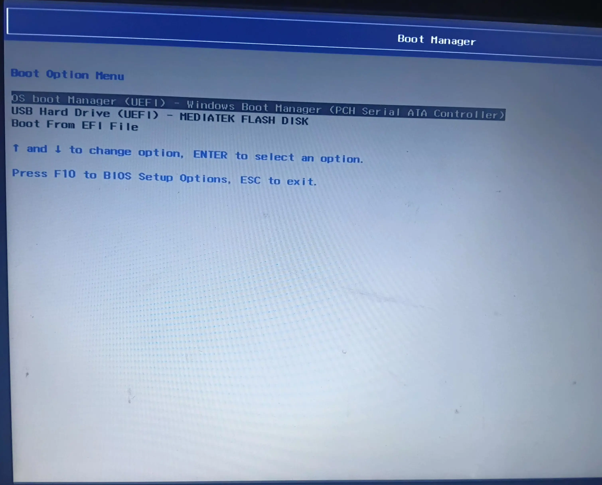
  </a>
  <figcaption>BIOS boot device selection menu showing the Tecno T455</figcaption>
</figure>


Then it failed. Blue screen, one word at the top: **ERROR**.
`Verification failed: (0x1A) Security Violation`. No Ventoy menu, no
GRUB.

I pressed a key, and the error gave way to a menu with three options:
**Continue boot**, **Enroll key from disk**, **Enroll hash from disk**.
I had no vocabulary for any of it. *Continue* was the only word I
understood, so I chose it. The machine retried, hit the same wall, and
showed me the same blue screen. Whatever that menu had been offering,
I had just declined it without knowing what it was.

<figure class="post-image">
  <a href="/images/bios-boot-decline.webp" target="_blank" rel="noopener noreferrer">
    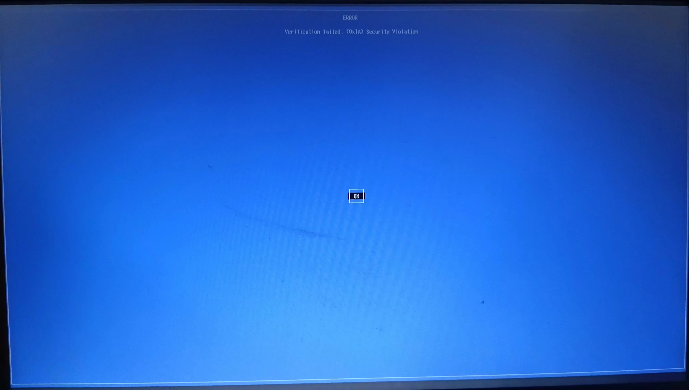
  </a>
  <figcaption>shim's Secure Boot rejection — "Verification failed: (0x1A) Security Violation." Pressing a key here opened the MOK Manager: the enrollment tool I opened, couldn't read, and walked away from.</figcaption>
</figure>


That was the first real shock of the project. It made me 
wonder if I actually had all the facts right like I had 
confidently assumed.

---

### The First Failure: Recognized, but Not Booting

This was a confusing kind of failure because the device was 
clearly visible in the boot menu. The BIOS had recognized 
it. So at first glance, everything looked correct.

But device recognition is not the same thing as successful 
boot compatibility.

A BIOS can see a connected storage device and still refuse 
to boot from it if the boot mode, security settings, or 
device presentation do not line up properly.

At that point, I did not yet understand that distinction 
clearly. The device was in the menu. I selected it. It still 
failed. 

That was the moment I realized I was no longer in 
ordinary Windows troubleshooting territory.

Here's the part that stings in hindsight: that three-option menu was
the **MOK Manager** — a one-time tool for adding a new trusted key to
the machine. **Enroll key from disk** was the entire fix: point it at
the certificate on the Ventoy partition
(`ENROLL_THIS_KEY_IN_MOKMANAGER.cer`), confirm, reboot, and Ventoy
boots with Secure Boot still enabled. About thirty seconds, once, and
the security feature stays on.

I was standing inside the tool, with the fix as option two on the
menu, and I chose **Continue boot** — which changes nothing, retries
the same load, and fails the same way. Not because I was careless, but
because the fix was written in vocabulary I didn't have yet. So I
retreated into the BIOS and turned the whole feature off. It worked,
and I'd make the same trade again at that knowledge level. But the
surgical fix existed the entire time, one menu option away. (The full
enrollment procedure — and why it beats disabling Secure Boot — is in
the [companion guide]().)

---

### Entering BIOS Settings to Troubleshoot

Since the device was being detected but still not booting, I 
went into the BIOS settings to see what could be blocking it.

The setting I actually intended to change was **Secure Boot**.

Secure Boot is a UEFI security feature that allows the 
system to boot only software signed by trusted authorities. 
That is useful for security, but it can also interfere with 
some Linux boot setups depending on how the boot media is 
prepared and how the firmware behaves.

Secure Boot wasn't rejecting Linux Mint — Mint's bootloader carries a
Microsoft signature. What got rejected was one step inside Ventoy's
boot chain. Ventoy's first stage, **shim**, is Microsoft-signed, which
is exactly why the machine got as far as it did: the firmware verified
shim and ran it. Shim then tried to load Ventoy's second-stage menu,
which is signed with Ventoy's own key — a key this laptop had never
seen. Verification failed, and shim put the reason on screen:
**Verification failed: (0x1A) Security Violation**. 0x1A is the UEFI
status code for a security policy violation — a trusted stage refusing
to hand control to an untrusted one.

So the plan was simple: disable Secure Boot and try again.

What happened was less simple.

---

### The Settings Mistake

While navigating the BIOS settings, I accidentally toggled 
**Legacy Support** when I meant to toggle Secure Boot.

I made that mistake because I was still unfamiliar with the 
BIOS layout, moving carefully but without fully 
understanding what each setting actually did.

<figure class="post-image">
  <a href="/images/bios-configuration-menu.webp" target="_blank" rel="noopener noreferrer">
    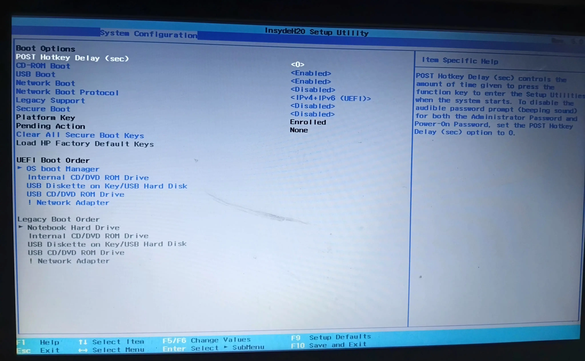
  </a>
  <figcaption>BIOS configuration menu showing Secure Boot and Legacy Support settings</figcaption>
</figure>


I only discovered the mistake later when I checked the 
settings again.

At the time, I had not intended to touch Legacy Support at 
all.

Legacy Support, also called **CSM** (Compatibility Support 
Module) on some systems, is a compatibility mode that allows 
the firmware to boot older, non-UEFI boot methods alongside 
the modern UEFI standard. My Windows 11 installation was 
already using UEFI boot, so Legacy Support was not the 
setting I needed for this situation.

Thankfully, toggling it did not break anything on its own. 
Enabling Legacy Support alongside UEFI simply adds an extra 
compatibility layer. It does not replace or disable UEFI 
boot. The system can still boot using the modern standard, 
which is exactly what it continued to do.

The real danger would have been setting the boot mode to 
**Legacy only**, which would have disabled UEFI entirely and 
prevented Windows 11 from booting at all.

That did not happen.

---

### Disabling Secure Boot

After noticing the mistake, I made sure **Secure Boot** was 
actually turned off.

That was the intended change from the start.

On HP systems, changing a security-sensitive BIOS setting 
often triggers a confirmation screen where you have to type 
a numeric code shown on the display and press Enter to 
confirm that the action is deliberate.

<figure class="post-image">
  <a href="/images/hp-bios-confirmation-code.webp" target="_blank" rel="noopener noreferrer">
    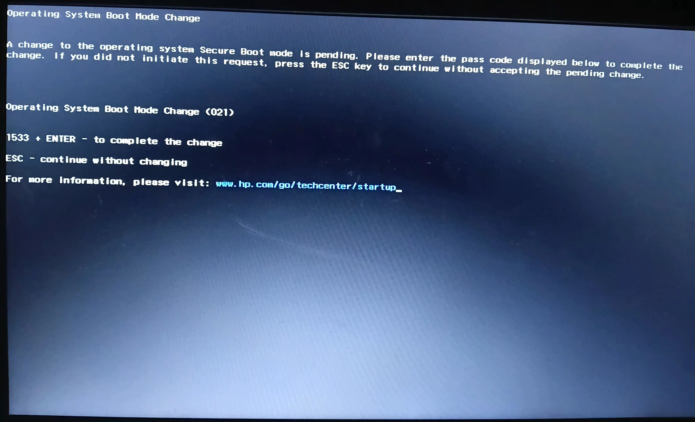
  </a>
  <figcaption>HP BIOS confirmation screen requiring a numeric code to change Secure Boot</figcaption>
</figure>


I entered the code, confirmed the change, and saved the BIOS 
settings.

At that point, I tried booting again.

This time, I got further.

The Tecno T455 device still appeared in the boot menu. I 
selected it again, and now the system finally moved past the 
immediate failure point.

Ventoy loaded.

That felt like a breakthrough.

<figure class="post-image">
  <a href="/images/ventoy-boot-menu-iso.webp" target="_blank" rel="noopener noreferrer">
    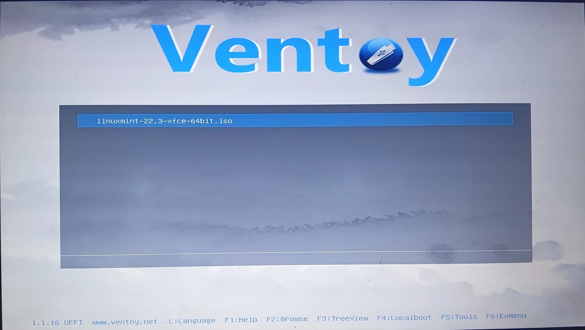
  </a>
  <figcaption>Ventoy boot menu with Linux Mint XFCE 22.3 ISO highlighted</figcaption>
</figure>


But the real trouble had only just begun.

---

### The Ventoy Boot Menu

Ventoy loaded and presented me with a boot menu. The Linux 
Mint XFCE 22.3 ISO file was already highlighted as the only 
available option. I selected it, chose "Boot in normal mode" 
from the next menu, and landed at the GRUB bootloader.

<figure class="post-image">
  <a href="/images/ventoy-boot-mode-selection.webp" target="_blank" rel="noopener noreferrer">
    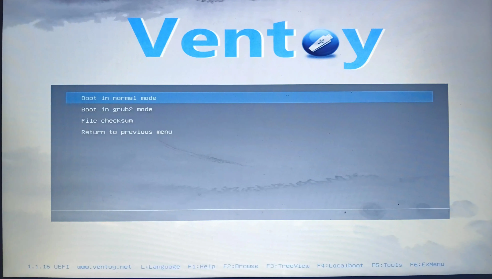
  </a>
  <figcaption>Ventoy boot mode selection — "Boot in normal mode" highlighted</figcaption>
</figure>


---

### The GRUB Menu

GRUB is the bootloader that handles the transition between 
selecting a boot device and actually starting the operating 
system.

The GRUB menu showed several options. The two that mattered 
were:

- **Start Linux Mint XFCE 22.3 64-bit**
- **Start Linux Mint XFCE 22.3 64-bit (compatibility mode)**

The first option was highlighted by default.

<figure class="post-image">
  <a href="/images/grub-menu-first-attempt.webp" target="_blank" rel="noopener noreferrer">
    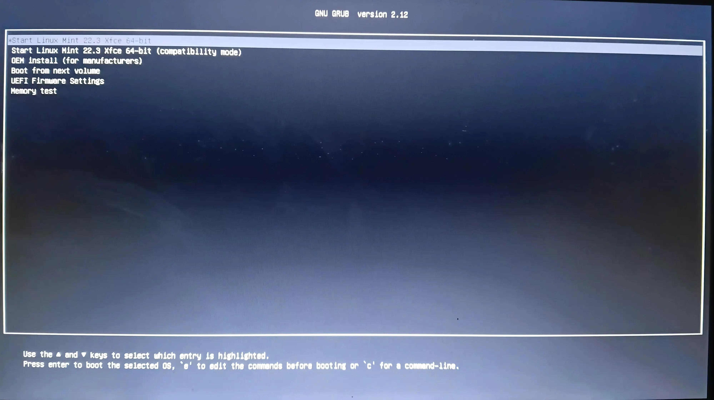
  </a>
  <figcaption>GRUB menu showing Linux Mint normal and compatibility mode options</figcaption>
</figure>


I selected it.

---

### Getting Stuck at a Frozen Logo

The Linux Mint logo appeared on screen.

And then nothing happened.

The logo stayed static. The screen blinked once. Then the 
logo just sat there. No loading bar. No visible progress. No 
desktop appearing behind it. Just a frozen logo on a black 
screen.

At first, I waited.

And kept waiting.

I waited over 30 minutes. There was no way to tell if the 
system was slowly loading in the background or had 
completely stalled. Eventually, I couldn't tell the 
difference between patience and wasted time. I forced a 
reboot.

What I know now that I didn't know then: the frozen logo
was not a dead machine. Behind that splash screen, 
the system had booted almost completely, and the display manager 
was crash-looping on a file it couldn't read, restarting and dying 
in a cycle that would have run forever. 
The logo wasn't the system refusing to work. 
It was the system working as hard as it could 
and losing the same fight every few seconds.

---

### Attempting Compatibility Mode

I restarted and cycled through the same sequence back to the 
GRUB menu. This time I selected **Start Linux Mint XFCE 
22.3 64-bit (compatibility mode)** instead.

Compatibility mode uses different graphics settings and 
fallback kernel parameters designed to work around hardware 
issues that might prevent a standard boot from completing.

I was hoping this would bypass whatever had caused the 
freeze.

It did not.

---

### The Text Flood

Instead of a frozen logo, I got something entirely different.

Lines of text began flooding the screen. Fast. Dense. 
Technical. It looked like the system was dumping every 
internal process message directly onto the display.

I couldn't tell if the system was still trying or had 
already finished failing.

<figure class="post-image">
  <a href="/images/kernel-text-flood-squashfs.webp" target="_blank" rel="noopener noreferrer">
    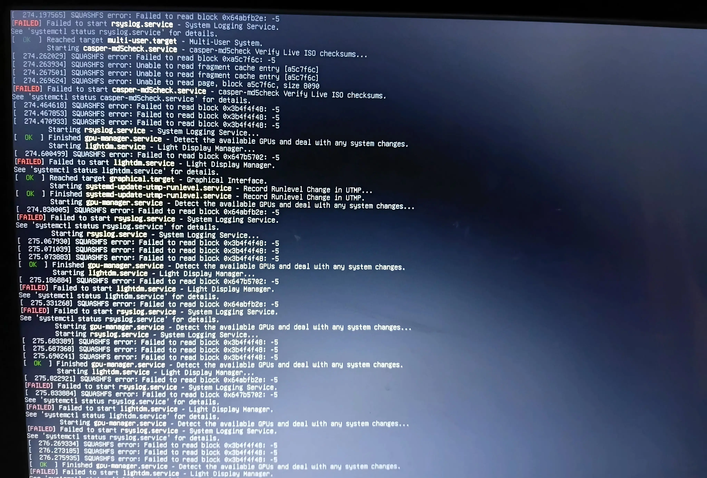
  </a>
  <figcaption>Kernel text flood showing SQUASHFS read errors interleaved with systemd failing to start lightdm (the display manager) — the crash loop that hid behind the frozen logo</figcaption>
</figure>


These were **kernel messages** — the Linux kernel reporting 
what it was doing as it tried to initialize the hardware.

In a strange way, this felt better than the frozen logo. At 
least the system was communicating, even if I couldn't 
understand what it was saying.

One error kept repeating across almost every line:

```text
[  275.067930] SQUASHFS error: Failed to read block 0x3b4f4f48: -5
```

I had already verified the ISO with SHA256, so I suspected 
this was a hardware read failure, not a corrupt file. But 
suspicion doesn't stop anxiety when raw kernel output is 
raining down your display for the first time.

---

### Dropping into TTY2

At some point during the text flood, I pressed 
**Ctrl + Alt + F2**.

I did not fully understand what that key combination would 
do. I had seen it mentioned as a troubleshooting step and 
decided to try it.

It dropped me out of the graphical display and into a 
secondary, text-only virtual terminal called **TTY2**.

I was staring at a login prompt:

```text
Linux Mint 22.3 Zena mint tty2
mint login:
```

And even there, the error messages kept interrupting the screen —
typing directly over the login prompt:

```text
mint login: [  449.024896] I/O error, dev loop0, sector 3313680 op 0x0:(READ) flags 0x800 phys_seg 6 prio class 2
[  449.025603] SQUASHFS error: Failed to read block 0x65201256: -5
[  449.025850] SQUASHFS error: Unable to read fragment cache entry [65201256]
[  449.026073] SQUASHFS error: Unable to read page, block 65201256, size 5ef0
```

The same I/O read failures. The same SQUASHFS errors.

<figure class="post-image">
  <a href="/images/tty2-terminal-errors.webp" target="_blank" rel="noopener noreferrer">
    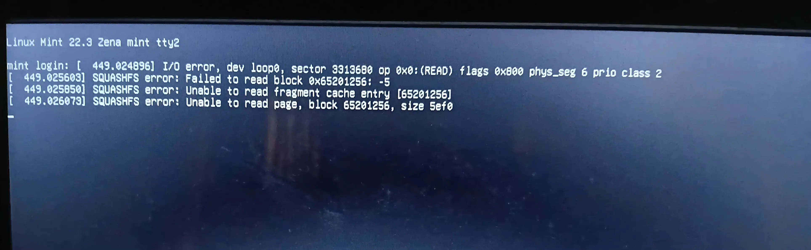
  </a>
  <figcaption>TTY2 terminal showing the login prompt interrupted by SQUASHFS errors</figcaption>
</figure>


This felt like the end of the road. None of my tricks were 
working, nothing made sense, and nothing I had prepared had 
braced me for this wall of errors.

That was the dead end.

---

### Stepping Back to Verify

At this point, I had two failed boot attempts and no working 
Linux environment. The instinct was to question everything.

Was the ISO file corrupted? Had something gone wrong during 
the over-100-minute transfer to the SD card? Was the file sitting 
on the Ventoy device actually intact?

I went back into Windows and ran the same `certutil` SHA256 check 
from Part 1 against both the original ISO in my Downloads folder
and the copy on the Ventoy SD card.

<figure class="post-image">
  <a href="/images/sha256-verify-original.webp" target="_blank" rel="noopener noreferrer">
    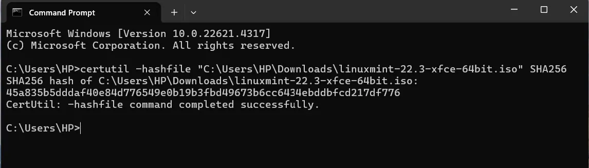
  </a>
  <figcaption>Terminal output — SHA256 verification of the original ISO in Downloads</figcaption>
</figure>


<figure class="post-image">
  <a href="/images/sha256-verify-ventoy.webp" target="_blank" rel="noopener noreferrer">
    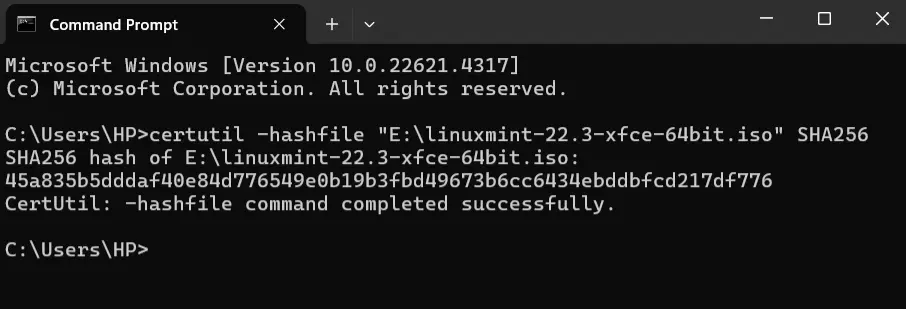
  </a>
  <figcaption>Terminal output — SHA256 verification of the ISO copy on the Ventoy device</figcaption>
</figure>


<figure class="post-image">
  <a href="/images/linux-mint-official-checksum.webp" target="_blank" rel="noopener noreferrer">
    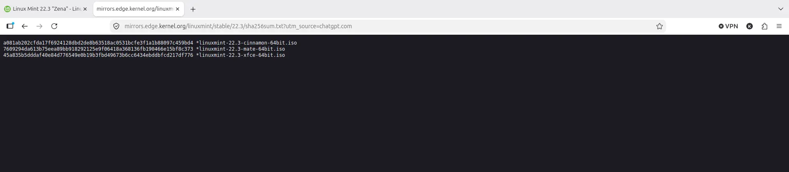
  </a>
  <figcaption>Official Linux Mint SHA256 checksum page for side-by-side comparison</figcaption>
</figure>


Both hashes matched the official Linux Mint checksum 
exactly. As I covered in Part 1, this ruled out file 
corruption entirely. The ISO was clean. The problem had to 
be elsewhere.

One detail worth stating plainly: the card was still 
inside the phone when I ran that second check. The same bridge that 
couldn't keep a kernel fed had just read the entire 2.82GB back to 
Windows, and the hash matched. A slow, sequential read is the gentlest 
workload a storage device can face. A live boot is one of the 
harshest: sustained, and driven by the kernel's demands. 
The phone passed the gentle test and failed the harsh one.

---

### Isolating the Last Variable

At this stage, I had worked through most of the checklist:

- Verified, uncorrupted ISO
- Secure Boot turned off
- Ventoy-prepared SD card ready

I also finally disabled Fast Startup — a step I had missed 
back in Part 1. To be clear, Fast Startup was not the cause 
of the boot failures I experienced in this phase. Those were 
the phone's USB bridge failing read requests — nothing to do with 
Windows' shutdown state. But leaving it enabled could 
have caused NTFS file system conflicts once Linux was 
actually installed, so it needed to be addressed before 
going any further.

The only variable left untested was the **boot media device 
path**.

Every failed attempt had run through the Tecno T455 phone 
acting as a bridge over a USB Type-C cable. That path was never 
engineered to serve a live operating system's sustained read workload.

So I obtained a dedicated **SD card reader**.

<figure class="post-image">
  <a href="/images/sd-card-reader.webp" target="_blank" rel="noopener noreferrer">
    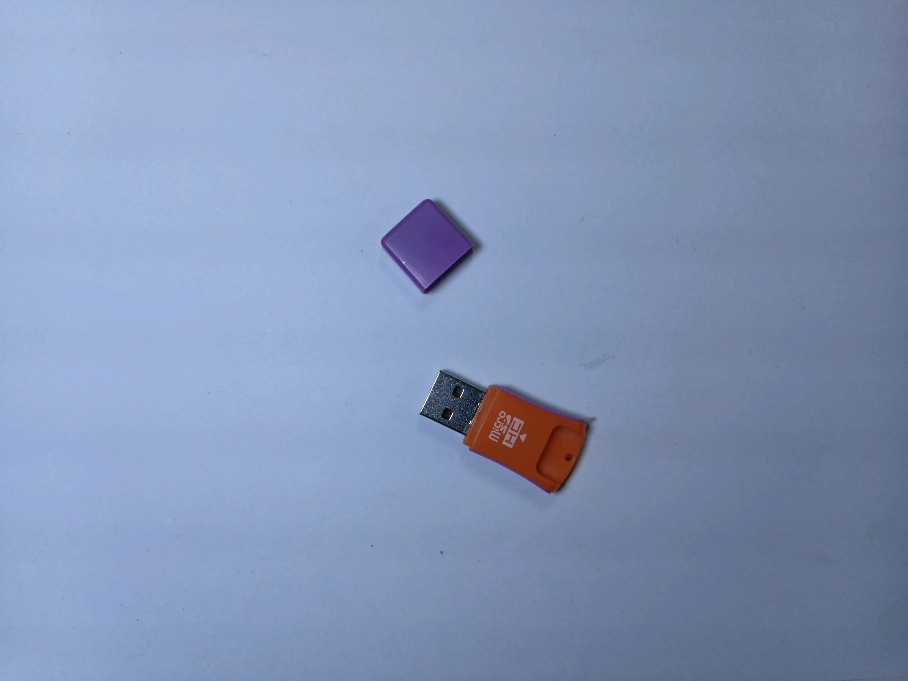
  </a>
  <figcaption>The dedicated SD card reader that solved the boot problem</figcaption>
</figure>


I removed the SD card from the phone, slotted it into the 
dedicated reader, and plugged it directly into the laptop's 
USB port.

Same SD card. Same Ventoy setup. Same ISO file. Different 
connection path.

I restarted the laptop, opened the BIOS boot menu, and 
selected the card reader.

---

### It Worked

Ventoy loaded. I selected the Linux Mint ISO. The GRUB menu 
appeared. I selected **Start Linux Mint XFCE 22.3 64-bit**.

This time, the Linux Mint logo appeared — and kept moving.

Seconds later, the desktop loaded. The live environment was 
running cleanly. WiFi connected. The system was completely 
responsive.

<figure class="post-image">
  <a href="/images/linux-mint-live-desktop.webp" target="_blank" rel="noopener noreferrer">
    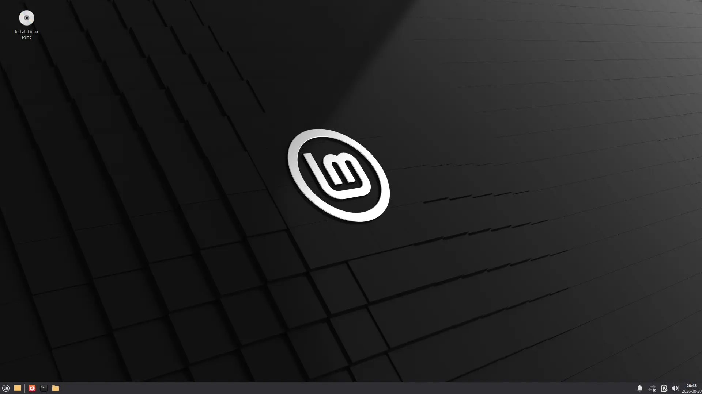
  </a>
  <figcaption>Linux Mint XFCE live environment loaded successfully via card reader</figcaption>
</figure>


The relief was overwhelming. I had never been so genuinely 
excited to see a desktop background.

That successful boot changed the diagnosis instantly. With 
Secure Boot already handled and Fast Startup disabled, the 
fact that the exact same SD card booted cleanly through a 
dedicated reader proved where the failure had been 
all along: **the Tecno T455 as a boot device**.

The phone could transfer files, and it could even carry the machine
through the BIOS handoff, Ventoy and GRUB. It failed exactly where the
workload became serious: a live kernel issuing sustained reads. The
card reader didn't fix the data — it removed the failing bridge
between the data and the machine.

---

### Hindsight Analysis: What the Machine Was Actually Saying

*Now that the machine was working, I wanted to understand 
what all those intimidating errors had actually meant.*


#### What Did the SQUASHFS Errors Mean?

SQUASHFS is a compressed, read-only filesystem. A live session doesn't
copy itself to disk — the kernel pulls compressed blocks from the boot
media on demand and decompresses them into RAM. Every service started,
every binary loaded, means more reads from the media.

The `-5` at the end of every line is **`EIO`**, the kernel's generic
"the device could not complete this read" code. Not returned late. Not
returned wrong. Failed. The SQUASHFS messages are the filesystem
reporting, one level up, that a block it asked for never arrived.

That killed my first theory — that the connection was simply too slow,
and the kernel was starving. Slow storage doesn't produce I/O errors.
It produces a slow boot: the kernel waits, the data eventually
arrives, everything crawls but nothing crashes. People boot live
sessions from genuinely ancient hardware. What produces `EIO` is a
device that fails the request. And the timestamps show these requests
were failing *fast* — multiple errors per second, for minutes. The
bridge wasn't choking quietly. It was actively refusing.

The photo captured something I couldn't see at the time: the boot was
*almost working*. The system reached `multi-user.target` — most of the
operating system loaded fine. What kept failing was **lightdm**, the
display manager, the component whose entire job is to replace the
splash screen with a desktop. Every attempt to start it hit a block
that wouldn't read, crashed, and was restarted by systemd, which
crashed it again. Same story for `rsyslog`, the logging service. Even
`casper-md5check` — the live session's built-in media integrity check
— died from read errors before it could check anything.

The same handful of block addresses repeat through the log:
`0x3b4f4f48`, `0x64abfb2e`, `0x647b5702`. That's not the whole card
failing. Every read that succeeded was cached in RAM and never
requested again — successful reads are invisible in this log. The only
entries are the reads that *never* succeeded, re-attempted every time
systemd restarted a crashed service.

And the card was innocent, proven twice: the SHA256 of the ISO *on the
card* matched the official checksum, and the same card booted
flawlessly the moment it moved to a dedicated reader. The data never
had a problem. The bridge did.

#### The Speed Test

<figure class="post-image">
  <a href="/images/tecno-transfer-speed-comparison.webp" target="_blank" rel="noopener noreferrer">
    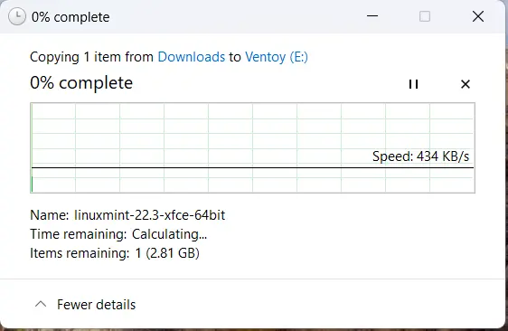
  </a>
  <figcaption>File transfer via Tecno T455 — 434 KB/s for comparison</figcaption>
</figure>


<figure class="post-image">
  <a href="/images/card-reader-transfer-speed.webp" target="_blank" rel="noopener noreferrer">
    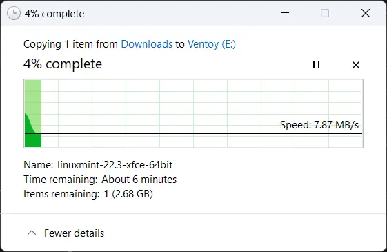
  </a>
  <figcaption>File transfer via dedicated card reader — 7.87 MB/s</figcaption>
</figure>

The numbers quantify how badly matched the bridge was: 2.82GB at
**434 KB/s** through the phone versus **7.87 MB/s** through the reader
— an **18x** difference from changing nothing except the connection
path.

But the speed is not what killed the boot. The failed reads are. The
number only measures how far outside its design envelope the phone was
operating: a T9 keypad feature phone presenting its SD card over USB
as a secondary function, asked to serve a live kernel's sustained
random-access read workload across two long boot attempts. It could
hand a file to Windows if you let it crawl. It could not keep a kernel
fed.


#### What Was TTY2?

Linux systems run multiple virtual consoles simultaneously. 
The graphical session runs on one virtual console — which 
one varies by distribution and display manager. 
**TTY2 through TTY6** are text-only terminal 
sessions running in the background.

When a graphical environment fails to launch, pressing 
**Ctrl + Alt + F2** drops you directly into TTY2. For an 
experienced administrator, this is an emergency rescue 
environment used to check logs, fix display drivers, or 
restart services. For me at that moment, it was an 
intimidating prompt — but it showed me for the first time 
that beneath the graphical interface, Linux provides direct, 
low-level access to the machine.

---

### What This Troubleshooting Process Actually Proved

Looking back, the path from failure to success followed a 
clear diagnostic methodology:

1. **First failure:** Device recognized, then rejected with
   `Verification failed: (0x1A) Security Violation` — Secure Boot
   blocking Ventoy's second-stage loader. The next screen, the MOK
   Manager, offered the enrollment fix directly; not knowing what
   "enroll key from disk" meant, I chose "Continue boot," which
   retried the identical load and failed identically. *Resolution:
   Disabled Secure Boot in BIOS. The cleaner fix was one menu option
   away the whole time.*
2. **Second failure:** Stalled at logo; repeated SQUASHFS 
   I/O read errors under compatibility mode. 
   *Resolution: Diagnosed as a failing connection path, 
   based on I/O errors rather than slowness.*
3. **Integrity verification:** Re-calculated SHA256 checksum 
   on the Ventoy media to rule out file corruption. 
   *Result: Clean match.*
4. **Environment cleanup:** Disabled Windows Fast Startup
    to prevent NTFS hibernation conflicts during installation.
5. **Variable isolation:** Kept the SD card, Ventoy setup, 
   and ISO constant while swapping only the connection 
   device (phone to card reader).
6. **Resolution:** Clean live boot on the first attempt once the 
   failing bridge was removed — same card, same ISO.

> **The Diagnostic Pattern That Actually Worked**
> 
> Change one variable at a time until the root cause reveals 
> itself. I didn't know the formal term while I was sweating 
> over BIOS screens at midnight. But applying that logic is 
> what transformed two failures into a working operating 
> system.

The troubleshooting was over. The live environment was 
working.

Now came the final step: writing Linux Mint permanently onto 
the SSD.

---

*Previous: [Part 1 — From Windows Frustration to a Verified 
ISO]()*  
*Continue to Part 3 — [Installation, GRUB and the 
Performance Verdict]()*

---

## Resources

- [Linux Mint Official Download](https://linuxmint.com/download.php)
- [Linux Mint SHA256 Checksums](https://linuxmint.com/verify.php)
- [Ventoy Official Site](https://www.ventoy.net/)
- [Ventoy GitHub Releases](https://github.com/ventoy/Ventoy/releases)