# Dual Booting Linux on a Machine That Barely Runs Windows

## Part 3 — Installation, GRUB and the Performance Verdict

By the time Linux Mint finally booted through the SD card 
reader, the hardest part of the project was already behind me.

The ISO was clean. Secure Boot was off. Fast Startup had 
been disabled. The card reader had solved the boot media 
problem. For the first time in the entire process, I was no 
longer staring at BIOS menus, frozen logos, or raw kernel 
text.

I was looking at a working Linux desktop.

And after everything, seeing that desktop felt earned.

---

### First Look at the Live Environment

The first thing I noticed was the dark Linux Mint background 
with a single **Install Linux Mint** icon sitting in the top 
left corner of the screen. There was a taskbar at the bottom 
with a few system icons, but the install icon was what 
immediately stood out because that was the entire reason I 
was there.

<figure class="post-image">
  <a href="/images/linux-mint-live-desktop-install.webp" target="_blank" rel="noopener noreferrer">
    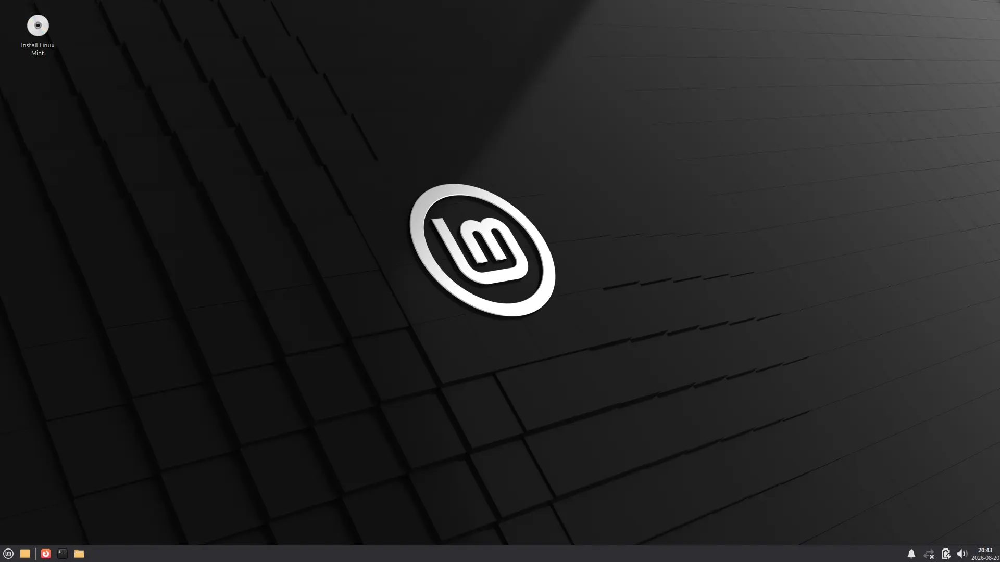
  </a>
  <figcaption>Linux Mint live environment with the Install icon in the top left corner</figcaption>
</figure>

The live environment runs the full system from 
the boot media without touching the drive — 
a chance to test the hardware before committing.

After Part 2, I had no interest in blind faith. I wanted 
proof the system actually worked on my hardware before 
writing it to my SSD. So I ran through some quick checks — 
WiFi connectivity, audio output, keyboard input, and display 
brightness controls.

Everything worked on the first try. The system was 
responsive, the hardware was clearly compatible, and Linux 
Mint was running smoothly on the machine.

That was enough for me.

So I clicked **Install Linux Mint**.

---

### Starting the Installation

After the chaos of Part 2, the installer felt almost 
dishonestly simple.

The flow was standard: language selection, keyboard layout, 
WiFi connection for third-party software downloads, and the 
option to install multimedia codecs for MP3 and MP4 support. 
I accepted the codec option.

<figure class="post-image">
  <a href="/images/install-language-selection.webp" target="_blank" rel="noopener noreferrer">
    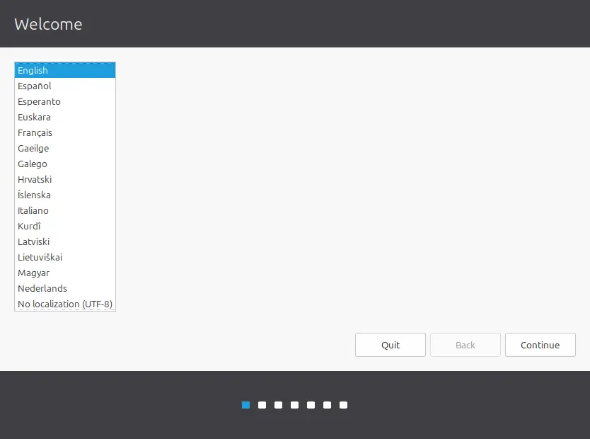
  </a>
  <figcaption>Installation step 1 — Language selection</figcaption>
</figure>

<figure class="post-image">
  <a href="/images/install-keyboard-layout.webp" target="_blank" rel="noopener noreferrer">
    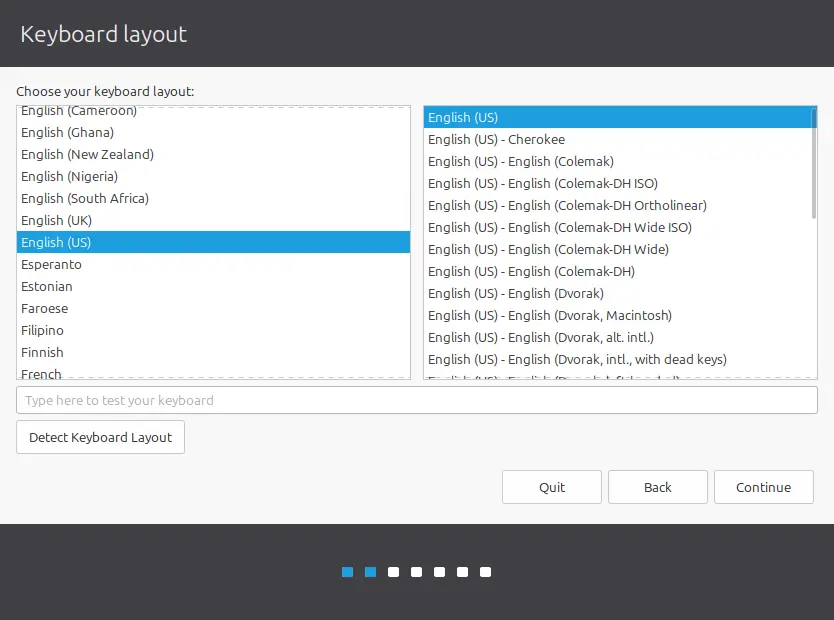
  </a>
  <figcaption>Installation step 2 — Keyboard layout selection</figcaption>
</figure>

<figure class="post-image">
  <a href="/images/install-multimedia-codecs.webp" target="_blank" rel="noopener noreferrer">
    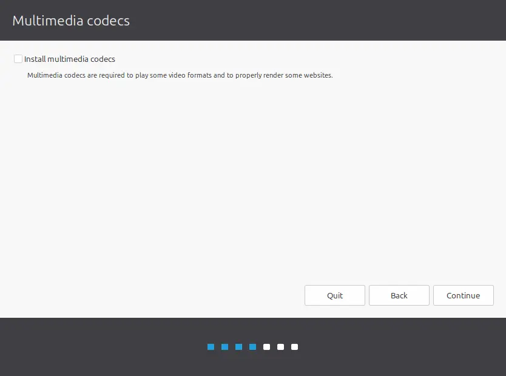
  </a>
  <figcaption>Installation step 3 — Multimedia codecs option</figcaption>
</figure>

---

### The Unmount Warning

Then I got a pop-up message that made me pause:

> The installer has detected that the following disks have 
> mounted partitions: /dev/sda. Do you want the installer 
> to try to unmount the partitions on these disks before 
> continuing?

<figure class="post-image">
  <a href="/images/install-unmount-warning.webp" target="_blank" rel="noopener noreferrer">
    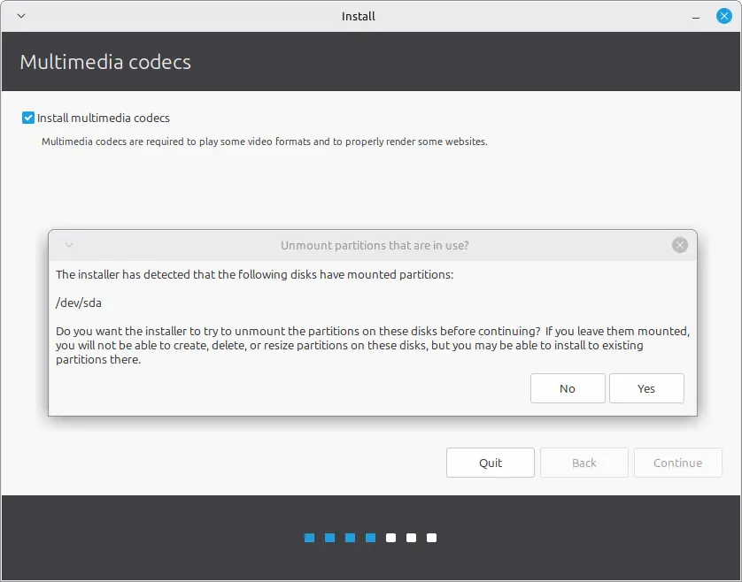
  </a>
  <figcaption>Unmount warning popup for /dev/sda mounted partitions</figcaption>
</figure>

I did not immediately understand what this meant, so I took 
a moment to research it before clicking anything.

What it meant was simple: the live environment had 
automatically mounted the existing partitions on my SSD so 
it could read them. The installer needed to unmount those 
partitions temporarily so it could safely resize and write 
to the drive without file system conflicts.

This is a standard safety step — clicking **Yes** 
deletes nothing; it just releases the lock so the 
installer can do its job.

---

### Installing Linux Alongside Windows

The next screen was the most important one in the entire 
installation process: the installation type.

The installer detected the 117GB of unallocated space I had 
prepared earlier in Windows and offered the option to 
**Install Linux Mint alongside Windows Boot Manager**.

<figure class="post-image">
  <a href="/images/install-alongside-windows.webp" target="_blank" rel="noopener noreferrer">
    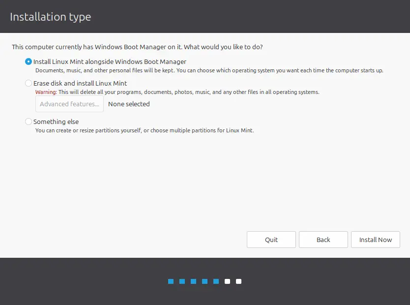
  </a>
  <figcaption>Installation type — Install Linux Mint alongside Windows Boot Manager</figcaption>
</figure>

I selected it.

I let the installer handle the partitioning automatically 
within the reserved space. For my skill level, this was the 
safer choice — it avoided the risk of manual partition 
errors and also meant GRUB would be configured automatically 
without me having to install it manually from the terminal 
afterward.

The installer created a single ext4 root partition in the 117GB 
of unallocated space, with a 2GB swap file inside it rather than 
a separate swap partition. It also reused the existing EFI System Partition that Windows had created, which is how GRUB and Windows Boot Manager ended up coexisting on the same drive — both bootloaders live on the same EFI partition.

---

### The Main Installation

Once I confirmed the installation type, the installer began 
copying files, configuring the system, and setting up Linux 
Mint in the unallocated space.

<figure class="post-image">
  <a href="/images/install-progress.webp" target="_blank" rel="noopener noreferrer">
    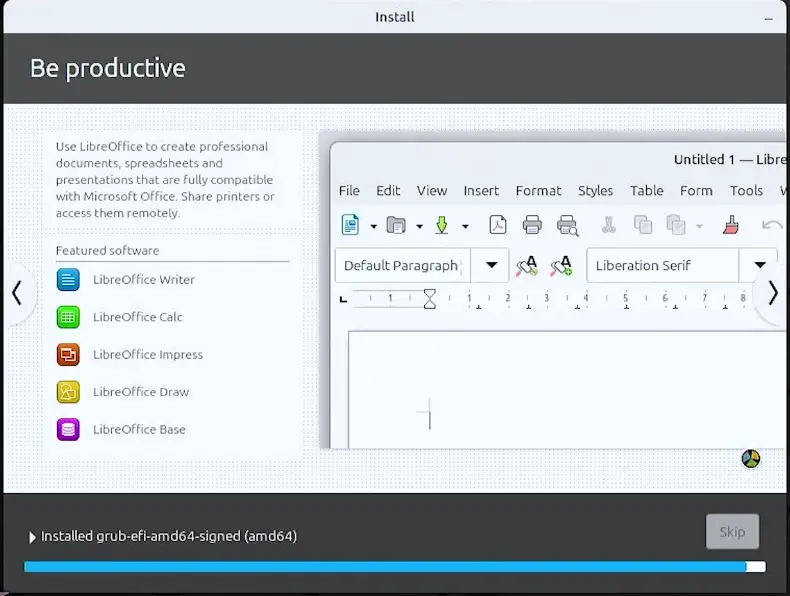
  </a>
  <figcaption>Installation progress bar during file copy and configuration</figcaption>
</figure>

There was not much left for me to do except wait. And after 
everything Part 2 had put me through, watching that progress 
bar move forward felt deeply rewarding. After everything 
Part 2 had put me through, watching that progress bar move 
forward was its own reward.

---

### The First Reboot

When the installation completed, I restarted the machine.

If anything was going to go wrong with the bootloader or 
partition setup, this is where it would show up. After Part 
2, I was bracing for it.

Instead, I was met with the **GRUB menu**.

 that boot menu appear on startup felt like the most 
important screen I had seen in this entire project. After 
the frozen logos, After the frozen logos, the kernel text floods, 
and the TTY2 dead ends, that menu was the moment 
everything finally came together 

---

### GRUB and the Dual-Boot Result

GRUB now showed both operating systems as boot options:

- **Linux Mint 22.3 XFCE**
- **Windows Boot Manager**

<figure class="post-image">
  <a href="/images/grub-dual-boot-menu.webp" target="_blank" rel="noopener noreferrer">
    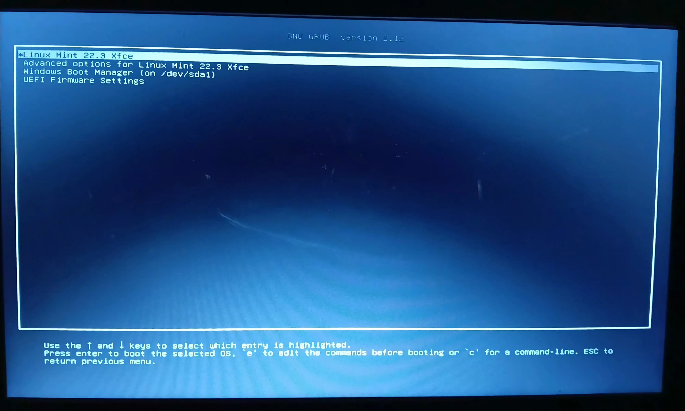
  </a>
  <figcaption>GRUB dual-boot menu showing Linux Mint 22.3 and Windows Boot Manager</figcaption>
</figure>

I selected Linux Mint first. It booted cleanly into the 
installed desktop.

Then I restarted and selected Windows. It booted normally 
into Windows 11.

Both systems worked, side by side in the same boot menu. 
That was the proof: the dual-boot setup had actually succeeded. 
Linux Mint became my main working environment; Windows stayed
available for Windows-specific workExactly the setup I 
had been aiming for.

---

### What It Has Been Like Since Then

The most noticeable difference is the smoothness. Linux Mint 
XFCE feels lighter and more responsive on this hardware. The 
machine no longer feels like it is fighting the operating 
system just to stay alive.

I still visit Windows when I need it, just as I've mentioned 
throughout this series. But Linux is where I spend most of 
my time now.

Feelings are not evidence though. So I measured everything.

---

### The Performance Verdict: RAM Usage

This is the part that justifies the entire project.

To keep the comparison fair, I measured idle RAM usage on 
both operating systems at exactly **3 minutes after a fresh 
boot**, with no applications open.

First, a disclaimer, because these numbers are about to do a lot of 
work: this is not a Windows-versus-Linux benchmark. It is one 
machine, one workload, and one question — which operating system 
lets *this* laptop do my daily work? I measured both sides as fairly 
as I knew how, but the sample size is one laptop and one user. Your 
machine will produce different numbers.

| Operating System | Idle RAM at 3-Minute Mark |
|---|---|
| **Windows 11** | 3.0GB / 7.9GB |
| **Linux Mint XFCE** | 993.6MiB (~1.04GB) / 7.7GiB |

<figure class="post-image">
  <a href="/images/windows-idle-ram-3min.webp" target="_blank" rel="noopener noreferrer">
    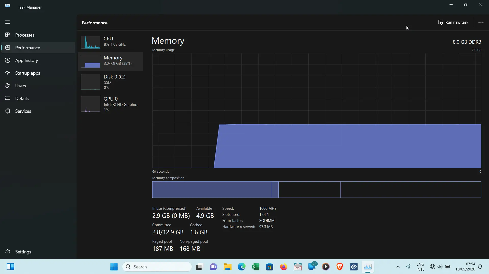
  </a>
  <figcaption>Windows 11 Task Manager — 3.0GB idle RAM at the 3-minute mark</figcaption>
</figure>

<figure class="post-image">
  <a href="/images/linux-idle-ram-3min.webp" target="_blank" rel="noopener noreferrer">
    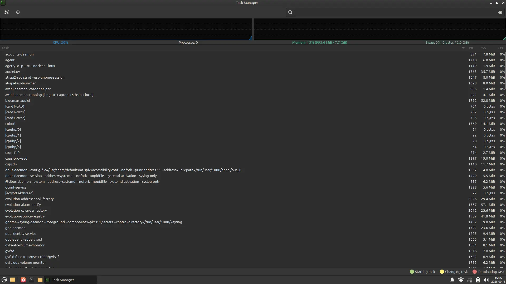
  </a>
  <figcaption>Linux Mint Task Manager — 993.6MiB idle RAM at the 3-minute mark</figcaption>
</figure>

> **A note on units:** Windows reports memory in decimal GB; Linux 
> System Monitor reports in binary GiB. 7.9GB and 7.7GiB are the 
> same 8GB of hardware in different units, and 993.6MiB converts to 
> about 1.04GB. Compared like-for-like, the real idle ratio is 2.9x 
> — so treat "3x" as a rounded headline, not an inflated one.

That is roughly a **3x difference** in idle memory consumption on the 
exact same hardware. Linux Mint XFCE leaves roughly 2GB more 
headroom for actual work — browser tabs, development tools, 
documents, applications — rather than spending a large 
portion of system memory on the operating system itself.

On an 8GB machine in an environment where every resource 
counts — where power is intermittent and hardware 
replacement is not an option — that extra headroom is the 
difference between a usable workstation and a frustrating 
one.

---

### The Performance Verdict: Stress Test

This is where the numbers stop being interesting and start 
being dramatic.

I ran the **same workload** on both operating systems to see 
how each one handled real pressure. The test consisted of 
**20 browser tabs** across Firefox and Brave, including:

- YouTube playing a 4K video
- Shadertoy (GPU-intensive shader rendering)
- Speedometer 3.0 (browser performance benchmark)
- WebGL Aquarium (3D rendering stress test)
- Google Earth
- Google Maps in 3D view
- Sigma (web-based design tool)
- Twitch (live video streaming)
- Reddit
- GitHub repository

Here is what each operating system did under that exact same 
load:

| Metric | Windows 11 | Linux Mint XFCE |
|---|---|---|
| **CPU** | **100%** (fully maxed) | **~50%** |
| **RAM** | 7.2 / 7.9GB (91%) | 6.2 / 7.7GiB (81%) |
| **Memory pressure** | Committed **10.4 / 12.9GB** — 2.5GB beyond physical RAM | Swap: **240MB** / 2GB |
| **Thermal** | Hot, overheating | Warm, not hot |
| **Battery** | Drained so fast I had to plug in to finish the test | Survived the entire test (95% to 45%) |

<figure class="post-image">
  <a href="/images/windows-stress-task-manager.webp" target="_blank" rel="noopener noreferrer">
    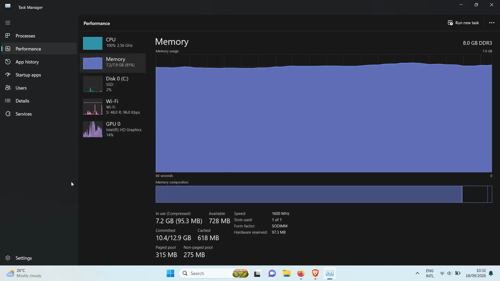
  </a>
  <figcaption>Windows Task Manager under stress — 100% CPU, 7.2GB RAM, 10.4GB committed, 14% GPU</figcaption>
</figure>

<figure class="post-image">
  <a href="/images/linux-stress-system-monitor.webp" target="_blank" rel="noopener noreferrer">
    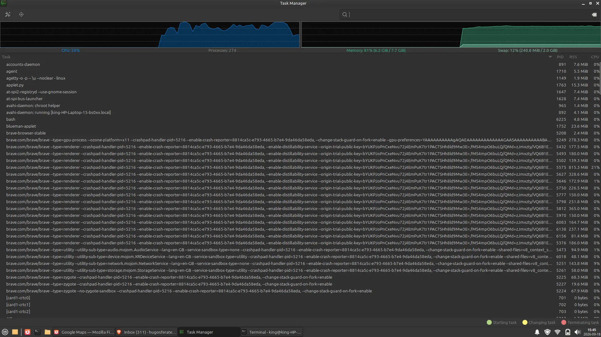
  </a>
  <figcaption>Linux Mint Task Manager under stress — ~50% CPU, 6.2GiB RAM, 240.8MiB swap</figcaption>
</figure>

<figure class="post-image">
  <a href="/images/windows-browser-tabs-stress.webp" target="_blank" rel="noopener noreferrer">
    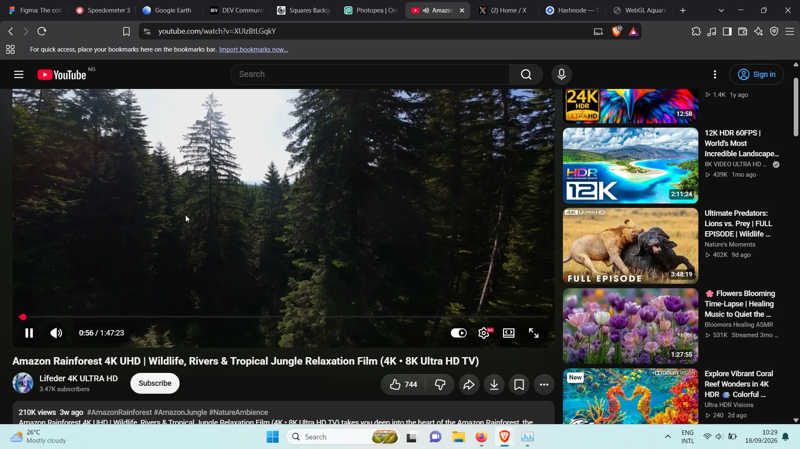
  </a>
  <figcaption>20 browser tabs open on Windows 11 during the stress test</figcaption>
</figure>

<figure class="post-image">
  
  <figcaption>20 browser tabs open on Linux Mint during the stress test</figcaption>
</figure>

Let me be clear about what these numbers mean.

Windows **maxed out the CPU at 100%** and consumed 91% of 
available RAM. Committed memory hit **10.4GB against a 12.9GB 
limit** — Windows had promised running software 2.5GB more memory 
than the physical RAM installed. Committed memory is a reservation, 
not a measure of current use — but a reservation beyond physical 
RAM creates real paging pressure: the system can only honor those 
promises by pushing pages to disk. Combined with 91% RAM usage, 
that pressure is where the lag came from. The 100% CPU is where 
the heat and battery drain came from.

(The GPU figure did one job on the Windows side: at 14%, it proved 
the tabs were actively rendering WebGL and 4K video — the load was 
real, not idle tabs. GPU and disk activity are not in the table 
because the two systems report and use those resources differently 
enough that a side-by-side number would be apples-to-oranges.)

The same hardware. The same workload. Two completely 
different experiences.

---

### The Performance Verdict: Boot Time

I also measured boot times using a stopwatch across three 
runs per operating system. The stopwatch started at the 
power button press and stopped when the desktop was fully 
loaded.

| Operating System | Test A | Test B | Test C | Average |
|---|---|---|---|---|
| **Windows 11** | 45.5s | 43.7s | 44.7s | **~44.6s** |
| **Linux Mint XFCE** | 39.8s | 38.6s | 39.0s | **~39.1s** |

> **A note on the Linux boot time:** `systemd-analyze` breaks the 
> 38.09s total into firmware 5.329s + loader 9.533s + kernel 5.084s 
> + userspace 18.142s. The loader phase is almost entirely GRUB 
> waiting for input — the kernel itself took only 5 seconds, and the 
> desktop (`graphical.target`) was ready 17.603s into userspace. The 
> stopwatch average of 39.1s includes the power-button press and 
> POST, so the two methods agree within a second.

<figure class="post-image">
  <a href="/images/systemd-analyze-output.webp" target="_blank" rel="noopener noreferrer">
    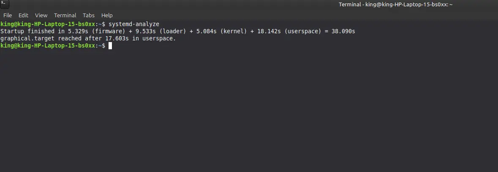
  </a>
  <figcaption>systemd-analyze output showing firmware, loader, kernel, and userspace boot times</figcaption>
</figure>

The boot time difference is modest — roughly 5.5 seconds 
faster on Linux. That is noticeable but not dramatic. The 
real transformation is not in how fast the system starts. It 
is in what happens after it loads — the responsiveness, the 
available memory, and the overall feel of the machine under 
daily use.

---

### The Bigger Picture

This project was never about ranking operating systems — it was 
about finding the right pairing for this specific hardware. 
Windows 11 is a capable operating system designed with modern 
hardware in mind; on a Pentium N3710 with 8GB of RAM, its baseline 
demands left little room for the actual work. XFCE was built for 
exactly this kind of constraint. The numbers confirmed the pairing.

That was the entire reason I started this project. The 
numbers confirmed it.

<figure class="post-image">
  <a href="/images/neofetch-output.webp" target="_blank" rel="noopener noreferrer">
    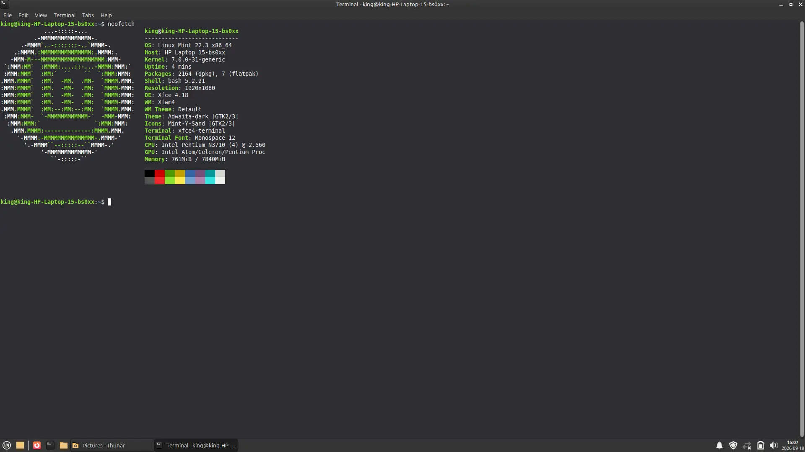
  </a>
  <figcaption>Neofetch terminal output showing system specs and uptime</figcaption>
</figure>

---

### What This Taught Me Technically

This project taught me a lot more than how to install Linux.

Here are the main technical lessons I took from it:

- **Internet infrastructure is not uniform.**
  The Linux Mint mirror system showed me that download 
  reliability depends on geography, hosting, and regional 
  infrastructure. There was no Nigerian mirror, and even the 
  closest African mirrors were unreliable. The assumption 
  that "pick the nearest mirror" solves everything breaks 
  down fast when your region is underserved.

- **A file transfer path is not just a detail — it can be 
  the entire problem.**
    The Tecno T455 moved files at 434 KB/s; a dedicated reader 
  moved the same files from the same card at 7.87 MB/s — an 
  18x gap from changing nothing except the connection path. 
  But speed was the symptom, not the cause: as Part 2's 
  analysis established, what killed the boot was the failed 
  read requests, not the crawl. A medium can pass a slow 
  sequential file copy and still fail the sustained 
  random-access workload of a live boot.

- **Kernel errors are readable if you know what to look 
  for.**
  The SQUASHFS errors and the `-5` I/O error code told me 
  the boot media connection was failing at the hardware read 
  level, not that the ISO was corrupted. Learning to 
  distinguish between a file problem and a connection 
  problem changed how I approached the entire 
  troubleshooting process.

- **File integrity can be verified, not guessed.**
  SHA256 checksums taught me that there are reliable 
  mathematical ways to confirm whether a downloaded file is 
  complete and untouched. Once the checksum matched, I could 
  eliminate the ISO as a suspect and focus on the actual 
  point of failure.

- **There is always a layer beneath the graphical 
  interface, and complex systems become manageable once 
  those layers are visible.**
  BIOS menus, kernel messages, GRUB, TTY2, and SQUASHFS 
  errors all showed me that behind the normal desktop 
  experience, the machine is still operating through text, 
  boot rules, hardware negotiation, and internal state 
  changes. A lot of what looked mysterious at first became 
  understandable the moment I could identify what layer I 
  was actually dealing with: file, boot media, firmware, 
  kernel, or installer.

- **Variable isolation is the backbone of real 
  troubleshooting.**
  The final solution came from changing one major factor at 
  a time — Secure Boot, Fast Startup, ISO verification, boot 
  device — until the actual point of failure became clear. 
  The failures had two separate causes — Secure Boot first, 
  then the connection path — and each only became visible after 
  the one before it was cleared. The last variable standing 
  was the boot media path.

---

### What This Taught Me Personally

On the personal side, this project did something important 
for me.

It changed what I believe is possible on limited hardware.

I did not think this laptop had much left to give beyond 
struggling through Windows 11. I definitely did not imagine 
it could run two operating systems cleanly and still feel 
significantly better than it did before. Seeing the idle 
RAM drop from 3.0GB to about 1GB on the same machine was not 
just a technical win. It was proof that the hardware was 
never the problem — the pairing was.

The SQUASHFS text flood looked like a dying machine until I 
learned what `-5` actually was: the kernel's I/O error code. 
The requests weren't slow — they were failing, fast and 
repeatedly, because a phone acting as a USB bridge was 
refusing read requests it was never designed to serve. The 
problem wasn't catastrophic. It was a bridge being asked to 
do a job it was never built for. Technical problems always 
look bigger than they are before you understand what they 
are actually saying.

And maybe the biggest personal lesson was this:

Working with what you have is not the same thing as settling.

Sometimes it means getting more creative, asking better 
questions, and extracting more value out of a machine or 
situation than you initially thought was possible. Using a 
phone as a file transfer bridge, reading kernel error codes 
I had never seen before, and isolating the failure to a 
USB connection path by changing one variable at 
a time — none of that was in any tutorial I followed.
It came from engaging with the problem 
directly and refusing to stop at the first failure.

That is exactly what this project was for me.

---

### Final Verdict

Dual booting Linux Mint XFCE alongside Windows 11 on this 
laptop was worth it.

Not because it was smooth. Not because it was easy.

But because it solved the actual problem I started with.

This hardware needed a lighter operating system for daily 
work. Linux Mint XFCE provided that. Windows 11 is still 
there when I need it.

And now, instead of being trapped inside one operating 
system that barely fit the machine, I have two working 
systems on hardware I thought was almost finished.

That is a very different place to be than where I started.

---

### Want the Clean Version?

This series documented the full experience — the mistakes, 
the troubleshooting, the dead ends, and the lessons learned 
along the way.

If you made it this far and you're looking for the shortest 
practical route to dual booting Linux Mint XFCE on a low-end 
Windows laptop without the detours, I wrote a clean 
companion guide that distills everything into a 
step-by-step walkthrough.

[How to Install Linux Mint (All Editions) on a Windows 11 Laptop]().

---

*Previous: [Part 2 — BIOS, Boot Failures and the 
Troubleshooting]()*  
*Back to the series intro: [Dual Booting Linux on a Machine 
That Barely Runs Windows]()*

---

## Resources

- [Linux Mint Official Download](https://linuxmint.com/download.php)
- [Linux Mint SHA256 Checksums](https://linuxmint.com/verify.php)
