# Linux Mint: The First Hour After Install

> **Last tested on:**
> * Linux Mint 22.3 (XFCE — steps are identical on Cinnamon and MATE)
> * Hardware: HP 15-bs0xx (Pentium N3710) & ASUS VivoBook X509UA (i3-7020U)

You installed Linux Mint. GRUB works, Windows still boots, and the desktop is waiting. This is the first hour: five tasks, in the order they should happen. Mirrors come first, because every update you will ever pull travels through them. Software installation comes before updates, because you need to know what a package *is* before the numbers start disagreeing. TimeShift comes before anything risky, because an undo button you configure afterward is no undo button at all. Tethering comes last, because it's the backdoor you hope never to need.

Every step stands alone. The failure recoveries live in collapsibles; the four field reports behind them — two incident reports, one drill, one field note — sit in the [Appendix](#appendix), each linked from the step that spawned it. Skip them all and lose nothing.

**Haven't installed yet?** Start with the installation guide: [How to Install Linux Mint (All Editions) on a Windows 11 Laptop]().

---

## Step 1: Optimize Your Software Mirrors {#step-1-mirrors}

Mirrors are the software servers that host Linux Mint's packages. Picking a fast one speeds up every download and update for the life of the install — this takes about two minutes.

1. Open the menu and launch **Software Sources**.
2. Click **Main repository** (the default, e.g. `zena`). Mint runs a speed test against every available mirror — about a minute.
3. Pick the fastest one (top speed in KB/s or MB/s). It doesn't have to be geographically close to you.
4. Click **Apply**.
5. Repeat for the **Base repository**, then **Apply**.
6. Click the **green refresh icon** to update the cache. Give it a few minutes.

<figure class="post-image">
  <a href="/images/step01-mirror-speedtest.webp" target="_blank" rel="noopener noreferrer">
    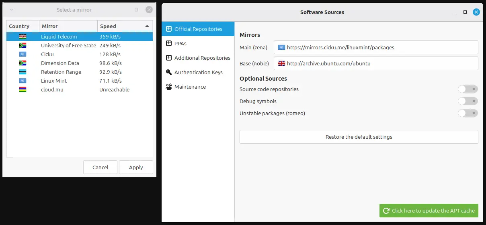
  </a>
  <figcaption>Figure 1: The two screens that bracket the operation. The speed test ranks mirrors by how fast they answer — Liquid Telecom on top here, cloud.mu unreachable — and once both repositories are Applied, the green button is what kicks off the cache refresh in step 6.</figcaption>
</figure>

> **Note:** The speed test ranks mirrors by how fast they *answer*, not how long they can *carry a download*. The top pick is usually right — but if a refresh ever stalls, the fix is simply taking the next mirror down the list.

On a bad network day, that final cache refresh can lock up — sometimes for half an hour at a stretch. If it happens to you:

<details markdown="1">
<summary><strong>🚨 The cache refresh froze — or the shield went red</strong></summary>

A stalled mirror fetch does not mean your system is broken. It means the connection somewhere stopped delivering mid-download, and Mint's GUI is holding the line open — politely, forever. It's rare, but on unreliable networks it happens. The recovery path below goes from least to most invasive. Stop the moment the GUI frees.

<figure class="post-image">
  <a href="/images/step01-cache-updating.webp" target="_blank" rel="noopener noreferrer">
    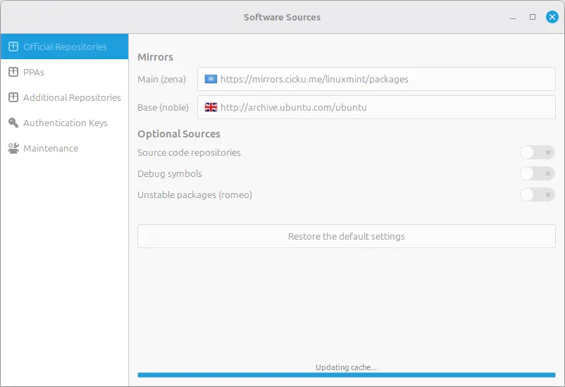
  </a>
  <figcaption>The frozen window: controls greyed, the cache bar stretched, no error and no timeout. This is the state the recovery path below assumes — a fetch that stopped delivering while the GUI holds the line open.</figcaption>
</figure>

**1. Read the red shield correctly.**
If the Update Manager shield turned red, you saw this:
> *"Could not refresh the list of updates — Your APT configuration is corrupt. Do not install or update anything — doing so could break your operating system! To switch to a different Linux Mint mirror and solve this problem, click OK."*

**Translation:** This is Mint's standard reaction to a failed mirror fetch. It clears the moment a refresh succeeds. It is not a verdict on your system.

<figure class="post-image">
  <a href="/images/step01-shield-warning.webp" target="_blank" rel="noopener noreferrer">
    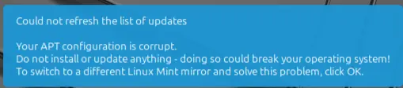
  </a>
  <figcaption>The notification itself: alarming wording, harmless meaning. Mint is reporting a failed fetch, not a broken system — and the line that matters is the last one, which is the actual fix.</figcaption>
</figure>

**2. Wait before touching anything.**
Freezes often resolve on their own — in my testing they cleared in 2–6 minutes, and the longest ran 23 minutes. One freeze outlasted 30 and I ended it with a shutdown; that story's in [the incident report](#a1-mirror-freeze).

**3. Identify before you kill.**
Open a terminal and run:
```bash
ps aux | grep apt
```
Read what's actually listed. The holder's name depends on the door: on Mint 22.3 the GUI's fetch runs through a Python script named **`aptk`** (`/usr/sbin/aptk`); a terminal update runs through `apt-get`. Kill what `ps` shows — not what you remember. Ignore the tourists: `grep` matches substrings, so unrelated lines like `--adaptive` will appear in the output too.

<figure class="post-image">
  <a href="/images/step01-ps-anatomy.webp" target="_blank" rel="noopener noreferrer">
    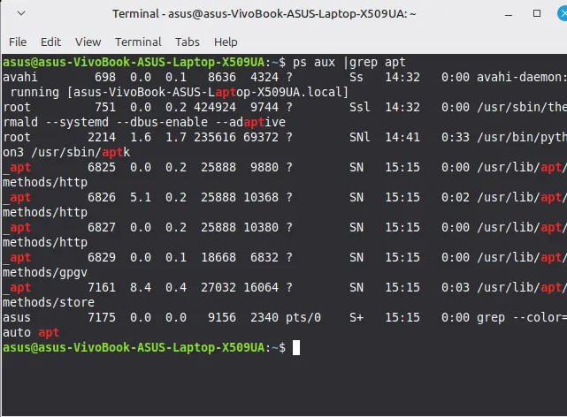
  </a>
  <figcaption>The anatomy, live: one holder (aptk), four workers, and the tourists that match on substring rather than on being apt. Read this before you kill anything — the frame is the lesson, and it is the same output the prose walks through line for line.</figcaption>
</figure>

**4. Kill the holder.**
In every capture taken for this guide, the GUI's holder answered to `aptk` — so:
```bash
sudo killall aptk
```
*Safety line:* this only holds for a cache **refresh** — no package transaction is in flight, so there's nothing half-installed to damage; the refresh restarts the moment you click the icon again. Mid-**install** is different — see [the Installing Software step's lock note](#step-2-installing-software) before killing anything. Killing the *wrong* name changes nothing. Target what step 3 showed you. *(This is the documented recovery path — my freezes released before I needed to fire it in sequence. And a confession: my own first draft of this step named the holder `aptd`, from memory. The capture in step 3 says `aptk`. The rule caught me too.)*

**5. Clear the lock, if the error persists.**
If you now get *"Could not get lock /var/lib/apt/lists/lock"*: confirm nothing's alive with `ps aux | grep apt`, then remove the lock your error names:
```bash
sudo rm /var/lib/apt/lists/lock
```
The other usual suspects are `/var/cache/apt/archives/lock` and `/var/lib/dpkg/lock-frontend`. Remove only the one named in your error. Locks are protection, not obstacles — but when the holder dies mid-fetch, the lock outlives it and blocks the next attempt.

**6. Reselect and verify.**
Back in Software Sources, take the **next mirror down the list** — not the one that stalled. Apply, then hit the green refresh icon. The shield returning to normal is the exam passed.

</details>

*Fixed it — or just curious why the GUI froze solid while a terminal `sudo apt install` kept working on the same machine at the same time? The full teardown — two laptops, one 23-minute freeze, one forced shutdown, and what `ps` was actually showing — lives in [Incident Report: The Mirror Cache Freeze](#a1-mirror-freeze) at the end of this guide. It's a read for the curious. Skip it, and you lose nothing.*

---

## Step 2: Installing Software on Linux {#step-2-installing-software}

Linux organizes software differently than Windows. There's no single `.exe` to download from a website — instead, software arrives as **packages** from **repositories** (curated software libraries your system trusts). Mint uses two package systems side by side, and understanding the difference between them will save you a lot of confusion later, especially when you run your first system update.

**The two systems:**

- **System packages (`.deb`)** — the native Linux format, maintained and vetted by Mint and Ubuntu developers. They're tightly integrated with your system, relatively small, and updated through the distro's own release cycle. When you run `apt` in the terminal, this is what you're working with.
- **Flatpaks** — sandboxed packages that bundle their own dependencies, distributed through [Flathub](https://flathub.org). They're isolated from your system (a security advantage), but larger on disk because they carry their own libraries instead of sharing the system's. They update independently of Mint's cycle. The terminal command for these is `flatpak`, not `apt`.

Neither system is "better." Most users end up with a mix of both, and Mint's tools handle them together so you don't have to think about the distinction most of the time. But when the numbers don't add up during an update — and they will — this is why.

#### Method 1: The Software Manager (GUI)

1. Open **Software Manager** from the menu.
2. The first time you open it — or after [changing mirrors](#step-1-mirrors) — the search may sit empty for two or three minutes while the catalog indexes. It's working, not hung.
3. Type the name of the app you want in the search bar.
4. Expect a **flood** of results. Searching `vlc` returns the player itself plus a dozen entries with hyphenated suffixes: `-plugin-`, `-backend-`, `-bin`, `-bindings`. These are *parts* of the program, not the program. The one you want has the plain name, a human-readable description, and usually a star rating.
5. Click on it. On the detail page, look at the top right, just under the Install button:
   - **"System Package"** chip = a native `.deb`.
   - **Cube icon + "Flathub"** badge = a Flatpak.
   - Some apps appear twice — one of each. Search `firefox` and you'll see both. A **green check** on one of them means it's already installed.
6. Click **Install**, enter your password, let it run.

<figure class="post-image">
  <a href="/images/pkg-gui-search.webp" target="_blank" rel="noopener noreferrer">
    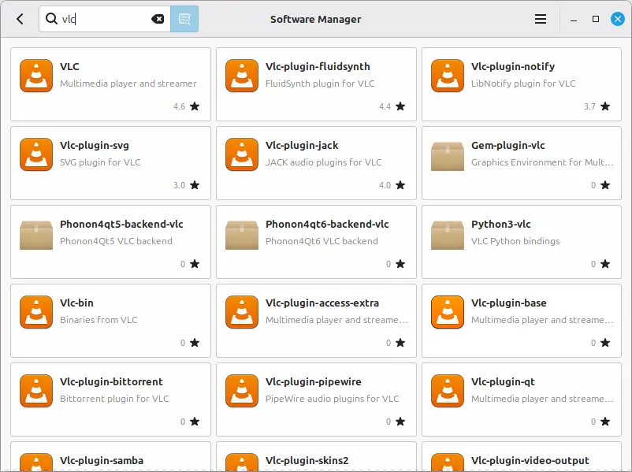
  </a>
  <figcaption>Figure 2: The flood, on screen. The tile you want is the plain name with a human description and a star rating — top-left here. Everything around it (-plugin-, -backend-, -bin, -bindings) is a component other programs depend on, not the program itself.</figcaption>
</figure>

<figure class="post-image">
  <a href="/images/pkg-dual-firefox.webp" target="_blank" rel="noopener noreferrer">
    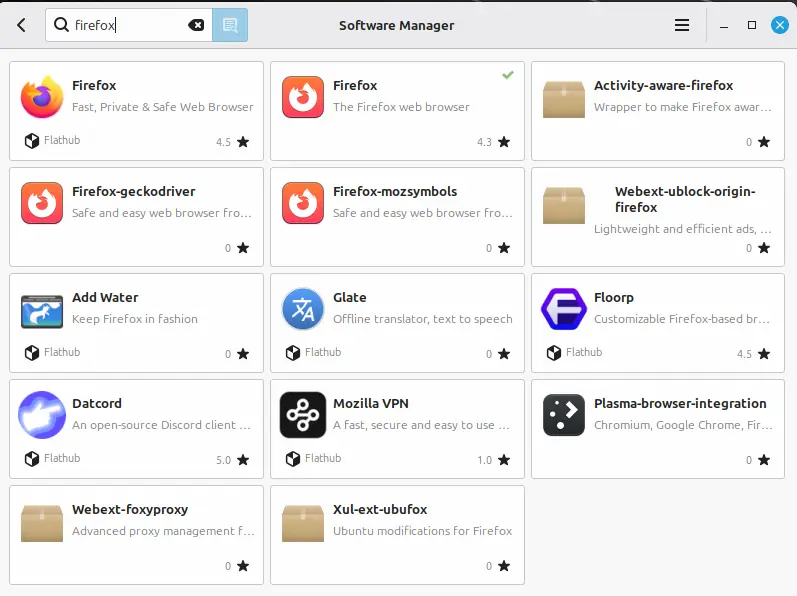
  </a>
  <figcaption>Figure 3: The twins. Same app, two package systems. The green check marks the installed native .deb; the cube plus Flathub badge marks the sandboxed Flatpak. Some apps appear twice exactly like this — firefox being the obvious one.</figcaption>
</figure>

<figure class="post-image">
  <a href="/images/pkg-detail-deb.webp" target="_blank" rel="noopener noreferrer">
    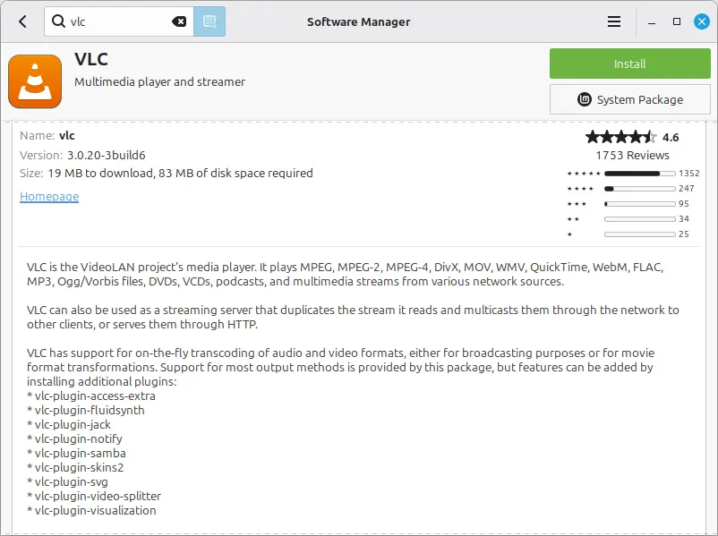
  </a>
  <figcaption>Figure 4: The chip, in place. System Package beneath the Install button means a native .deb; a cube plus Flathub badge here would mean a Flatpak. Note the size line — 19 MB to download, 83 MB of disk — the same figure the blockquote below unpacks, and the plugin list echoing the flood from Figure 2.</figcaption>
</figure>

> **Two numbers on the detail page:** "19 MB to download, 83 MB of disk space required." Not a contradiction — the download is the compressed package traveling over the wire; the disk size is what it occupies once unpacked and installed. Same program, measured before and after the squeeze.

#### Method 2: The Terminal (`apt`)

1. Refresh the package index:
   ```bash
   sudo apt update
   ```
   Enter your password when prompted. This doesn't install anything — it just downloads the latest catalog of what's available.

2. Install a package:
   ```bash
   sudo apt install <package-name>
   ```
   Read the output before confirming. It tells you exactly what will be downloaded, how much disk space it will use, and whether any additional dependencies will be pulled in.

3. Type **Y + Enter** to confirm.

4. To remove a package later:
   ```bash
   sudo apt remove <package-name>
   ```

5. To clean up leftover dependencies nothing needs anymore:
   ```bash
   sudo apt autoremove
   ```

> **`autoremove` is not a kernel pruner.** On both test machines — before *and* after a fresh kernel install — it swept nothing. Old kernels pile up quietly, and the deliberate tool for trimming them is Update Manager's **Linux Kernels** window. Removing kernels is the one housekeeping act that can strand your boot path; leave it alone until you know what you're cutting.

> **Package names are case-sensitive and must be exact.** `sudo apt install Firefox` will fail. `sudo apt install firefox` will work. If you're unsure of the exact name, search for it first with `apt search <keyword>` or check the Software Manager.

#### Key Differences to Remember

- **The Software Manager shows everything** — `.deb` packages, Flatpaks, and third-party repo packages — all in one list. The terminal's `apt` commands only see `.deb` packages. If an app is Flatpak-only, `apt install` won't find it. Use `flatpak install flathub <name>` instead, or just use the GUI.
- **The search flood is normal.** Those hyphenated plugin entries are real packages — they're just components that other programs depend on. You almost never install them directly.
- **Not every app is in Mint's repositories.** Some software isn't packaged for Linux at all, and some exists only as a Flatpak or a manual download. If the Software Manager and `apt search` both come up empty, the app's official website is your next stop.

#### When You Can't Find a Package Anywhere

Sometimes the app you need isn't in the Software Manager *or* `apt`. This usually means one of three things:

**1. It's a Flatpak you need to install manually.**
Some apps are only distributed through Flathub. The terminal command is:
```bash
flatpak install flathub <app-id>
```
You can find the exact app ID by searching on [flathub.org](https://flathub.org).

**2. It's a standalone `.deb` from the developer's website.**
Some projects (like VS Code, Google Chrome, or Discord) provide a `.deb` file for download. Once you have it:
```bash
sudo apt install ./path-to-file.deb
```
Using `apt install` instead of `dpkg -i` is important — `apt` will automatically fetch any missing dependencies, while `dpkg` will just fail and leave you to chase them manually.

**3. It needs a PPA (Personal Package Archive).**
Some developers maintain their own Ubuntu/Mint repositories. Adding one typically looks like:
```bash
sudo add-apt-repository ppa:<developer>/<project>
sudo apt update
sudo apt install <package-name>
```
PPAs are not vetted by Mint. Only add them from developers you trust, and read the project's official installation instructions before running anything.

<details markdown="1">
<summary><strong>🧱 A tutorial told you to <code>snap install</code> — and Mint refuses</strong></summary>

Plenty of internet tutorials start with `snap install something`. On Mint, that door is welded shut on purpose:

```text
$ sudo apt install snapd
E: Package 'snapd' has no installation candidate
```

Nothing is broken — not the repository, not your setup. That line is distro policy speaking through apt's mouth: Mint chose Flatpak as its sandboxed format and dropped snap entirely. The refusal is the feature working.

<figure class="post-image">
  <a href="/images/pkg-snap-refusal.webp" target="_blank" rel="noopener noreferrer">
    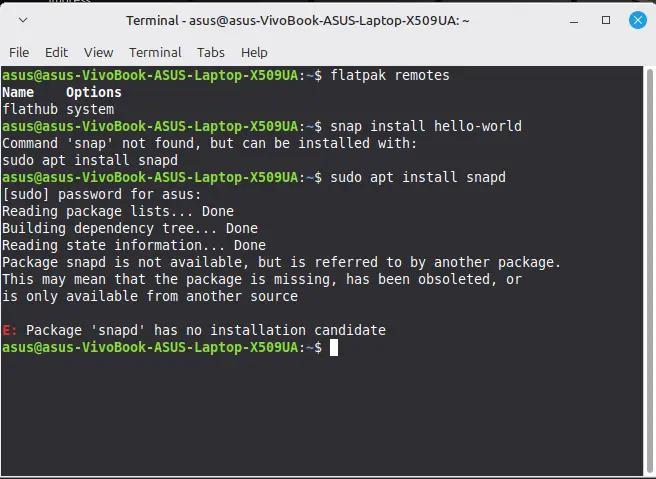
  </a>
  <figcaption>The whole session behind the fence's two lines. snap is missing, the system points you at snapd to fetch it, and snapd itself has no candidate — the red line is the fence's excerpt, shown here inside the chain that produced it. The door is welded shut from both sides.</figcaption>
</figure>

**What to do instead:** skip the `snap install` step and look the app up in the Software Manager — cube icon + Flathub badge means it's there in Mint's sanctioned sandbox. If it's genuinely not listed anywhere, the [Flathub site](https://flathub.org) is the authoritative source for what exists.

</details>

<details markdown="1">
<summary><strong>🧱 "Waiting for cache lock" — apt is standing in line, not broken</strong></summary>

Run an `apt` command while the Software Manager or Update Manager is mid-download and you'll see this wall scroll past:

```text
Waiting for cache lock: Could not get lock /var/lib/dpkg/lock-frontend.
It is held by process 6205 (aptk)
```
<figure class="post-image">
  <a href="/images/pkg-cache-lock-wall.webp" target="_blank" rel="noopener noreferrer">
    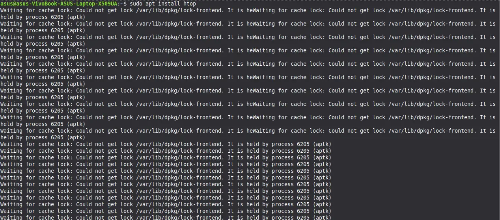
  </a>
  <figcaption>This wall, scroll past, made literal: the same line repeated twenty times, the same holder — 6205 (aptk) — every time. Read the first word, not the count: Waiting. apt is queuing behind the GUI, not refusing.</figcaption>
</figure>

Read the first word: **Waiting**. apt isn't refusing — it's queuing behind the GUI and resumes the moment the line moves. On our bench it waited 142 seconds, then carried on by itself. Beginners who've seen this wall have been panicking at a queue this whole time.

**So the correct move is: wait.** This is the exact opposite of the mirror freeze. There, the holder was a stalled *fetch* with no package work in flight. Here, the holder is mid-*install* — real package work. Killing an installer mid-transaction is how you actually damage package state. Let the queue resolve.

**If the wait truly never ends** (many minutes, nothing moving anywhere): confirm the holder is actually dead first — `ps aux | grep apt` shows nothing alive — then choose by what it was doing:

- It was **installing** (a progress bar was moving): repair any half-finished state, then retry:
  ```bash
  sudo dpkg --configure -a
  ```
- It was only **refreshing the cache** (the Mirrors freeze): no package state was in flight — use [the Mirrors step's lock-clearing path](#step-1-mirrors).

</details>

### A Note on Drivers

Linux Mint includes a **Driver Manager** (Menu → Driver Manager) for proprietary hardware drivers — most commonly Nvidia graphics cards, some Broadcom Wi-Fi chips, and certain printers or scanners.

Neither laptop used for this guide ever showed anything in Driver Manager, on a fresh install or on any later check: *"No drivers needed — Your computer does not need any additional drivers."* That's not a malfunction — it almost always means your hardware is already fully supported by Mint's default, open-source drivers, which is the common case for most mainstream laptop hardware. An empty Driver Manager is a good sign, not a missing step.

<figure class="post-image">
  <a href="/images/pkg-driver-manager-empty.webp" target="_blank" rel="noopener noreferrer">
    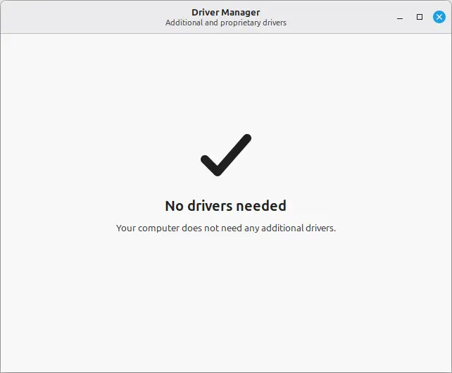
  </a>
  <figcaption>The good sign, on screen: an empty Driver Manager is not a malfunction. For most mainstream hardware — both laptops here included — the default open-source drivers already cover everything, so this blank window is the correct result. The populated case (an Nvidia card listing an Install option) is the one state I never saw on either machine, which is why the section points you to the official docs for it instead of guessing at a flow I didn't run.</figcaption>
</figure>

If you do have hardware that needs a proprietary driver — an Nvidia GPU is the most common case — Driver Manager will list it with a clear "Install" option. I haven't personally walked through that flow on either test machine, so rather than guess at steps I've never run, here's where to go instead:

- [Linux Mint User Guide](https://linuxmint.com/documentation.php) — official documentation
- Your hardware manufacturer's official Linux driver page, if one exists

This is one of the only places in this guide where I'm pointing you elsewhere instead of walking you through it myself — and that's deliberate. I'd rather tell you honestly that I haven't tested it than hand you a confident-sounding process I made up.

---

## Step 3: TimeShift: Your System's Undo Button {#step-3-timeshift}

Timeshift is Mint's built-in rollback tool — not a personal backup app. If an update or experiment breaks your system, Timeshift restores it to an earlier working state. It does not protect your documents, photos, or downloads — `/home` is excluded by design. That's a separate job, for a separate tool.

**Setup — one-time, under two minutes:**

1. Open **Timeshift** from the menu. The setup wizard launches automatically on first run.
2. **Snapshot Type:** Leave it on **RSYNC** — on an ext4 system it's the only available mode, not a recommendation. *(The BTRFS option only activates on systems actually running BTRFS — on ext4, RSYNC is the only door.)*
3. **Snapshot Location:** Your Linux root partition is pre-selected and is the only valid target — the wizard blocks NTFS/FAT outright. A dual-booter physically cannot point a snapshot at the Windows drive, even by accident.
4. **Schedule:** Daily, keep 5 is the default. On a smaller SSD (256GB or less), trim this to 3 to curb space creep over time.
5. **Home Directories:** Leave **Exclude All** checked, for both your user folder and root. This keeps Timeshift doing exactly one job — system state, not personal files.
6. Click **Finish**.
7. Back in the main window, click **Create** to trigger your first snapshot now. Don't wait for the schedule — you want a baseline sitting there before you ever need one.

<figure class="post-image">
  <a href="/images/step03-timeshift-wizard.webp" target="_blank" rel="noopener noreferrer">
    
  </a>
  <figcaption>Figure 5: the four wizard decisions, on screen. RSYNC is the only live option because this is ext4; the location panel lists no Windows partition because the wizard blocks NTFS outright; Daily/Keep 5 is the default schedule; and both root and the user home are excluded — which is the whole point, Timeshift guards system state, not your files.</figcaption>
</figure>

<figure class="post-image">
  <a href="/images/step03-timeshift-main-empty.webp" target="_blank" rel="noopener noreferrer">
    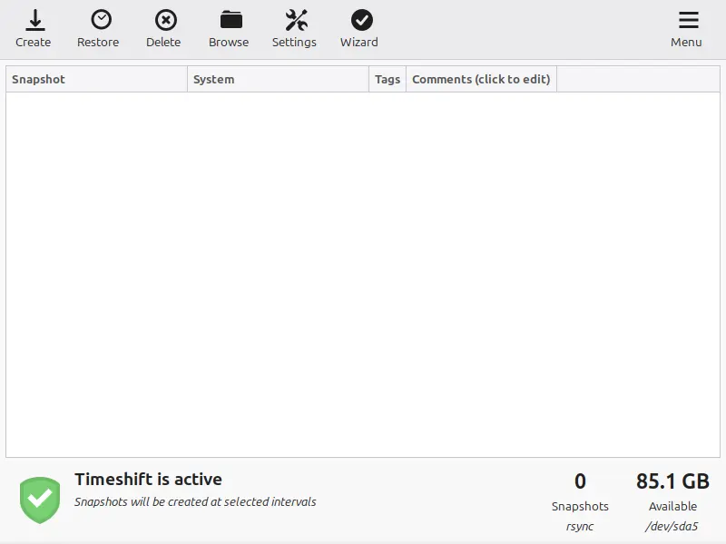
  </a>
  <figcaption>The armed tool, before the first snapshot: zero entries, rsync active, Create and Restore waiting in the toolbar. This is the state at the end of setup — configured, forgotten, still working — and the only view that shows where Restore lives for the restore flow below.</figcaption>
</figure>

**Restoring a snapshot, if you ever need to:**

1. Open Timeshift and select a snapshot from the list.
2. Click **Restore**.
3. Review the **Confirm Actions** screen before confirming anything — it lists every file Timeshift is about to create, restore, or delete, in advance.
4. Confirm. The system restores the files and reboots automatically.

<figure class="post-image">
  <a href="/images/step03-timeshift-confirm-actions.webp" target="_blank" rel="noopener noreferrer">
    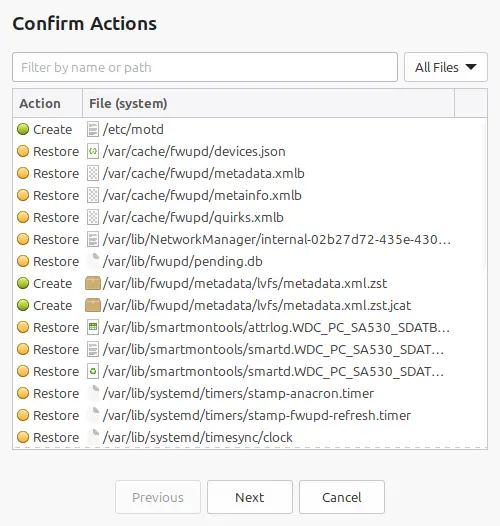
  </a>
  <figcaption>Figure 6: the read-before-confirm screen. The very first line is the wound Timeshift found and named — Create /etc/motd — and everything under it is the drift a restore rolls back alongside it: firmware metadata, network state, disk logs, timer stamps. None of it is /home; the exclusion held. This is why you review this list before you click, not after.</figcaption>
</figure>

> **Know the limits before you rely on it:** snapshots live on the same disk they protect — if the drive fails, the snapshots fail with it. Restoring rolls back *everything* since that snapshot, not just the one thing you're trying to undo, so you'll lose any updates or changes made in between. Snapshot before you experiment, not after something breaks.

*The numbers in the Timeshift window can look alarming on their own — a single snapshot claiming several gigabytes, times five scheduled copies, on a drive that doesn't have that much room to spare. It's not what it looks like. Here's how to check it yourself.*

<details markdown="1">
<summary><strong>🤔 The misconception about Timeshift's disk usage</strong></summary>

Run a size check on a single snapshot folder and you'll see a number that looks like a full copy of your OS — several gigabytes, easily. Multiply that by five scheduled snapshots and the math looks like Timeshift is about to eat your entire drive. It isn't. Here's how to verify that yourself instead of taking my word for it.

**What the disk actually holds (ground truth):**
```bash
df -h /
```

This is your root partition's real, total usage — snapshots included, nothing hidden.

**What each snapshot actually costs:**
```bash
sudo du -sh /timeshift/snapshots/*
```
Run against *all* your snapshots in one command, and the sizes come back small. RSYNC mode doesn't copy unchanged files between snapshots — it hardlinks to data already on disk. A snapshot only costs you new space for files that actually changed since the last one.

**What one snapshot actually contains:**
```bash
sudo du -sh /timeshift/snapshots/<folder-name>
```
Run it alone, pointed at a single snapshot folder, and the number jumps — because now you're measuring every file it points to, shared or not. That's not what it *cost* you. That's what it *contains*.

<figure class="post-image">
  <a href="/images/step03-timeshift-du-df.webp" target="_blank" rel="noopener noreferrer">
    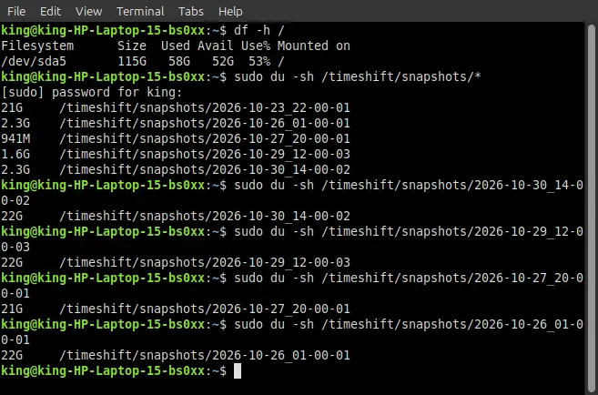
  </a>
  <figcaption>Run it yourself and the rule becomes visible: df tells you what the disk holds, du across all snapshots tells you what each one cost, du on a single snapshot tells you what it contains. The combined figures stay small because RSYNC hardlinks unchanged files; the solo figures balloon because now you are counting shared data too. Neither number is wrong — they answer different questions.</figcaption>
</figure>

**The rule:** `df -h /` tells you what your disk actually holds. `du` across all snapshots tells you what each one cost. `du` on one snapshot alone tells you what it contains. Three different numbers, all true — pick the one that answers the question you're actually asking.

</details>

*Care to see how I put this to the test — deleted a system file on purpose, restored it through the GUI, and nearly misread my own proof twice? The full drill — the wound, the restore, two self-caught misdiagnoses, and the metadata that settled it — is in the [TimeShift Drill Report](#a3-timeshift-drill) at the end of this guide. Fixed or just curious, you lose nothing by stopping here.*

---

## Step 4: Keeping Your System Updated {#step-4-updates}

Updates patch security holes and keep your kernel and drivers current. Two equivalent paths — pick whichever fits your flow.

#### Method 1: The GUI (Update Manager)

1. Click the **shield icon** on the panel bar — or search for **Update Manager** in the menu.
2. A list of available updates appears.
3. **Install Updates** applies everything, or untick anything you want to skip — the checkboxes are yours.
4. Enter your password.
5. Let it run.
6. When it's done, the shield reads **"Your system is up to date."**

<figure class="post-image">
  <a href="/images/step04-update-manager.webp" target="_blank" rel="noopener noreferrer">
    
  </a>
  <figcaption>Figure 7: the two states the GUI walks you through. The list appears at step 2 — three logical rows here, each a ticked checkbox you can untick — and the shield closes at step 6 once the batch is applied. The footer's 3 updates / 886 KB is the GUI's own tally; the terminal counts the same work differently, and that gap is the field note's subject, not this step's.</figcaption>
</figure>

#### Method 2: The Terminal

```bash
sudo apt update
```
Refreshes the package index. When it finishes, it reports how many packages are upgradable.

```bash
apt list --upgradable
```
Shows exactly what's pending — every package, listed individually. Read-only, no password needed. The GUI shows the *same packages* grouped into fewer rows, which is exactly why its counts and size quotes differ from the terminal's — [the Field Note](#a4-update-mismatch) has the numbers.

```bash
sudo apt upgrade
```
Starts the update. Type **Y + Enter** when prompted, and let it complete.

```bash
flatpak update
```
Updates your Flatpaks. `apt` can't see them (see [the Installing Software step](#step-2-installing-software)), so a terminal-only routine needs both commands. The Update Manager handles both kinds in one list — one reason its totals rarely match the terminal's.

> **Note:** The terminal has no checkbox screen — `sudo apt upgrade` updates everything by default. To update a single package without touching the rest, use `sudo apt install --only-upgrade <package>`. It may bring tightly tied companions along — upgrading `firefox` also upgraded `firefox-locale-en` on the test machine — but everything else stays exactly where it was.

*The GUI said 893 KB once. The terminal said 216 MB for the exact same update. Neither was wrong — they just don't use the same ruler. The full breakdown — two machines, two kinds of mismatch, one shared cause — is in the [Field Note](#a4-update-mismatch) at the end of this guide. Purely optional.*

---

## Step 5: USB Tethering — The Wi-Fi Backdoor {#step-5-usb-tethering}

Sometimes Wi-Fi just dies — a bad driver, a kernel update, a fight with your wireless card that you didn't start and can't immediately win. When that happens, you still need a way online to search for a fix, download a driver, or roll back a kernel. USB tethering turns your phone into a wired lifeline: plug it in, and your laptop treats it like an ethernet connection.

**Android:**
1. Connect your phone to the laptop with a USB data cable (not a charge-only cable).
2. Turn **mobile data on**
3. Enable **USB Tethering** — usually in the notification shade, or under **Settings → Network & Internet → Hotspot & Tethering** *(on Samsung phones: Settings → Connections → Mobile Hotspot and Tethering)*.

    <figure class="post-image">
          <a href="/images/step05-android-tether.webp" target="_blank" rel="noopener noreferrer">
            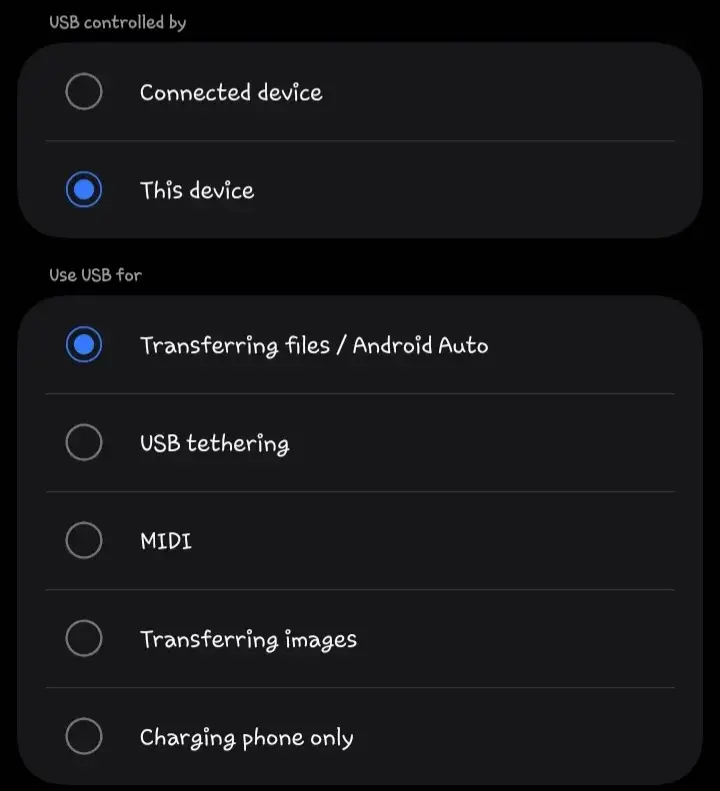
          </a>
          <figcaption>The Android door, open. USB tethering is one option in this list — not the selected one yet (file-transfer is lit here), so this is the screen where you <em>choose</em> it. The lesson is in the words, not the pixels: pick USB tethering from this list after mobile data is on, and Mint takes it from there.</figcaption>
        </figure>

4. Linux Mint detects it automatically as a wired connection. No terminal, no setup. If your phone has mobile data, you're online.

**iPhone:**
1. Turn **mobile data on**
2. Go to **Settings → Personal Hotspot** and switch it on *(The hotspot shares the phone's mobile connection over the cable — with data off the link forms but no internet flows, and Mint's wired icon won't finish the handshake.)*

      <figure class="post-image">
          <a href="/images/step05-iphone-hotspot.webp" target="_blank" rel="noopener noreferrer">
            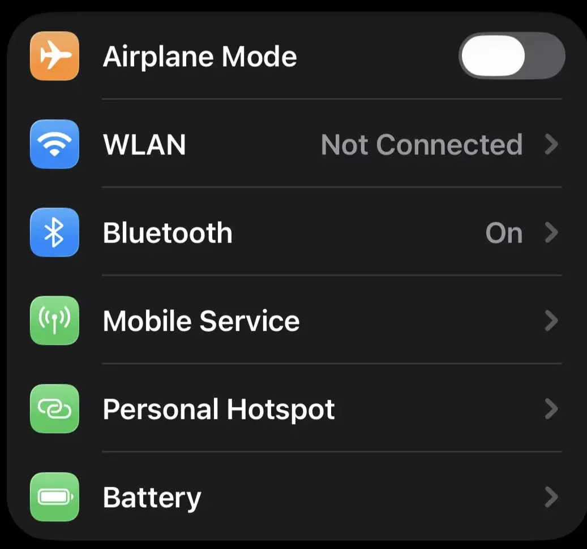
          </a>
          <figcaption>Where the hotspot lives on iOS — the Personal Hotspot row in the first Settings group. Switch it on here, after mobile data, and the cable handshake completes on its own; Mint ships the iPhone driver, so there is no terminal step waiting behind this screen.</figcaption>
        </figure>

3. Connect the iPhone to the laptop with a USB cable.
4. The phone will prompt **"Trust This Computer?"** — tap **Trust**, and enter your passcode if asked.

    <figure class="post-image">
          <a href="/images/step05-iphone-trust.webp" target="_blank" rel="noopener noreferrer">
            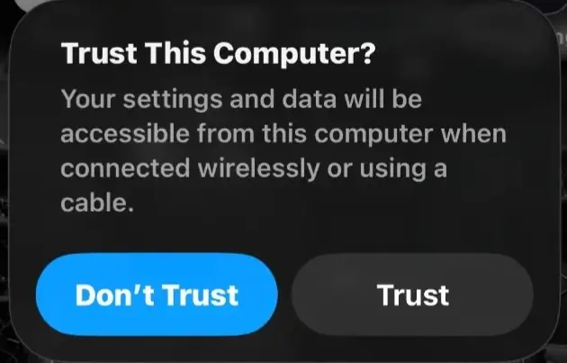
          </a>
          <figcaption>The gate, on screen. Tap Trust and enter your passcode; declining it is the most common way tethering fails silently on your own laptop. The dialog is the whole instruction — there is no confirmation screen after it, just the wired icon in Mint's tray once the link forms.</figcaption>
        </figure>

5. Check the network icon in the Mint taskbar — it switches to a wired/ethernet icon once connected.

> **Always tap Trust.** There's no reason to decline it on your own laptop, and skipping it is the most likely way this fails silently.


This isn't a permanent fix — it's a bridge to get you online long enough to actually solve the Wi-Fi problem. Speaking of which:

<details markdown="1">
<summary><strong>🧯 Wi-Fi suddenly dead? Try the previous kernel first</strong></summary>

If Wi-Fi was working fine and then vanished right after a routine update, the new kernel is the prime suspect — not your hardware. Kernel updates occasionally ship without full driver support for a specific wireless chip, and the failure is often silent: no error, no warning, just a radio that never connects again.

**The fix, if this is what happened to you:**
1. Reboot the laptop.
2. At the GRUB boot screen, select **Advanced options for Linux Mint**.
3. Choose the **previous kernel version** — the plain entry, **not** recovery mode. *(Recovery mode boots a minimal repair shell, not a normal desktop, so it won't bring your Wi-Fi back the way a regular older kernel will. Any plain entry below the newest one works.)*  

    <figure class="post-image">
          <a href="/images/step05-grub-advanced.webp" target="_blank" rel="noopener noreferrer">
            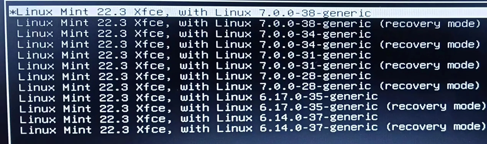
          </a>
          <figcaption>The menu the fallback walks you through. The starred line at the top is the newest kernel — the one that broke Wi-Fi — and it is already selected, so do not press Enter here. Arrow down to a plain older entry (7.0.0-34 is the one that revived the connection in the kernel-war report) and avoid every line marked (recovery mode): those boot a minimal repair shell, not a desktop, so they will not bring your Wi-Fi back. The pairs are the trap this step warns about, visible.</figcaption>
        </figure>

4. Boot into it, and check whether Wi-Fi reconnects.


If it does, you're not stuck. You can keep using that older kernel while a fix lands, or dig further yourself.

I went through this myself — two hours fighting a wireless card that had no business dying, before I found the previous kernel sitting in the GRUB menu the entire time. It worked. I've been back on the newest kernel since, with zero recurrence — and I still don't have a fully confirmed answer for exactly what failed that night.

</details>

*Curious about the full two-hour fight — the dead ends, the configuration file I found with a typo baked into it, and the honest admission that I can't prove exactly what fixed it? The full report is in [Incident Report: The Kernel War](#a2-kernel-war).*

---

## Appendix {#appendix}

---

### A1. Incident Report: The Mirror Cache Freeze {#a1-mirror-freeze}
*Two machines. One frozen GUI. Zero reinstallations.*

**Classification:** Observational report from field testing, not a diagnosis. Where I'm inferring, I say so.

#### Context
The initial post-install mirror selection ran clean on both test machines (HP Pentium N3710, ASUS VivoBook X509UA). The freeze below appeared later — on re-selection during routine maintenance, which is exactly the scenario the Mirrors step's collapsible covers. Fresh installs behaved. The second visit is where the floor got slippery.

#### Machine 1 — HP (the 23-minute hold)
Routine maintenance: switched the Main repository mirror, clicked Apply, hit the cache refresh. The refresh froze completely — no progress, no error, no timeout. Exactly 23 minutes later, it released on its own.

<figure class="post-image">
  <a href="/images/a1-hp-mirror-freeze.webp" target="_blank" rel="noopener noreferrer">
    
  </a>
  <figcaption>The HP freeze, whole: cache window locked mid-refresh, red shield, and the corrupt-config notification — the same standard warning the Step 1 crop isolates, here shown in context. The surrounding desktop is the author's established workspace, the same branded backdrop as the opening image, which is why the capture ships uncropped: the wallpaper is the proof this is the article's own machine.</figcaption>
</figure>

The moment the freeze began, the Update Manager shield went red with the standard warning: *"Your APT configuration is corrupt. Do not install or upgrade anything…"* The moment the freeze released, the shield returned to normal and showed the standard pending-updates indicator. Nothing was ever corrupt — the shield was reporting a failed fetch, not a broken system.

Afterward, I ran the lock-clearing commands to clean up the stale state the stalled fetch left behind. Clean recovery. Confirmed working.

#### Machine 2 — ASUS (the ghost)
Same flow, worse manners. The freeze ran past 30 minutes with no shield warning at all. Two details worth their weight in gold:

1. **The terminal never froze.** While the GUI sat locked, `sudo apt install <package>` ran fine in a terminal on the same machine, at the same time. Whatever was stuck was stuck inside the GUI's own fetch — one wedged connection, not a dead network: the terminal's transactions ran fine beside it the whole time.
2. **Killing the wrong name does nothing.** I ran `sudo killall apt` — the GUI stayed frozen, because the holder wasn't `apt`. It was `aptk`, Mint's GUI package worker — a name I only learned later, from a `ps` capture I should have read more carefully the first time. The GUI never freed; I shut the machine down hard. It booted clean afterward — no damage — but the lesson stuck: the holder's name depends on the door.

#### The reproduction attempt
I went back to trigger it deliberately, for screenshots. Couldn't get the deep freeze — only 2-, 3-, and 6-minute holds that cleared on their own. Selecting deliberately dead mirrors produced an error popup, not a freeze. The deep stall appears to require a specific flavor of network misbehavior — the kind you can't order on demand.

The `ps aux | grep apt` anatomy captured during a hold:

- **The holder:** a root `python3` process — `/usr/sbin/aptk`, Mint's GUI package worker
- **The workers:** multiple `_apt` child processes — `methods/http` (the actual downloads), `methods/gpgv` (signature verification), `methods/store`
- **The tourists:** unrelated lines like `thermald --adaptive`, matching by substring because `grep` doesn't check whole words

#### What I believe happened (suspected, not proven)
The mirror speed test ranks servers by latency — how fast they answer, not how long they can carry a conversation. A mirror that aces the ping test can still stall mid-fetch. The GUI holds that fetch open with no timeout aggressive enough to matter on a bad route. The red shield is Mint interpreting a failed fetch as possible corruption — conservative by design, alarming by accident.

It also likely explains why the terminal kept working beside the frozen GUI: a cache refresh holds the package-list lock (`/var/lib/apt/lists/lock`), while an install needs the dpkg lock — different doors, so one stuck refresh didn't block the other. A GUI *install* is different: it holds the dpkg lock, and terminal apt queues behind it (see [the Installing Software step](#step-2-installing-software)).

#### Scorecard
- **Confirmed:** waiting works (HP, 23 min) · lock-clearing works (HP) · killing the wrong process name frees nothing (ASUS) · the terminal survives a GUI freeze (ASUS)
- **Suspected:** the latency-vs-throughput gap as root cause
- **Unresolved:** the deep freeze would not reproduce on demand; network conditions appear to be a prerequisite

#### The transferable lesson
Fastest ≠ most reliable. A ranking is a suggestion, not a verdict. When a fetch stalls: identify the actual holder before killing anything, remove only the lock your error names, and take the next mirror down. The system was never broken. The server was.

---

### A2. Incident Report: The Kernel War {#a2-kernel-war}
*Two hours. One dead wireless card. One config file with a typo in it. No fully confirmed cause.*

**Classification:** Unplanned incident. Real time lost, mid-work, with a resolution that arrived before the diagnosis finished — the honest kind of ending, not the tidy kind.

#### Context

The HP 15-bs0xx — my daily driver, holding every asset for this article — was fully up to date via the terminal, like it had been for weeks. The wireless chip is a Realtek RTL8188EE, a controller with a long, well-documented history of kernel-to-kernel instability. That history matters: this wasn't a freak event on unusual hardware. It's a known trouble spot, which is exactly why it's worth documenting properly instead of guessing.

#### The Timeline

Reconstructed from `last -x reboot`:

- **20:31 → 22:37** — Boot into the newest kernel (`7.0.0-38-generic`). Wi-Fi dead for the full two hours.
- **22:39 → 23:18** — A retry boot, same kernel. Still dead.
- **23:21 → 23:40** — Boot into the previous kernel (`7.0.0-34-generic`). Connection restored within two minutes.
- **Oct 21, 07:39 onward** — Back on the newest kernel. No recurrence since.

#### What Didn't Change

`/var/log/apt/history.log` for October 20 records no kernel, no firmware, and no network-stack changes — an `acpi` install at 14:44 and a handful of small upgrades at 14:46 (`cifs-utils`, `git`, `python3-jwt`, and friends). The failing kernel had been installed five weeks earlier, on September 14. Whatever sprang at 20:31, it was not a fresh package landing under the machine. The trigger was state, not installation — which is precisely why the diagnosis never closed.

#### The Void

`journalctl` from the dead window shows the driver initializing correctly at boot — the hardware itself was never the problem. What failed was the authentication handshake, on a 30-second retry loop, for two straight hours:

```text
Oct 20 20:33:07 wpa_supplicant: wlo1: SME: Trying to authenticate with [AP-MAC] (SSID='Galaxy A07 ecff' freq=2412 MHz)
Oct 20 20:33:07 kernel: wlo1: send auth to [AP-MAC] (try 1/3)
Oct 20 20:33:09 kernel: wlo1: send auth to [AP-MAC] (try 2/3)
Oct 20 20:33:11 kernel: wlo1: send auth to [AP-MAC] (try 3/3)
Oct 20 20:33:11 kernel: wlo1: authentication with [AP-MAC] timed out
Oct 20 20:33:32 NetworkManager: <warn> device (wlo1): Activation: (wifi) association took too long; failing activation
```

This block repeated, almost unchanged, every ~30 seconds until the 22:37 reboot. The shape of the failure is important: initialization succeeded, operation failed. This was never a missing driver — it was a driver that loaded and then couldn't finish a handshake it used to complete without issue.

#### The Relic

At 23:08 — thirteen minutes before the rescue boot — a configuration file was dropped into `/etc/modprobe.d/rtl8188ee.conf`:

```text
options rtl8188ee fswconn=0 ips=0 swenc=1
```

Two of these are real, documented fixes for this exact chip: `ips=0` disables idle power save, and `swenc=1` forces software encryption instead of hardware crypto — both known workarounds for RTL8188EE handshake failures on forums going back years. The third, `fswconn=0`, is not a real parameter for this driver at all. It's been silently ignored by the kernel at every boot since — `unknown parameter 'fswconn' ignored`, logged and forgotten, a dead instruction carried for days without doing anything.

#### The Handshake, Restored

Booting into the older kernel (`7.0.0-34-generic`) at 23:21, the first connection attempt still failed — same signature as before. The second attempt, two minutes later, succeeded outright:

```text
Oct 20 23:23:07 kernel: wlo1: authenticated
Oct 20 23:23:07 kernel: wlo1: associated
Oct 20 23:23:07 wpa_supplicant: wlo1: WPA: Key negotiation completed with [AP-MAC] [PTK=CCMP GTK=CCMP]
Oct 20 23:23:08 NetworkManager: <info> manager: NetworkManager state is now CONNECTED_SITE
Oct 20 23:23:10 NetworkManager: <info> manager: NetworkManager state is now CONNECTED_GLOBAL
```

Same chip. Same access point. Same night. One kernel change, plus the config file dropped thirteen minutes earlier.

#### The Confound

Two variables changed in the window between the failure and the fix: the kernel version, and the driver options file. The tested matrix:

- Newest kernel, no options file → dead (twice, over two hours).
- Older kernel, options file present → alive, within two minutes.
- Newest kernel, options file present → stable, from the next morning onward.
- Older kernel, no options file → never tested.

**The honest ruling: it's not possible to say with certainty which variable did the work.** The options file could have been the real fix, with the kernel downgrade being incidental. The kernel downgrade could have been the real fix, with the options file being irrelevant noise that happened to arrive first. Both are consistent with every data point collected that night. Nothing here points to a single, provable root cause — and manufacturing one for the sake of a cleaner story would be exactly the kind of claim this guide refuses to make.

#### External Corroboration

<!-- If you still have the Kernel Bugzilla / CachyOS / Superuser URLs, link them inline here. -->

The RTL8188EE has a long paper trail of exactly this failure pattern: open complaints on Kernel Bugzilla describing dropped connections across kernel versions, forum reports of the same "authentication timed out" signature appearing on newer kernels while older LTS kernels stay stable, and descriptions elsewhere of a reboot reviving the card "for a few minutes" before it degrades again. None of this proves what happened on this specific machine, this specific night — but it confirms the failure class is real, known, and not unique to this hardware.

#### Scorecard

- **Confirmed:** the failure was a handshake timeout, not a missing driver · the newest kernel failed twice, consistently, over two hours · the older kernel succeeded within two minutes of booting into it · the system has run stable on the newest kernel since, with no recurrence · no kernel, firmware, or network-stack package changed on the night of the incident — the failing kernel was five weeks old
- **Suspected:** either the driver options file, the kernel downgrade, or both together resolved the handshake failure
- **Unresolved, and staying that way:** which single variable (or combination) was actually responsible · whether the newest kernel alone, without the options file, would have failed indefinitely or eventually recovered on its own
- **Confirmed dead end:** the `fswconn=0` parameter does nothing — it isn't a real option for this driver, and the kernel has silently ignored it since the night it was written

#### The Transferable Lesson

When the cause is genuinely ambiguous, say so. The kernel rollback worked. The reason it worked is less certain than the fact that it worked — and a guide that pretends otherwise, for the sake of sounding more authoritative, is lying by omission. If your Wi-Fi dies right after an update and the previous kernel brings it back, that's a legitimate fix to use immediately. It doesn't obligate you to also know exactly why.
Most Wi-Fi deaths follow a fresh kernel update. Mine was a ghost — a state failure on a kernel that had been stable for five weeks. The rollback worked anyway, which is why it's the first thing to try.

---

### A3. Drill Report: The TimeShift Stress Test {#a3-timeshift-drill}
*A deleted file, a GUI restore, and two predictions that turned out wrong — caught before they shipped.*

**Classification:** A deliberate, controlled test — not an accident, not a crisis. I broke the system on purpose to find out if the tool actually does what it claims.

#### The Setup

Before touching anything, the machine already had three snapshots sitting on disk — one taken automatically during the fresh install ten days earlier, and two taken the night of this drill. That install-day snapshot had been quietly on deck the entire time, untouched, exactly how most users will actually encounter Timeshift: configured once, forgotten, still working.

```text
Num  Name                Tags  Description
0  > 2026-10-15_12-00-01  D
1  > 2026-10-25_22-00-01  D
2  > 2026-10-25_22-49-51  O     drill-second
```

**One technical note from setup:** Timeshift is single-instance — the GUI and the terminal share one lock. Trying to run a CLI snapshot while the GUI is open gets refused outright: `Another instance of this application is running`. Close the GUI first.

#### The Space Truth, Measured Three Ways

Before breaking anything, I checked the disk usage numbers — and got my own prediction wrong on the first try.

```bash
df -h /
```
```text
/dev/sda5    89G   27G   58G  32% /
```
The whole root partition — system plus all three snapshots combined — was using 27G. Modest.

```bash
sudo du -sh /timeshift/snapshots/*
```
```text
7.5G  /timeshift/snapshots/2026-10-15_12-00-01
412M  /timeshift/snapshots/2026-10-25_22-00-01
4.2G  /timeshift/snapshots/2026-10-25_22-49-51
```
I expected this command to show three separate, enormous, near-identical numbers — the classic "panic" scenario. It didn't. Run against *all* snapshots in a single command, `du` deduplicates hardlinks across every argument it's given, so what comes back is the actual *cost* of each snapshot — the incremental space it added, not the total it contains.

To see the panic-inducing number, I had to isolate one snapshot and run `du` against it alone:

```bash
sudo du -sh /timeshift/snapshots/2026-10-25_22-49-51
```
```text
8.4G
```
Same snapshot. Different question. Run combined, it cost 4.2G. Run solo, it contains 8.4G. Both numbers are true — `du` combined tells you what a snapshot *cost*, `du` solo tells you what it *contains*, and `df` settles what the disk actually *holds*. I predicted 11–12G for the solo figure and got 8.4G instead — lower than expected, because files already deleted since the Oct 15 baseline (old caches, rotated logs, removed packages) only exist inside the *older* snapshots now. That's also the real argument for keeping more than one snapshot: older ones aren't redundant copies — they're the only remaining holders of history the newer ones no longer carry.

#### The Wound

With the baseline established, I opened a terminal and deleted a real system file:

```bash
sudo rm /etc/motd
```
```bash
cat /etc/motd
```
```text
cat: /etc/motd: No such file or directory
```
The wound was real, confirmed on the spot.

#### The Restore

I deliberately bypassed the terminal for the fix and used the Timeshift GUI instead — the exact window a panicked user would actually see. Selected the snapshot taken minutes before the deletion, clicked **Restore**, and reviewed the **Confirm Actions** screen before confirming anything.

The very first line of the repair plan: **`Create /etc/motd`**. Timeshift wasn't guessing — it compared the live system to the snapshot and named the wound first.

Below it, roughly 49 minutes of ordinary system drift — firmware metadata, NetworkManager state, SMART disk logs, systemd timer stamps — all queued to be restored or recreated alongside the one file I actually cared about. None of it was `/home` — the exclusion held, exactly as configured. But `/boot/efi` needs a correction, and the correction is the lesson: the Confirm Actions screen showed no `/boot/efi` rows, and I first read that as "the ESP was left alone." It wasn't. The restore log shows `Re-installing GRUB2 bootloader... Installing for x86_64-efi platform` — a separate post-restore step that writes into the ESP, which the file plan never enumerates. The warning dialog had listed `/dev/sda1 → /boot/efi` under "devices where data will be modified" before I clicked anything. The file list was one layer of the process; the bootloader re-install was the second. Absence in one screen is not absence in the operation.

That drift is the honest cost of a restore: **it doesn't undo one thing. It undoes everything since that snapshot.** Confirm, and the warning screen is explicit about what's about to happen — right down to carrying over upstream's own disclaimer verbatim:

> *"This software comes without absolutely NO warranty and the author takes no responsibility for any damage arising from the use of this program. If these terms are not acceptable to you, please do not proceed beyond this point!"*

I proceeded. The system restored the files and rebooted on schedule.

#### The Verification — and Two Mistakes I Caught Myself

Post-reboot, my first attempt to confirm the fix had a typo:

```bash
cat/etc/motd
```
```text
bash: cat/etc/motd: No such file or directory
```

**Misdiagnosis #1 — mine, caught immediately.** That's a `bash:` error, not a `cat:` error — the shell couldn't find a command literally named `cat/etc/motd` because I forgot the space. The restore never failed. My verification sentence was just misspelled. The prefix is the tell: `bash:` means the command itself was never found; `cat:` means the command ran and the *target* was the problem. Two completely different failures that look identical to a tired pair of eyes.

Corrected:
```bash
ls -l /etc/motd
```
```text
-rw-r--r-- 1 root root 1 Jan 8 2026 /etc/motd
```

This single line settled three things at once:

1. **It's a regular file, not a symlink.** I'd assumed going in that `/etc/motd` might be a symlink into `/run` (a known Ubuntu/Mint pattern for other files), which would have meant a successful-looking restore could still mask a broken link. **Misdiagnosis #2 — also mine, also wrong.** The file itself corrected the theory; no symlink was involved here.
2. **The 1-byte size** confirms this file was always just a lone trailing newline. Even a correctly typed `cat` would have printed nothing visible — `cat` was never going to be a convincing verification tool for this particular file, typo or not.
3. **The timestamp — `Jan 8 2026`, not the date of the restore.** This is the actual proof. A recreated file gets today's date. This one carried its *original* timestamp through the entire wound-and-restore cycle, because `rsync` preserves file attributes. The file wasn't rebuilt from scratch — it was restored, signature intact.

One last check, just to see the invisible byte directly:
```bash
cat -A /etc/motd
```
```text
$
```
That `$` is `cat -A`'s way of marking a newline character. One byte, present, correct, photographed.

<!-- CONDITIONAL IMAGE (include only if the original capture exists — do not recreate):

*Figure 10: The entire restored file — one byte, one newline, original timestamp intact.*
-->

#### Scorecard

- **Confirmed:** the restore correctly identified and recreated the deleted file as the first action in its plan · `/home` exclusion held throughout · file timestamp survived the round trip, proving restoration rather than recreation · combined vs. solo `du` genuinely report different, equally valid numbers · Timeshift enforces single-instance locking between GUI and CLI
- **Self-corrected in real time:** my prediction that combined `du` would show three independently huge numbers (wrong — hardlinks dedupe across arguments) · my assumption that `/etc/motd` was a symlink into `/run` (wrong — it's a regular file) · my reading that `/boot/efi` was untouched (wrong — the file plan omitted it, but the warning device table and the GRUB2 re-install log showed the ESP was modified)
- **Unresolved, left unclaimed:** the exact cause of the 4.2G delta between the two same-day snapshots (candidates: package cache, logs — never independently verified, so it stays unclaimed) · a live-USB restore path (booting the install media and restoring from there) was never actually tested, so it isn't claimed here either
- **Available, not demonstrated here:** a CLI restore path exists (`sudo timeshift --restore`) — this drill deliberately used the GUI throughout, since that's the window most users will actually face when something breaks

#### The Lesson

Timeshift works exactly as advertised. But the drill surfaced something more useful than a pass/fail result: **the verification step is where mistakes actually happen**, not the restore itself. I made two wrong calls in the space of thirty seconds — a typo misread as a tool failure, and a filesystem assumption that turned out to be wrong — and caught both only because I checked metadata instead of trusting a single command's surface-level output. Existence alone isn't proof. Existence plus metadata is.

Snapshot before you experiment, not after something breaks. And when the disk usage numbers look alarming, remember there are three different true answers depending on which question you're actually asking: what it cost, what it contains, or what the disk holds.

---

### A4. Field Note: The GUI Said 893 KB. The Terminal Said 216 MB. Both Were Telling the Truth. {#a4-update-mismatch}
*A kernel update, two machines, and two numbers that only looked like a contradiction.*

**Classification:** Observational — nothing broke, nothing needed fixing. Filed because the explanation is satisfying, not because anything went wrong.

#### The Setup

Routine update cycle on both machines, same three-command habit: `sudo apt update`, then a bare `sudo apt install` — no target, just a status check — then `sudo apt upgrade`. On both machines, the GUI's Update Manager and the terminal disagreed. Not just on how many packages were involved — on how much they'd weigh.

| | ASUS (no kernel update) | HP (kernel update included) |
|---|---|---|
| GUI rows shown | 3 (`brotli`, `xapp`, `xapp-thumbnailers`) | 4 (adds `Linux kernel 7.0.0-42.42`) |
| "Not upgraded" count (after bare `apt install`) | 12 | 15 |
| Final result (after `apt upgrade`) | 12 upgraded, 0 new | 15 upgraded, **8 new** |
| GUI's quoted download size | **886 KB** | **893 KB** |
| Terminal's actual download size | **886 KB** | **216 MB** |
| Extra disk space used | 0 B | 355 MB |

The ASUS numbers matched end to end — no kernel in the batch, nothing for the two tools to disagree about. The HP numbers split on both axes at once: package count *and* download size. Same cause, two symptoms.

#### Why the Numbers Never Lied

**The GUI groups by logical unit, not by package.** One row — `xapp`, say — can represent a dozen individual `.deb`s underneath it: `libxapp1`, `gir1.2-xapp-1.0`, `xapps-common`, and a run of thumbnailer plugins. The GUI shows the headline; the terminal shows everything the headline is made of.

**Both the "not upgraded" count and the GUI's price tag are computed from the same shallow pass.** They only know about packages that are already installed and simply need a version bump — the 15 (or 12) packages visible *before* any resolver has run. Neither figure has met the kernel's real dependency chain yet.

**The kernel is the one update that can't be priced in advance.** A kernel bump isn't a version swap of something that already exists — it's the installation of an entirely new, independently versioned set of packages: image, headers, modules, tools, plus any DKMS rebuilds for things like webcam or ZFS drivers. That cost is invisible until `apt upgrade` runs a full dependency resolution and those new packages surface for the first time — bringing their package count *and* their download weight with them. That's where the HP's extra 8 packages came from, and it's the same resolution step that took the price from 893 KB to 216 MB. One mechanism, two numbers moving at once.

#### The Lesson

When a kernel update or a Flatpak runtime is in the list, treat the toolbar's download size as a placeholder, not a forecast. Kernels make the terminal's total bigger than the GUI predicted (new dependency packages the GUI hadn't counted yet). Flatpak runtimes make the GUI's total bigger than the terminal can see (`apt` cannot count Flatpak packages at all). Same root cause — two package ecosystems, one aggregated view — opposite directions.

In this case the real download — 216 MB — was roughly 240 times larger than what the GUI quoted up front. On a metered or unstable connection, don't plan your data budget around the number shown before you hit Install.

#### Scorecard
- **Confirmed:** ASUS matched perfectly on both count and size with no kernel in the mix · HP diverged on both metrics, and the divergence landed exactly on the kernel's new dependency fan-out
- **Suspected:** both mismatches trace to one root cause — the GUI and the pre-upgrade tally only know about packages already installed; full dependency resolution during `apt upgrade` is what first reveals the kernel's new packages, and their weight, together
- **Unresolved:** no byte-level audit of what the GUI priced internally (would need `apt show` per package to fully confirm) · only one kernel-inclusive data point exists — "expect substantially more" is a direction, not yet a calibrated range

---

— King Anthony | kinganthony.tech | hello@kinganthony.tech
*If this guide saved you from a disaster, share it. If you found something I didn't cover, reach out. I'm still learning.*

**Haven't installed yet?** Start here: [How to Install Linux Mint (All Editions) on a Windows 11 Laptop]()

**Want the full story behind every step?** Read the companion narrative series: [Dual Booting Linux on a Machine That Barely Runs Windows]()

