# How to Install Linux Mint (All Editions) on a Windows 11 Laptop

> **Last tested on:**
> * Linux Mint 22.3 (XFCE)
> * Ventoy 1.1.17
> * Windows 11 (21H2)
> * Hardware: ASUS VivoBook (i3-7020U) & HP (Pentium N3710)

A complete guide to installing Linux Mint alongside Windows 11. While this guide uses **Linux Mint XFCE** as the primary case study (due to its performance on low-end hardware), these steps apply to **Cinnamon** and **MATE** editions as well. Cinnamon and MATE install identically but want more RAM and GPU headroom. Below 8 GB RAM, or on graphics hardware that struggles with desktop effects, use XFCE.

I wrote this after dual-booting two laptops — an HP Pentium with a phone-bridged download bottleneck, and an ASUS whose drive threw unexplained I/O errors mid-install. Every step here was run on real hardware in real conditions. If something could go wrong, it went wrong here first.

### Which guide should you read?

* **This guide** = Clean step-by-step reference. Use this if you want to install Linux Mint efficiently with a proven procedure.
* **The narrative series** = The full story of why this guide exists, including failures, kernel errors, and the diagnostic process behind every decision made here. Use this if you want to understand how to troubleshoot when YOUR installation doesn't go as planned.

> **Note on Editions & File Names:**  
> This guide applies equally to the XFCE, Cinnamon, and MATE editions. To keep the text clean, we use the **XFCE** filename and performance baseline as the running example. If you are installing Cinnamon or MATE, simply swap "xfce" for "cinnamon" or "mate" in the ISO filenames and GRUB menu selections. The commands, partition sizes, and installation steps remain identical.

This guide uses progressive disclosure. Each step shows the essential instructions first. If you need deeper explanations, troubleshooting, or advanced procedures, click the expandable sections.

---

## Step 0: Suspend BitLocker (~5-10 minutes)

**If BitLocker is enabled, you MUST suspend it before partitioning. If you alter partitions or add a new bootloader (GRUB) while BitLocker is actively enforcing TPM checks, Windows will lock the drive on the next reboot and demand a 48-digit recovery key.**

1. Open **PowerShell as Administrator**.
2. Check current status:
   ```powershell
   manage-bde -status C:
   ```
3. If "Protection Status" is **ON**, inspect which protectors actually exist on the volume:
   ```powershell
   manage-bde -protectors -get C:
   ```
4. Back up your 48-digit recovery key based on what that output shows:
   * **If a "Numerical Password" protector is listed:** copy the key to your clipboard:
     ```powershell
     manage-bde -protectors -get C: -Type RecoveryPassword | clip
     ```
     *(This prints nothing — the key is now on your clipboard. Paste it into Notepad immediately to confirm it copied.)*
   * **If only "TPM" is listed (no Numerical Password):** no recovery key exists on this volume yet. Create one first:
     ```powershell
     manage-bde -protectors -add C: -RecoveryPassword
     ```
     The new 48-digit key is printed directly in the command output.

   > 🛑 **Do not proceed until your 48-digit recovery key exists in at least two places off this machine** — saved to your Microsoft account or cloud AND written on paper. A key stored only on the encrypted drive is not a backup. If BitLocker locks the drive and the key is gone, everything on C: is gone.

5. Suspend BitLocker protection (this takes seconds and does not decrypt the drive):
   ```powershell
   manage-bde -protectors -disable C: -RebootCount 0
   ```
   *(Without `-RebootCount 0`, suspension expires after ONE reboot and silently re-arms mid-install. Zero means suspended until you re-enable it manually in Step 9.)*

6. Verify suspension:
   ```powershell
   manage-bde -status C:
   ```
   *(Protection Status should now say "Off", but Percentage Encrypted will remain 100%).*

<figure>
  <a href="/images/s0-bitlocker-collage.webp" target="_blank">
    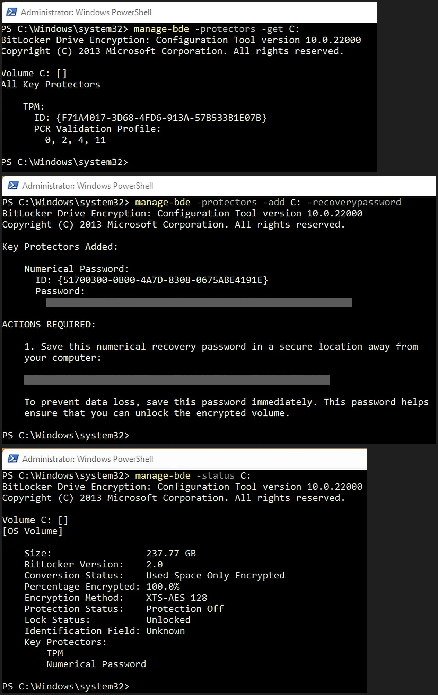
  </a>
  <figcaption>Step 0 receipts: inspect, create the key, verify suspension.</figcaption>
</figure>

<details markdown="1">
<summary><strong>▶ Why is BitLocker dangerous for dual boot?</strong></summary>

**The TPM Measurement Trap**  
BitLocker ties the decryption key to the TPM (Trusted Platform Module) chip. The TPM measures the boot chain. When you install Linux and add GRUB to the EFI partition, you change the boot chain. On the next boot, the TPM may detect this unauthorized change and lock the drive to protect the data.

By suspending BitLocker, you temporarily place a clear-text key in the volume metadata, allowing the system to boot through the new GRUB chain without tripping the TPM alarm.

**When the typical Microsoft backup routes fail**  
The standard GUI paths — Control Panel → BitLocker → "Back up your recovery key", Settings → Device encryption — only work if a recovery key was escrowed when BitLocker was provisioned. On many machines, BitLocker was enabled TPM-only. There is no key in your Microsoft account, no key in the GUI, and nothing to print. The CLI chain above is authoritative because it queries the volume directly.

**Windows 11 Home Note (Device Encryption)**  
If you are on Windows 11 Home, you likely have "Device Encryption". **Warning:** Clicking "Turn off" in the Settings GUI initiates a *full decryption process* that can take hours. It does not temporarily suspend the TPM. Use the PowerShell `manage-bde` commands above for instant suspension.

**Re-enabling after install:** covered in **Step 9**, after dual-boot verification. Do not re-enable before then.

</details>

---

## Step 1: Disable Fast Startup (~3 minutes)

1. Press **Win + R** → type `control` → Enter
2. Go to **Power Options** → **Choose what the power buttons do**
3. Click **Change settings that are currently unavailable**
4. Uncheck **Turn on fast startup (recommended)**
5. Click **Save changes**
6. *(Optional but Recommended)* Open **PowerShell as Administrator** and run:
   ```cmd
   powercfg -h off
   ```
   *(This fully disables hibernation and deletes hiberfil.sys, ensuring a clean shutdown)*


 <figure>
  <a href="/images/s1-faststartup.webp" target="_blank">
    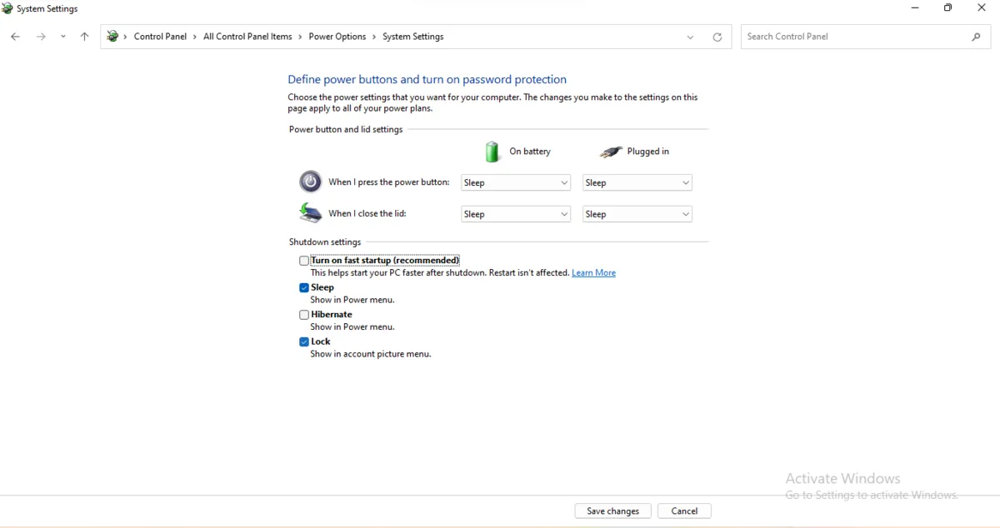
  </a>
  <figcaption>The one box that matters: fast startup off. Sleep and lock stay on — you are not disabling power management, only the hybrid shutdown that freezes NTFS.</figcaption>
</figure>


<details markdown="1">
<summary><strong>▶ Why does Fast Startup break dual boot?</strong></summary>

Fast Startup is a hybrid shutdown feature. Instead of fully shutting down, Windows writes the kernel session to a file called **hiberfil.sys** and hibernates. This leaves the NTFS partition in a semi-locked state.

When Linux tries to access that partition during dual boot, it can cause file system conflicts, write errors, and strange boot behavior.

**The fix is simple:** disable Fast Startup so Windows performs a true, complete shutdown every time.

</details>

---

## Step 2: Shrink the Windows Partition (~15-30 minutes)

**This is where most dual-boot attempts fail.** If Windows only lets you shrink a tiny amount, see the collapsible section below.

1. Right-click **Start** → **Disk Management**
2. Right-click **C:** → **Shrink Volume**
3. Wait for Windows to calculate available space
4. Enter the amount to shrink in MB (1GB ≈ 1024 MB)
*(Windows Disk Management labels these values "MB," but they behave like MiB: 1 GiB = 1024 MiB. Use the formula: `intended Linux space in GiB × 1024 = MB to enter`. Example: 90 GiB = 92160 MB. Do not enter more than the "Size of available shrink space in MB" value shown above it.)*
5. Click **Shrink**
6. Verify the **Unallocated** space appears

<figure>
  <a href="/images/s2-diskmgmt-compare.webp" target="_blank">
    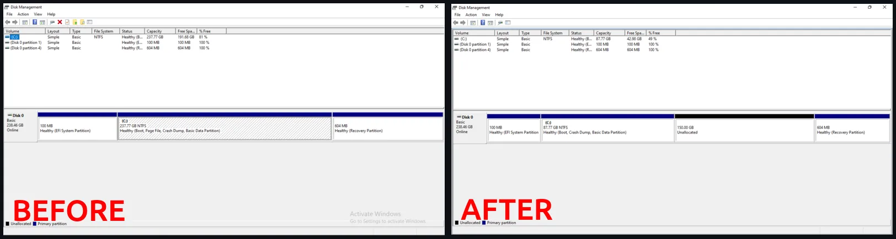
  </a>
  <figcaption>The shrink on real hardware: C: drops to 87.77 GB and the 150 GB unallocated window appears exactly where the installer lays Linux. Black fill is Windows' own "Unallocated" legend; the red labels are added for orientation.</figcaption>
</figure>

**Recommended partition split for a 256GB SSD:**

| Partition | Size | Purpose |
|---|---|---|
| **Windows 11 (C:)** | ~80-120GB | Windows system and apps |
| **Unallocated** | ~90-150GB | Reserved for Linux Mint |
| **EFI / Recovery** | Remaining | System partitions (do not touch) |

```text
DRIVE LAYOUT VISUALIZED:
BEFORE: [EFI][MSR][Windows C: ████████████][Recovery]
AFTER:  [EFI][MSR][Windows C: ██████][Unallocated █████][Recovery]
```

<details markdown="1">
<summary><strong>⚠️ Problem: Windows only lets you shrink a tiny amount?</strong></summary>

**Why this happens:**  
Windows has **unmovable system files** (pagefile.sys, hiberfil.sys, System Restore points) pinned to the end of the partition. Disk Management cannot shrink past them.

**How to fix it:**

**A. Disable the pagefile temporarily:**
1. Press `Win + R` → type `sysdm.cpl` → Enter
2. Go to **Advanced** tab → **Performance** Settings
3. Go to **Advanced** tab → **Virtual Memory** Change
4. Uncheck "Automatically manage paging file size"
5. Select **No paging file** → click **Set** → OK
6. Restart when prompted

**B. Disable hibernation:**
1. Open **PowerShell as Administrator**
2. Run:
   ```powershell
   powercfg -h off
   ```

**C. Disable System Protection:**
1. Press `Win + R` → type `sysdm.cpl` → Enter
2. Go to **System Protection** tab → Select C: → click **Configure**
3. Select **Disable system protection**
4. Click **Apply** to commit the change while keeping the dialog open.
5. Click **Delete** to remove existing restore points. *(Warning: This removes an existing Windows recovery option. Ensure you have backups).*
6. Click **OK** to close the dialog.

**D. Restart the computer and try shrinking again.** The available shrink space should increase significantly.

**E. After shrinking, RE-ENABLE only these settings:**
1. **Pagefile:** Check "Automatically manage paging file size".
2. **System Protection:** Turn on system protection.

<figure>
  <a href="/images/s2-unmovable-collage.webp" target="_blank">
    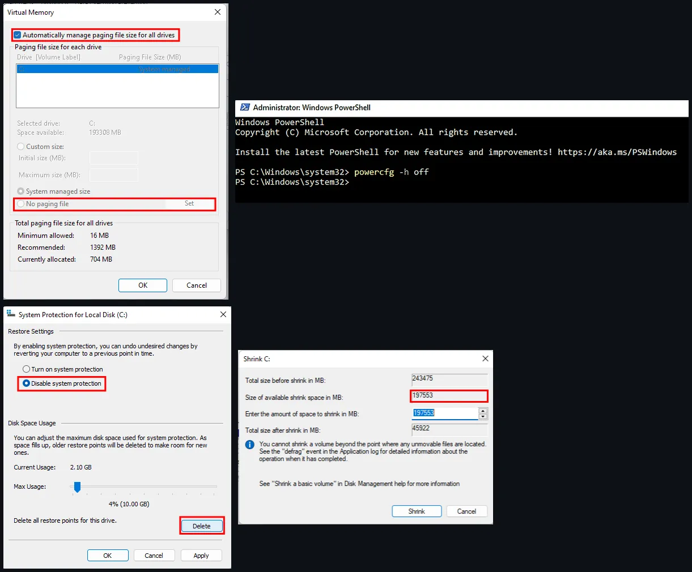
  </a>
  <figcaption>The unmovable-file cleanup, in order: release the pagefile, disable hibernation, disable System Protection and delete restore points, then return to Shrink Volume with a larger available-shrink number. Red boxes mark the controls to change.</figcaption>
</figure>

</details>

---

## Step 3: Download the Linux Mint ISO (~15-60 minutes)

1. Go to the [official Linux Mint download page](https://linuxmint.com/download.php)
2. Select your Edition (**XFCE**, **Cinnamon**, or **MATE**)
3. Choose a download method: **Direct mirror** or **Torrent**
4. Wait for the download to complete (~2.5GB to 2.8GB)
5. **Verify the ISO Checksum:**
   * **Quick Method:** Open Command Prompt, paste this exact line (adjust the path), and press Enter:
     ```cmd
     certutil -hashfile "C:\Users\YourName\Downloads\linuxmint-22.3-xfce-64bit.iso" SHA256
     ```
   * Compare the output hash with the official checksum on [linuxmint.com/verify.php](https://linuxmint.com/verify.php).

<details markdown="1">
<summary><strong>▶ When and why to use torrent instead of mirrors, including qBittorrent setup</strong></summary>

**What is a mirror?**  
A mirror is a server in a specific country that hosts a copy of the Linux Mint ISO. Mirror availability depends on local infrastructure. During our installation in Nigeria, the closest African mirrors were unreliable.

**Why use a torrent?**  
A torrent downloads the file in small pieces from multiple peers simultaneously. This is more resilient on unstable connections because the download can pause and resume without losing progress. The `.torrent` file (a tiny ~28KB metadata file) is universal; it will automatically fetch the specific edition (Cinnamon, MATE, or XFCE) you selected on the download page.

**How to set up qBittorrent (Standard Flow):**

1. Download qBittorrent from the [official site](https://www.qbittorrent.org/) ONLY. *(Fake installers carrying malware are common on third-party sites).*

    <figure>
      <a href="/images/s3-qb-acq-collage.webp" target="_blank">
        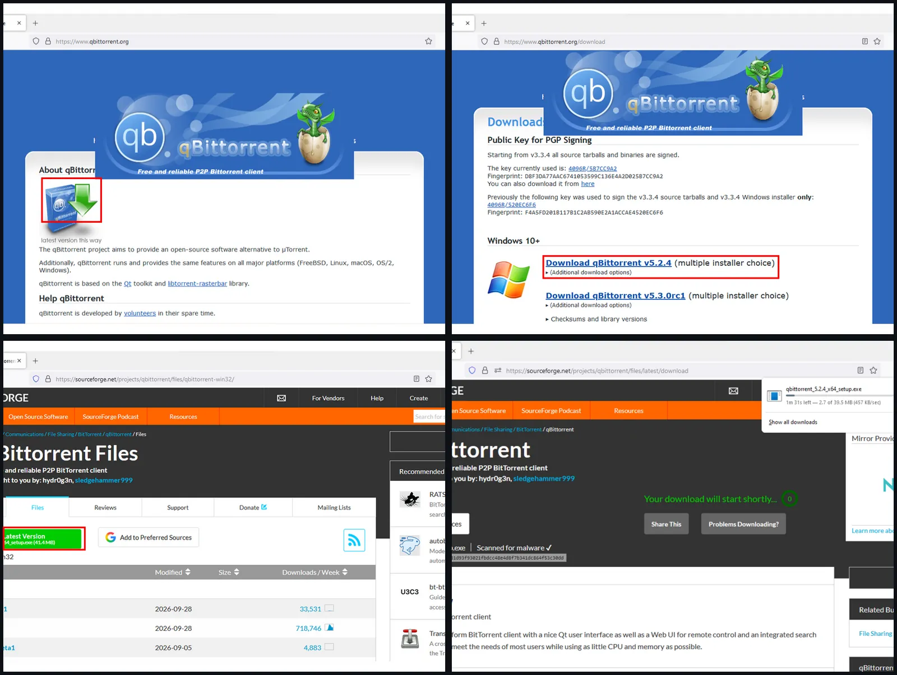
      </a>
      <figcaption>The colored boxes are the route: official homepage arrow, then the stable v5.2.4 link — the release candidate below it deliberately unmarked — then SourceForge's Latest Version, then the malware-scanned setup.exe. This is what "official source only" looks like click by click, with the decoy rc build visibly declined.</figcaption>
    </figure>

2. Install and open qBittorrent. Approve administrator access *only* for the installer if Windows requests it, and click through any post-installation wizards using default settings.

    <figure>
      <a href="/images/s3-qb-install-collage.webp" target="_blank">
        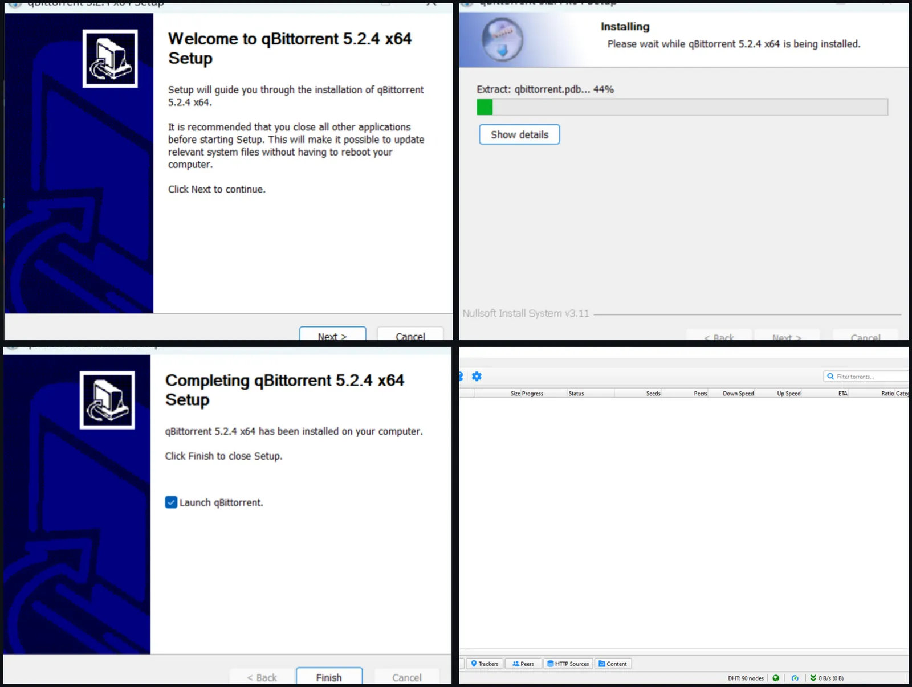
      </a>
      <figcaption>Next, Next, Finish — the wizard adds nothing you didn't ask for. The last panel is the prize: a clean, empty client with a live DHT count, ready for the .torrent you are about to feed it.</figcaption>
    </figure>

3. Download the Linux Mint `.torrent` file from the Mint download page.

    <figure>
      <a href="/images/s3-mint-torrent.webp" target="_blank">
        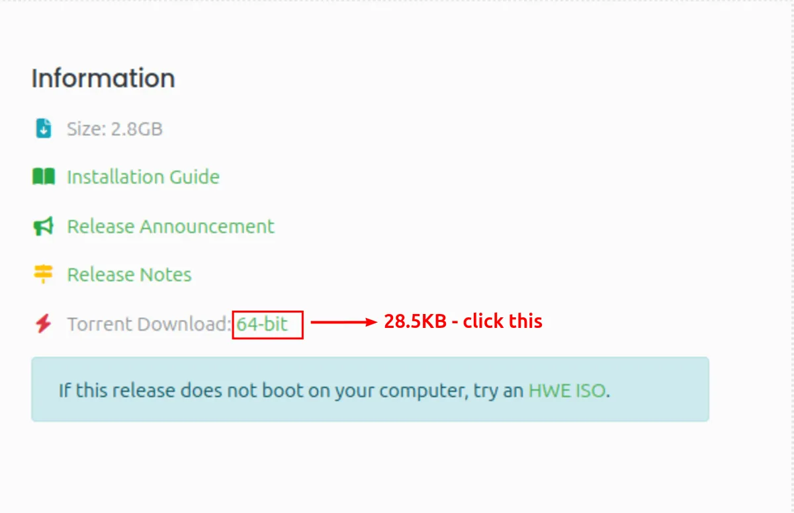
      </a>
      <figcaption>The torrent is the 28.5 KB line, not the 2.8 GB one. The red box marks the metadata file you actually pull into qBittorrent; the 2.8 GB figure above it is the ISO itself, which the torrent then fetches.</figcaption>
    </figure>

4. **Add the torrent to qBittorrent:** Open the qBittorrent app. Click the **"+" (Add Torrent File) icon** on the top toolbar (or go to **File > Add Torrent File**). Browse to your Downloads folder, select the `.torrent` file, and click **Open**.
5. A "New Torrent" dialogue menu will appear. Leave it on default settings and click **OK**. The download starts.

    <figure>
      <a href="/images/s3-dialog.webp" target="_blank">
        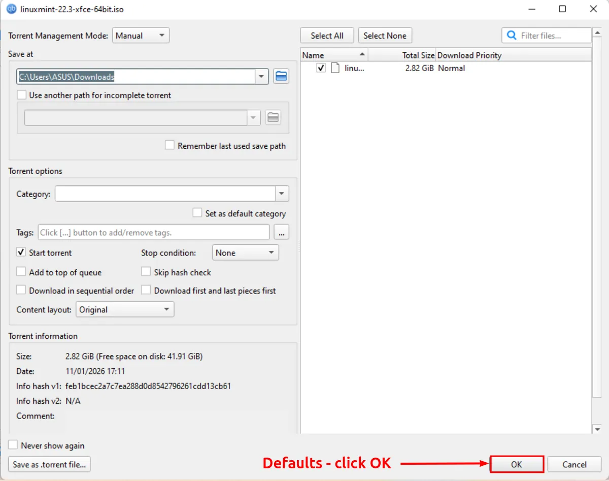
      </a>
      <figcaption>Leave it alone and click OK. The red mark is the whole instruction: default settings, no tweaking, Start torrent already ticked so the pull begins the moment you confirm.</figcaption>
    </figure>

6. *(Note on Seeding: After reaching 100%, you are uploading (seeding) to others. On metered or capped data, right-click the file → Pause. On unmetered connections, leaving it seeding for a while keeps the torrent alive for the next person in your region).*

    <figure>
      <a href="/images/s3-progress.webp" target="_blank">
        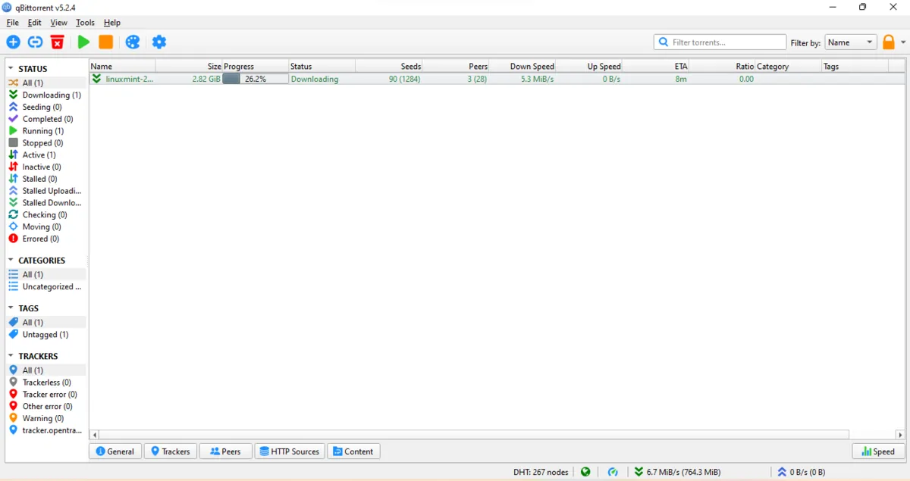
      </a>
      <figcaption>A healthy pull on a flaky link: 90 seeds feeding 3 peers, speed holding in the MiB/s range, ETA under ten minutes. This is the resilience the torrent method buys you when a mirror stalls.</figcaption>
    </figure>


    <figure>
      <a href="/images/s3-complete.webp" target="_blank">
        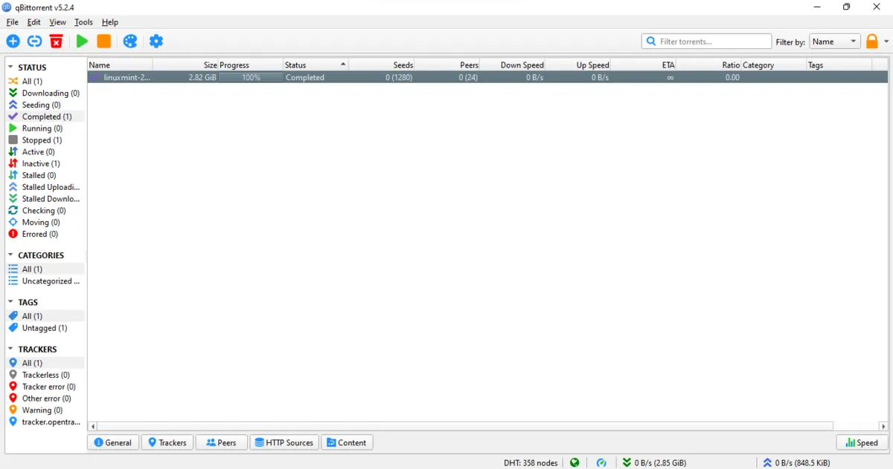
      </a>
      <figcaption>The finish line, paused: 100% and stopped rather than seeding — the state the step-6 note describes for metered or capped connections. The bottom counters (2.85 GiB down, 848 KiB up) are the proof the pull was real.</figcaption>
    </figure>


**Fallback for Unstable/Restricted Connections:**

If the download is stalling or painfully slow:

1. **Add trackers:** Go to [newtrackon.com/lists](https://newtrackon.com/lists) and click the green copy icon to copy all trackers. In qBittorrent, highlight the downloading Mint file and right-click it → **Edit trackers**. A dialogue box appears with a single default tracker ending in `...announce`. Move your cursor to the very end of that text and press **ENTER** to create a blank line, then paste the new trackers. *(Without this line spacing, qBittorrent may parse the pasted trackers as a single entry).*
2. **Adjust connection limits:** Click the **Option icon (⚙️)** in the top left bar → click **Connection**. Change the values from default to the recommended values:
   * **Global Maximum Number of connections:** 200-300
   * **Maximum Number of connection per Torrent:** 50-80
   * **Global Maximum Number of Uploaded slots:** 4  
   *(DHT and PeX are enabled by default. No action needed there).*

<figure>
  <a href="/images/s3-connection-tab.webp" target="_blank">
    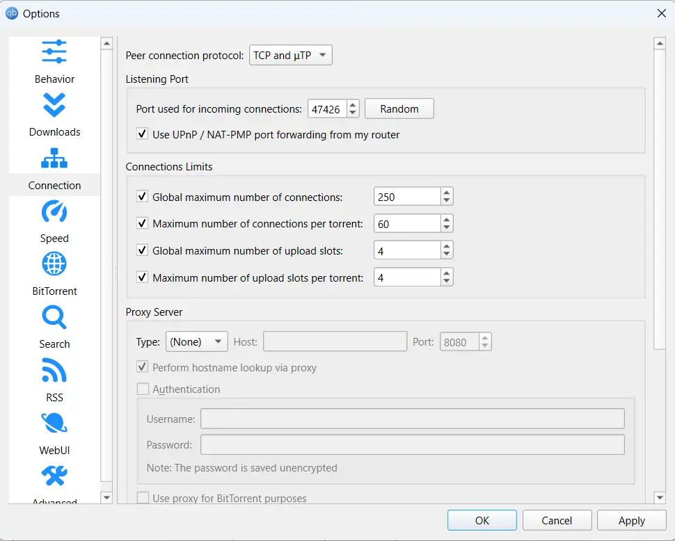
  </a>
  <figcaption>The tuned tab: 250 / 60 / 4, all four boxes ticked. The greyed-out Apply is the receipt — these are committed values, not typed-and-abandoned.</figcaption>
</figure>

**Verify File Integrity (Step-by-step for Beginners):**

Windows has a built-in tool to verify the ISO without needing third-party software.

1. Open the **Command Prompt** (Press `Win + R`, type `cmd`, and press Enter).
2. Type `certutil -hashfile ` *(⚠️ Make sure to leave exactly one space after the word hashfile)*.
3. **Get the file path into the Command Prompt:**
   * *If you have a mouse:* Click and **drag the downloaded Linux Mint ISO file** directly into the black Command Prompt window and let go. Windows will paste the path automatically.
   * *If you are using a trackpad (or drag-and-drop fails):* Right-click the downloaded ISO file in your folder and select **"Copy as path"**. Then, **right-click** anywhere inside the black Command Prompt window to paste the path.
4. Type a space, then `SHA256`. Your full command should look something like this (using our running example): `certutil -hashfile "C:\Users\Name\Downloads\linuxmint-22.3-xfce-64bit.iso" SHA256`
5. Press **ENTER**.
6. **Wait:** The prompt will appear to freeze for 1 to 5 minutes while it reads the file. This is normal. Do not close the window.
7. **Read the output:**
   ```text
   SHA256 hash of C:\Users\Name\Downloads\linuxmint-22.3-xfce-64bit.iso:
   a1b2c3d4e5f6...[long string of numbers and letters]...
   CertUtil: -hashfile command completed successfully.
   ```
   *(Cinnamon and MATE readers: your output will show your edition's filename here. That is expected — compare the hash string, not the filename label).*
8. **Compare:** Open the [official Linux Mint verification page](https://linuxmint.com/verify.php). Find the exact edition (Cinnamon, MATE, or XFCE) and version you downloaded. Compare the long string of characters in your Command Prompt with the one on the website.
   * **If they match exactly:** Your download is perfect.
   * **If even a single character is different:** The download is corrupted. Delete it and download again.

<figure>
  <a href="/images/s3-verify-compare.webp" target="_blank">
    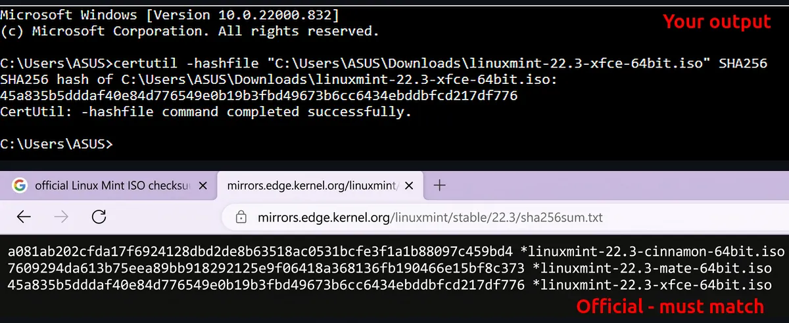
  </a>
  <figcaption>The match that matters is the third line — xfce-64bit.iso. Your certutil output and that official string are character‑for‑character identical, which is the only acceptable result. Cinnamon and MATE readers: your edition is a different line in the same file, and the same equality rule applies to it.</figcaption>
</figure>


</details>

---

## Step 4: Create Boot Media with Ventoy (~10-15 minutes)

1. Download [Ventoy](https://www.ventoy.net/) from the official site.
2. Insert your USB drive or SD card in a dedicated reader (8GB+). Ensure it is formatted and empty.
3. Run **Ventoy2Disk.exe** (Allow Admin rights).
4. Select your USB device from the dropdown.
5. Set the Partition style to GPT.
6. Click **Install** → Accept formatting warnings.
7. Copy the Linux Mint ISO file (~2.5GB to 2.8GB) into the Ventoy drive.
8. **Verify the file integrity** on the USB drive using `certutil` (same as Step 3).

<details markdown="1">
<summary><strong>▶ Full Ventoy walkthrough for beginners (Critical Step)</strong></summary>

**Why Ventoy?**  
Unlike Rufus or Etcher, Ventoy prepares the drive once. After that you simply copy ISO files onto it like normal files. You can keep multiple ISOs on the same stick.

### 1. Download Ventoy

1. Go to the [official Ventoy website](https://www.ventoy.net/).
2. Download the latest Windows release (the `.zip` file).
3. Extract the Zip folder to your Downloads folder.

### 2. Prepare the USB drive

1. Back up anything important that is currently on the USB drive. Ventoy will **erase the entire drive**.
2. Insert the USB drive (or SD card in a dedicated reader) into your computer.
3. *(Note: After previous formatting, Windows File Explorer sometimes does not show the drive immediately. This is normal. Do not panic.)*

### 3. Launch Ventoy2Disk

1. Go to your Downloads folder and locate the Ventoy `.zip` file you just downloaded.
2. Right-click it → **Extract All** (or extract with 7-Zip / WinRAR).
3. Open the extracted folder.
4. Find and double-click **Ventoy2Disk.exe**.
5. When Windows asks for permission, click **Yes** (run as administrator).

### 4. Set the partition style to GPT

1. In the Ventoy2Disk window, click **Option** in the top menu bar.
2. Go to **Partition Style** → select **GPT**.
3. The interface will switch from MBR to GPT.

**Why GPT?**  
Your laptop is running 64-bit Windows 11 in UEFI mode. GPT is the correct partition style for native UEFI boot. Using MBR could force the system into Compatibility Support Module (CSM/Legacy) mode, which is unnecessary and can cause problems later.

### 5. Install Ventoy on the USB drive

1. In the device dropdown, carefully select your USB drive.  
   Double-check the drive letter and size so you do not accidentally select your internal hard drive.
2. Click **Install**.
3. Accept both warning dialogs that appear. Ventoy will format the drive and install its bootloader.
4. When the process finishes, Windows File Explorer should show a new drive named **Ventoy**.

At this point the USB drive is ready. It will contain a small Ventoy system partition (usually hidden) and a large open partition where you will place ISO files.

<figure>
  <a href="/images/s4-ventoy-compare.webp" target="_blank">
    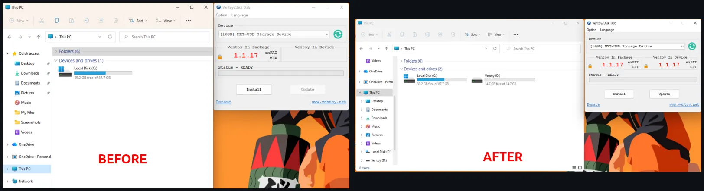
  </a>
  <figcaption>The install, measured by what Windows sees: before, the stick is not a usable volume and the explorer counts one drive; after, Ventoy writes its layout and a second volume, Ventoy (D:), appears. The green ready state is the installer confirming it, but the drive count is the receipt you check on your own screen.</figcaption>
</figure>


### 6. Copy the Linux Mint ISO

1. Go to your Downloads folder.
2. Locate the Linux Mint ISO.  
   **Important:** It must be the large file (~2.5–2.8 GB). Do **not** copy the tiny `.torrent` file (~28 KB).
3. Copy the ISO file.
4. Open the **Ventoy** drive in File Explorer and paste the ISO there.
5. Wait for the transfer to finish.  
   Expected speed on a normal USB 2.0/3.0 connection: roughly 7–10 MB/s → about 5–7 minutes for a 2.8 GB file.
6. Confirm the ISO is visible inside the Ventoy drive.

### 7. Verify the ISO on the Ventoy drive

Copying can introduce corruption. Always verify the file that is actually sitting on the boot media.

1. Open **Command Prompt** (`Win + R` → type `cmd` → Enter).
2. Type the following (leave a space after `hashfile`):
   ```cmd
   certutil -hashfile 
   ```
3. Drag the Linux Mint ISO **from the Ventoy drive** into the Command Prompt window (or right-click the file → Copy as path and paste it).
4. Type a space and then `SHA256`. The full command should look similar to:
   ```cmd
   certutil -hashfile "E:\linuxmint-22.3-xfce-64bit.iso" SHA256
   ```
5. Press **Enter**.
6. Wait 1–5 minutes while the hash is calculated. The window may appear frozen — this is normal.
7. Compare the resulting hash string with the official checksum on [linuxmint.com/verify.php](https://linuxmint.com/verify.php).

<figure>
  <a href="/images/s4-certutil-ventoy.webp" target="_blank">
    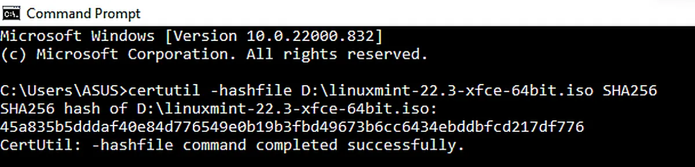
  </a>
  <figcaption>Re-hash the copy, not just the download. The path is D: — the same Ventoy volume that appeared in the figure above — so this proves the bytes survived the trip onto the stick. The string matches the official xfce hash character for character, and the success line is the closer.</figcaption>
</figure>


**If the hashes match exactly**, the file on the Ventoy drive is clean and ready for booting.  
**If even one character is different**, delete the ISO from the Ventoy drive and copy it again.

This verification step is one of the most important safeguards in the entire process. A corrupted ISO on the boot media is a common cause of later boot failures that look like hardware or BIOS problems.

</details>

---

## Step 5: Configure BIOS Settings (MOK Enrollment) (~5 minutes)

**Boot Menu Keys by Manufacturer:**

| Brand | Boot Menu | BIOS Setup |
|---|---|---|
| **HP** | F9 or Esc | F10 |
| **ASUS** | Esc or F8 | F2 |
| **Dell** | F12 | F2 |
| **Lenovo** | F12 or Fn+F12 | F1 or F2 |
| **Acer** | F12 | F2 |

**Primary Method: Enroll Ventoy Key (Keep Secure Boot ON)**

1. Insert the Ventoy boot device. Restart and press your **boot menu key**.
2. Select your USB device from the boot menu. It appears under the drive's own name, usually with a **UEFI:** prefix (e.g., `UEFI: SanDisk` or `UEFI: Kingston`). It will NOT say "Linux Mint" — the Ventoy menu loads after the device boots. If the same drive appears twice, choose the entry with the **UEFI** prefix.
3. If you see a **blue screen failure** (MOK Management), press **ENTER**.
4. Select **Enroll Key from Disk** → Select **VTOYEFI** → Select **ENROLL_THIS_KEY_IN_MOKMANAGER.cer**.
5. Select **Continue** → Select **Yes**.
6. If prompted for a password, **try leaving it blank and pressing Enter**. If rejected, try `ventoy`. *(If both fail, consult the official Ventoy Secure Boot documentation for your specific version).*
7. Select **Reboot**.

*(Note: Enrolling Ventoy's key adds it to your machine's trust store, allowing its bootloader to pass Secure Boot. Only use Ventoy from its official source).*

<details markdown="1">
<summary><strong>▶ Fallback Method: Disable Secure Boot</strong></summary>

If MOK Enrollment fails, disable Secure Boot as a last resort.

1. Restart and press your **BIOS key**.
2. Navigate to **Security** or **Boot** tab.
3. **Disable Secure Boot**.
4. Verify **UEFI mode** is still active. **(⚠️ Do NOT switch to Legacy/CSM)**.
5. Save and exit.

</details>

---

## Step 6: Boot into the Live Environment (~3-5 minutes)

1. At the Ventoy menu, select the Linux Mint ISO.
2. Choose **Boot in normal mode**.
3. At the GRUB menu, select **Start Linux Mint Xfce 22.3 64-bit** *(or your downloaded edition's name, e.g., Cinnamon)*.
4. Wait for the live desktop to load.

    <figure>
      <a href="/images/s6-live-collage.webp" target="_blank">
        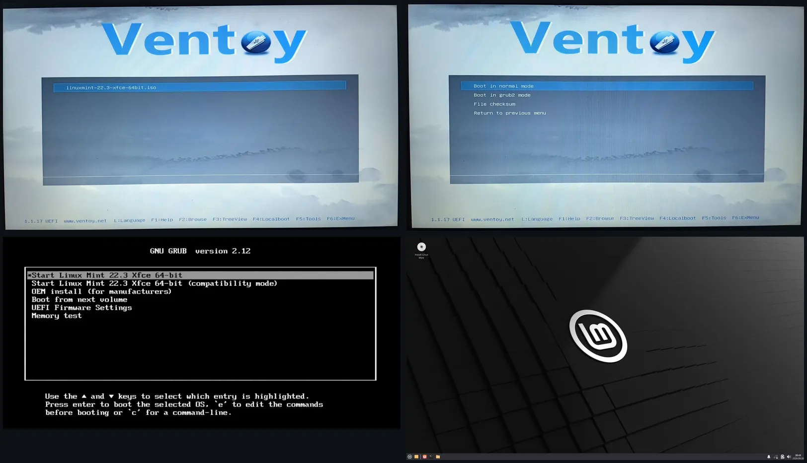
      </a>
      <figcaption>The path from stick to live session: Ventoy loads the ISO, normal boot mode is selected, GRUB launches Linux Mint 22.3 Xfce 64-bit, and the live desktop appears. This is the moment the machine is testing Mint without installing it yet.</figcaption>
    </figure>

5. Test WiFi, Sound, Keyboard, and Display.

---

## Step 7: Install Linux Mint (~15-30 minutes)

⚠️ **WARNING: Home Folder Encryption**  
Do **not** enable home-folder encryption on Intel Pentium, Celeron, or older dual-core CPUs, or on machines with 4 GB RAM or less. The cryptographic overhead will noticeably degrade performance on constrained hardware and is difficult to reverse without a fresh installation.

**Standard Installation Steps:**

1. Double-click the **Install Linux Mint** icon.
2. Select **Language** → **Keyboard Layout** → Continue.
3. Connect to WiFi → Check **Install multimedia codecs** → Continue.
4. If prompted about mounted partitions, click **Yes** to unmount.

    <figure>
      <a href="/images/s7-preinstall-collage.webp" target="_blank">
        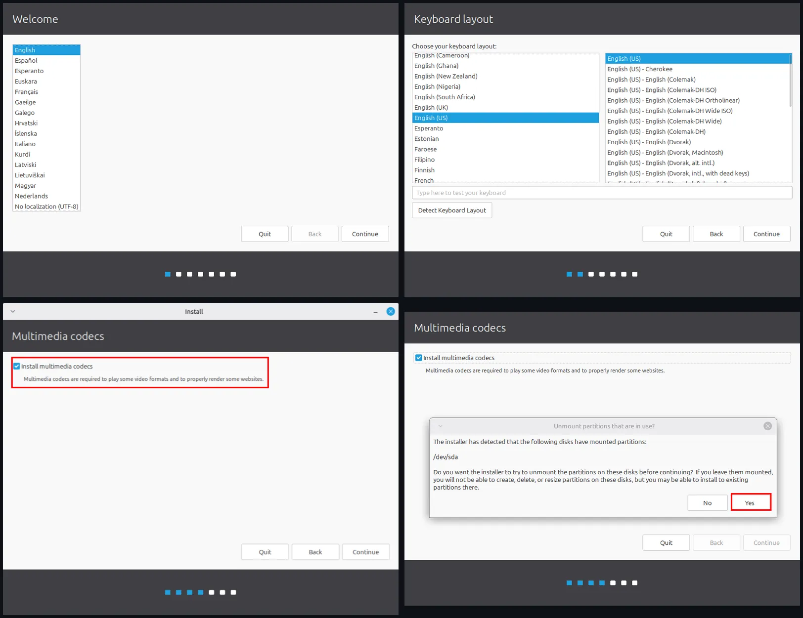
      </a>
      <figcaption>The four screens before the partitioning choice. Pick your language and keyboard as usual; the two red boxes are the only forced calls here — tick Install multimedia codecs so video and sites render, and when the installer asks to unmount the in-use /dev/sda, answer Yes so it can lay out the unallocated window you freed in Step 2.</figcaption>
    </figure>


   > **🛑 STOP AND VERIFY BEFORE PROCEEDING:**  
   > Select **Install Linux Mint alongside Windows Boot Manager** ONLY IF:  
   > * Windows Boot Manager is explicitly detected.  
   > * The proposed Linux space corresponds to the unallocated region you created in Step 2.  
   > * The Windows partition remains visible and is NOT marked for formatting.  
   >  
   > **DO NOT select "Erase disk and install Linux Mint".** That option removes Windows and all existing data. If "Install alongside" is missing, stop and back up your data.

    <figure>
      <a href="/images/s7-alongside.webp" target="_blank">
        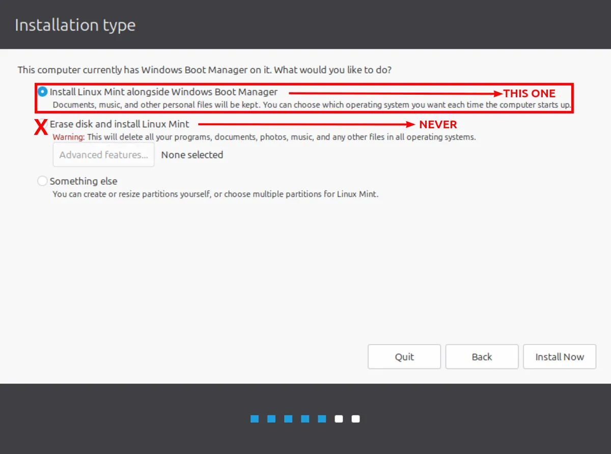
      </a>
      <figcaption>The header is the proof the installer found your Windows — without that line, the alongside option would not appear, so if your screen differs, stop and read before clicking. The red marks settle the choice: alongside is THIS ONE; Erase disk, which wipes every file on every OS, is NEVER. Leave Advanced features at None selected and continue.</figcaption>
    </figure>

5. Select **Install Linux Mint alongside Windows Boot Manager**.
6. Create your user account.

    <figure>
      <a href="/images/s7-account.webp" target="_blank">
        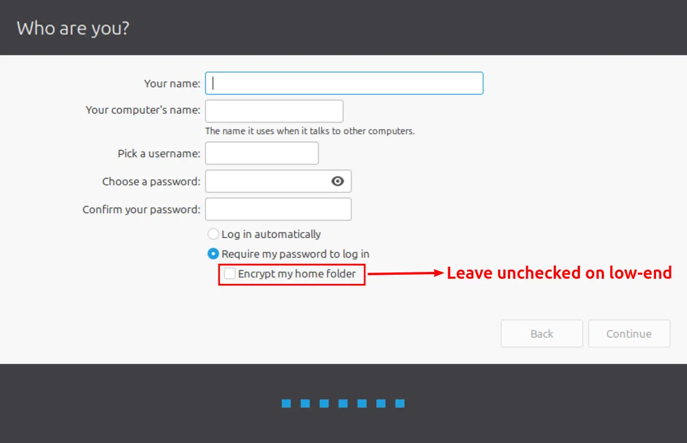
      </a>
      <figcaption>Fill the fields and leave Require my password to log in as the default. The one trap the red box flags: Encrypt my home folder. It looks like free security, but on low-end hardware the home-directory encryption tax is real CPU and RAM on every file access — leave it unchecked, exactly as the mark says.</figcaption>
    </figure>

7. Click **Install Now** and confirm.
8. Wait for the installation to complete.
9.  When prompted, **remove the boot media** and press **Enter**.

**Important:** The installer should reuse the existing Windows EFI System Partition. If it offers to create a *new* EFI partition, stop. Creating a second EFI partition is a common source of later GRUB / Windows boot problems.

*Swap: The automated installer creates a swapfile by default. Manual setup is only needed if you chose 'Something Else' or are recovering from an interrupted installation (see Step 8).*

---

## Step 8: Verify the Dual Boot & Configure Swap (~3 minutes)

1. Restart the laptop.
2. The **GRUB menu** should appear automatically.

    <figure>
      <a href="/images/s8-grub.webp" target="_blank">
        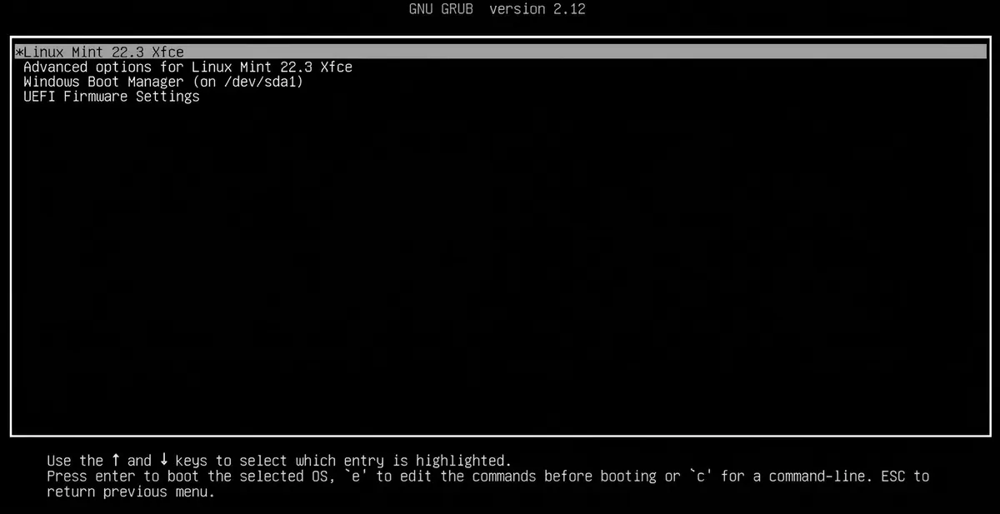
      </a>
      <figcaption>The menu the finished install hands you at power-on: Linux Mint and Windows Boot Manager both listed, Mint as the default. Arrow down and Enter reaches Windows; the /dev/sda1 tag names the EFI partition Windows was installed to. Both operating systems, one switch, no USB stick required anymore.</figcaption>
    </figure>

3. Select **Linux Mint** → verify it boots to the desktop.

    <figure>
      <a href="/images/s8-welcome.webp" target="_blank">
        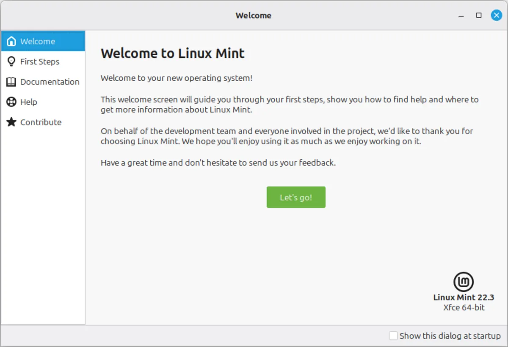
      </a>
      <figcaption>The first thing the new system shows after the reboot: a welcome screen, version-locked to 22.3 Xfce 64-bit, with the startup nag left off. Let's go! opens the guided first-run. Nothing here is required — it is the machine saying it is alive and yours.</figcaption>
    </figure>

4. Restart → select **Windows Boot Manager** → verify Windows boots.

**Verify Swap Configuration:**  
Once booted into your new Linux desktop, open a terminal and run:
```bash
swapon --show
free -h
```
If no swap is listed, create it manually:
```bash
sudo fallocate -l 4G /swapfile
sudo chmod 600 /swapfile
sudo mkswap /swapfile
sudo swapon /swapfile
grep -q '/swapfile' /etc/fstab && echo "Already present" || echo '/swapfile none swap sw 0 0' | sudo tee -a /etc/fstab
```

<details markdown="1">
<summary><strong>▶ Post-installation checklist</strong></summary>

| Task | How |
|---|---|
| **Run updates** | Open Update Manager in Linux Mint and install available updates |
| **Check disk layout** | Open Disks or run `lsblk` in the terminal |
| **Test reboot** | Restart a few times to confirm GRUB appears consistently |
| **Run neofetch** | Open a terminal and type `neofetch` (or `fastfetch`) to see your system specs |


<figure>
  <a href="/images/s8-updates.webp" target="_blank">
    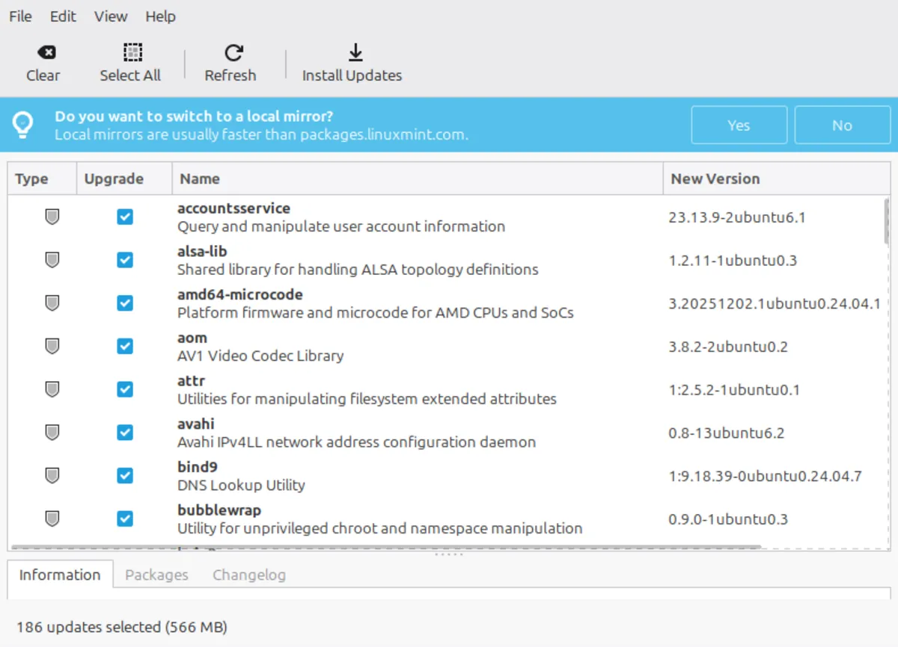
  </a>
  <figcaption>The Run updates row, executed: 186 updates, 566 MB, queued and selected. The mirror prompt at the top is the same latency lever the download step relied on — a local mirror is what keeps a flaky link from stalling the update run.</figcaption>
</figure>


<figure>
  <a href="/images/s8-neofetch.webp" target="_blank">
    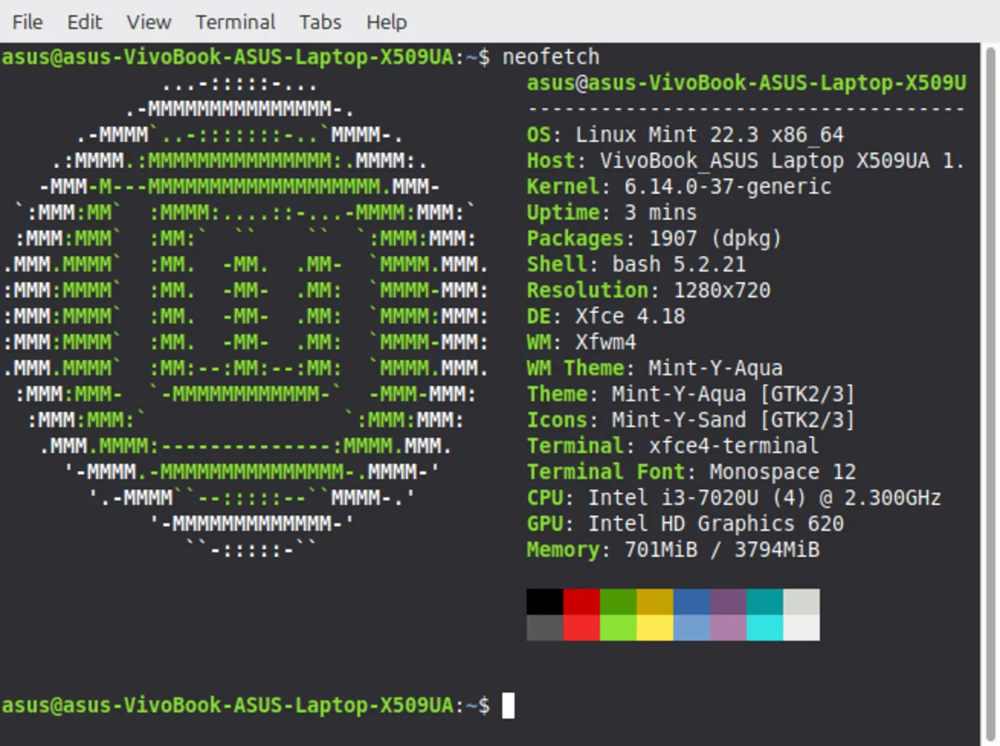
  </a>
  <figcaption>The Run neofetch row, executed: the starting XI's own receipt — three minutes into its first Mint session, the ASUS that ran every step of this guide idles at 701 MiB on 4 GB. The weaker box's numbers live in the narrative series; this frame is the demo machine testifying for itself.</figcaption>
</figure>


One more validation, from the bench: this same guide was also run end-to-end on the HP 15-bs0xx — the Pentium box that barely runs Windows and stars in the four-part narrative series. Its finish line:


<figure>
  <a href="/images/author-workspace.webp" target="_blank">
    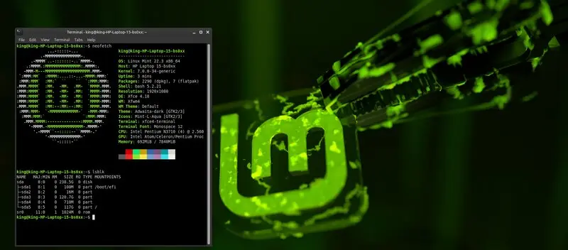
  </a>
  <figcaption>The substitute's call-up: the weaker HP, dual-booted by this same guide, Windows partitions untouched. Its full story and its own benchmarks live in the narrative series; here it only testifies that the guide generalizes past the demo box.</figcaption>
</figure>


</details>

---

## Step 9: Re-enable BitLocker (Optional, ~2 minutes)

You suspended BitLocker with `-RebootCount 0` in Step 0. Protection stays off until you turn it back on manually. Do this only after you have booted into Windows through GRUB at least once and confirmed both systems work.

1. Boot into **Windows** through the GRUB menu.
2. Open **PowerShell as Administrator**.
3. Resume protection:
   ```powershell
   manage-bde -protectors -enable C:
   ```
4. Verify:
   ```powershell
   manage-bde -status C:
   ```
   *(Protection Status should say "On").*

⚠️ **CRITICAL WARNING:** The first time you reboot into Windows after re-enabling BitLocker, the TPM may measure the GRUB bootloader and trigger the recovery screen. Have your 48-digit recovery key ready to type in manually. Once entered, subsequent boots should be seamless. If you never had BitLocker enabled, skip this step.

---

## Performance Comparison

These measurements were taken at the 3-minute mark after a fresh boot with no applications open, on the ASUS test machine. The HP from the narrative series is benchmarked separately, in the series.

| Metric | Windows 11 | Linux Mint XFCE |
|---|---|---|
| **Idle RAM** | 2.1 / 3.9GB | 923.3MiB / 3.7GiB |
| **Boot Time (average)** | ~28.6s | ~25.6s |

> **A note on measurement conditions:** Boot times were measured with a stopwatch across three runs per OS. OS memory accounting differs, but based on the displayed idle usage, Linux showed roughly 1GB more physical-memory headroom under these test conditions.

On constrained hardware, that extra gigabyte prevents aggressive background swapping. Linux Mint (XFCE baseline) consumes roughly half the idle RAM of Windows 11. Cinnamon and MATE will use slightly more RAM at idle, but the installation workflow and the performance benefits over Windows remain identical.


<figure>
  <a href="/images/perf-win.webp" target="_blank">
    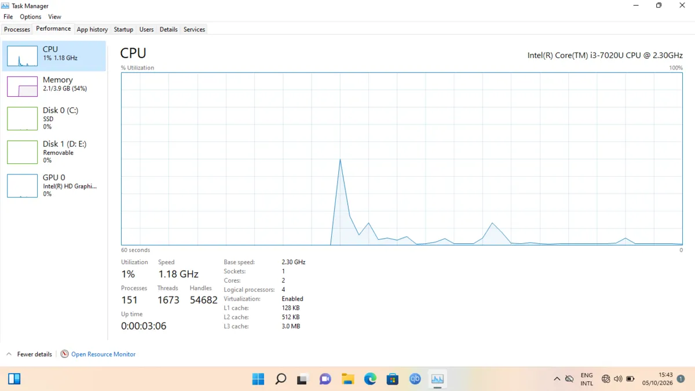
  </a>
  <figcaption>The demo machine at rest under Windows 11: three minutes in, over half of its usable RAM is already spoken for — 54% — with the CPU idling at 1%. This is the baseline the next figure is measured against: same box, same idle mark, nothing else running.</figcaption>
</figure>


<figure>
  <a href="/images/perf-mint.webp" target="_blank">
    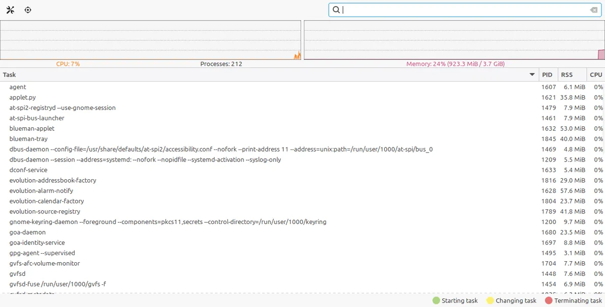
  </a>
  <figcaption>Same machine, same three-minute mark, Mint XFCE: 923 MiB of 3.7 GiB — 24%, less than half of Windows' 54%. And note the process count, 212 against 151: more daemons, far less weight. Process count is not memory footprint; the RSS column is where you check each service's share for yourself.</figcaption>
</figure>


<figure>
  <a href="/images/perf-systemd.webp" target="_blank">
    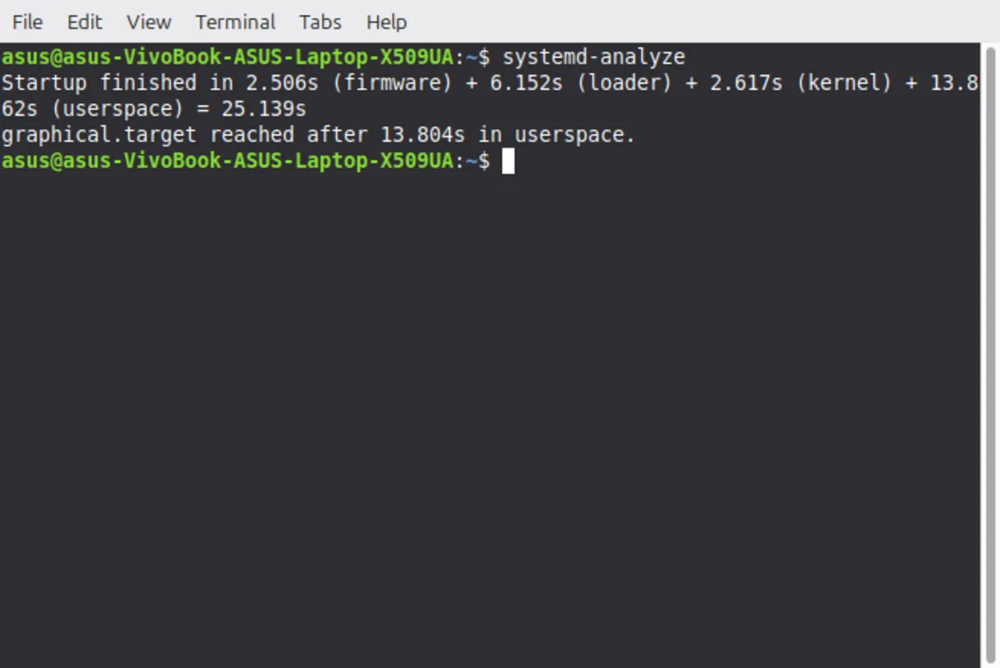
  </a>
  <figcaption>One representative boot, itemized: firmware 2.5s, loader 6.2s, kernel 2.6s, userspace 13.9s — 25.1s to a graphical session. The table's ~25.6s is the three-run stopwatch average; this frame is the single run that shows where those seconds actually live, reproducible by any reader with one command.</figcaption>
</figure>

---

## Troubleshooting Quick Reference

| Problem | Likely Cause | Fix |
|---|---|---|
| Boot device absent from boot menu | Port/reader incompatibility, firmware USB boot disabled | Try another USB port, use a dedicated reader, enable USB boot in BIOS |
| Device visible but boot rejected | Secure Boot verification, incompatible boot mode | Follow MOK enrollment (Step 5) or Disable Secure Boot |
| Frozen logo during boot | Graphics incompatibility | Try compatibility mode from GRUB |
| Windows partition locked | Fast Startup still enabled | Disable Fast Startup in Power Options |
| BitLocker recovery screen | TPM detected hardware change | Enter your backed-up 48-digit recovery key |
| Tiny shrink space | Unmovable system files | Disable pagefile, hibernation, and System Protection (Step 2) |
| ISO boot fails | Corrupted download | Re-verify SHA256 checksum and re-download |
| GRUB missing after install | Boot order reset or Windows Update | In UEFI firmware, move the `ubuntu` or `Linux Mint` EFI entry above Windows Boot Manager. Do not switch to Legacy/CSM. |
| Laptop boots to live environment | Boot media not removed | Shut down, remove USB/SD, restart |
| ext4 creation or mkfs fails with I/O error | Drive fault or geometry conflict | Stop; back up; see [Incident Report](#incident-report-asus-io) |

---

## Incident Report: Installation Failure and I/O Recovery on the ASUS VivoBook {#incident-report-asus-io}

> **⚠️ NOTE FOR BEGINNERS:** This section documents an edge-case recovery from one specific machine. If your installation completes without errors, you don't need to read this. Bookmark it in case you face similar issues later.

**This section is not a standard procedure. This is an incident report from the ASUS test machine.**

This is a field report from one machine, not a diagnosis of Ubiquity, parted, ext4, or SSDs in general. Everything below is what I observed, what I ran, and what changed as a result. Where I inferred, I say so. Where I don't know, I say that too.

### What Happened

1. **Initial Setup:** I shrunk Windows to 87.8 GiB, leaving an unallocated window of ~150 GiB (sectors 184,303,616–498,878,463) for Linux Mint.
2. **Automated Failure:** Selecting "Install alongside Windows Boot Manager" halted the installer at the filesystem-creation step. The exact dialog: *"Failed to create a file system — The ext4 file system creation in partition #5 of SCSI1 (0,0,0) (sda) failed."*

    <figure>
      <a href="/images/ir-trigger.webp" target="_blank">
        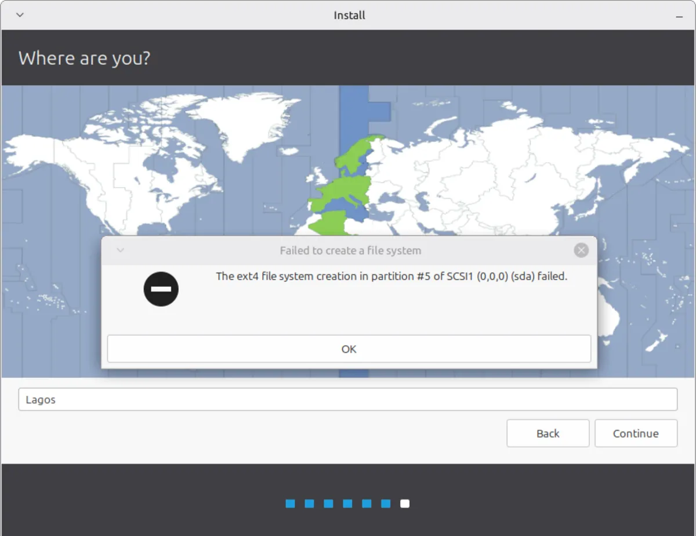
      </a>
      <figcaption>The trigger, verbatim: ext4 creation failed on partition #5, mid-install, over the timezone screen. Everything in this report starts at this dialog.</figcaption>
    </figure>


3. **The Table the Installer Left:** In GParted (live session), `/dev/sda5` existed at its full 150.00 GiB with filesystem type "unknown" and a warning flag. **No truncation existed at this stage.** Every truncated geometry in this report was created later, by me, during recovery.
4. **Manual ext4 Creation Attempts:** I attempted filesystem creation by hand from the live session. Four attempts died at the identical final line — `Writing superblocks and filesystem accounting information: mkfs.ext4: Input/output error while writing out and closing file system` — across three different geometries, with and without discard. One attempt completed clean.

| # | Command | Span | Flags | Outcome |
|---|---|---|---|---|
| 1 | Ubiquity (automated) | ~150 GiB window | installer defaults | Failed at ext4 creation (dialog above) |
| 2 | `mkfs.ext4 -F` | 94GB→100% (150 GiB) | default | `Discarding device blocks: failed - Input/output error`, then died at final superblock write-out |
| 3 | `mkfs.ext4 -F -E nodiscard` | same | nodiscard | Died at the identical final line |
| 4 | `mkfs.ext4 -F -E nodiscard` | 94GB→248GB (143 GiB) | nodiscard | Died at the identical final line |
| 5 | `mkfs.ext4 -F -O ^has_journal -E nodiscard` | 100GB→200GB (93.1 GiB) | nodiscard, journal-less | Completed without error (24,414,208 blocks) |

**Observed pattern, stated as observation only:** every failed creation spanned beyond the 200 GB decimal mark; the single clean creation did not. The clean creation was also the only journal-less one, so end-offset and journal presence are confounded in the data. I did not separate those variables, and I am not claiming to.


<figure>
  <a href="/images/ir-mkfs-collage.webp" target="_blank">
    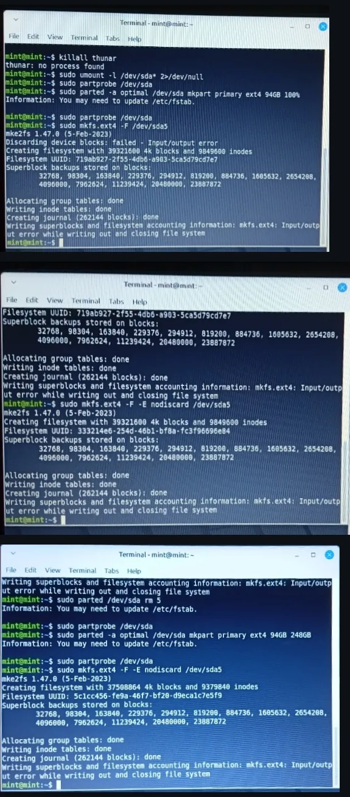
  </a>
  <figcaption>The three identical deaths, table rows 2 through 4 on screen: different spans, different flags, three distinct UUIDs — and every one of them dying at the same final superblock write. The first panel even shows the discard failure that preceded them. Same last line, three times, is not a coincidence; it is a pattern.</figcaption>
</figure>


### The Geometry Phase I Caused

**This part was my error, and the report says so plainly.**

While attempting to resize partitions, I ran `parted /dev/sda resizepart 5 100GB` and later `resizepart 5 95GiB`, believing the argument was a size. **`parted resizepart` takes the partition's END position, not a size.** On a partition starting at the ~100 GB mark, "100GB" as an end position leaves roughly 884 sectors. The results, captured live:

- Partition collapsed to **110 4k blocks**; `resize2fs` refused with "The containing partition (or device) is only 110 (4k) blocks."
- A later `resizepart 5 95GiB` produced a partition of **489,728 blocks (1.9 GiB)**.

<figure>
  <a href="/images/ir-geometry.webp" target="_blank">
    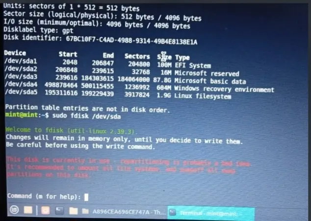
  </a>
  <figcaption>The collapsed table, read straight off the disk: partition 5 at 1.9 GiB — 3,917,824 sectors, which times 512 is exactly the 2,005,925,888 bytes blockdev reported two figures earlier — entries out of disk order, Windows partitions untouched beside the wreckage, and fdisk's red warning that the disk is in use. This is the state the rewrite started from.</figcaption>
</figure>

- `e2fsck` then reported the superblock/device mismatch: *"The filesystem size... is 20971520 blocks / The physical size of the device is 489728 blocks... Either the superblock or the partition table is likely to be corrupt!"*


<figure>
  <a href="/images/ir-crisis.webp" target="_blank">
    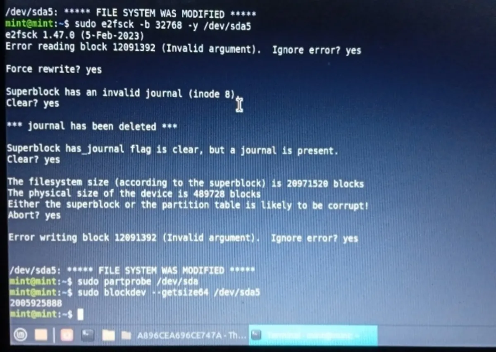
  </a>
  <figcaption>The mismatch, with its arithmetic proof: the superblock claims 20,971,520 blocks, the device holds 489,728 — and blockdev confirms it in bytes, 2,005,925,888, which is 489,728 × 4096. Even the backup-superblock repair path ran into the same wall.</figcaption>
</figure>


- One collapse was performed from inside the booted installation, on the partition mounted as `/`. After it, even running tools failed: `sudo: unable to execute /usr/sbin/e2fsck: Input/output error`. **Do not repair a partition table from an operating system booted off that table.**


<figure>
  <a href="/images/ir-diag-collage.webp" target="_blank">
    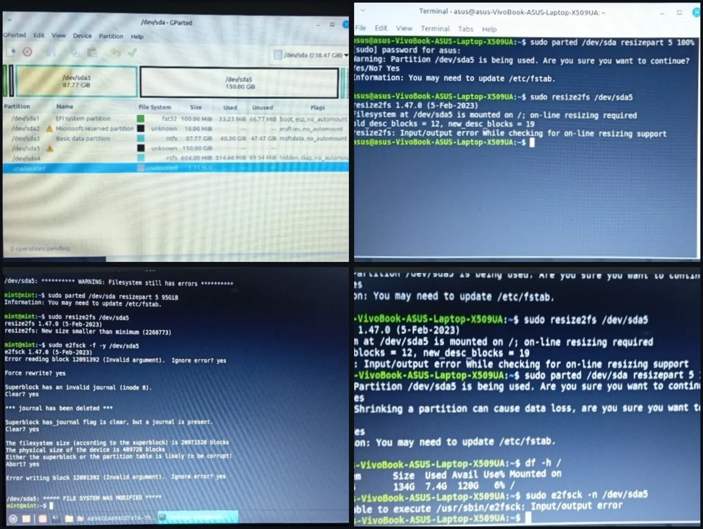
  </a>
  <figcaption>Every probe, same verdict: the table the installer left — 150 GiB typed unknown, a 1.11 MiB sliver — then resize attempts dying on I/O errors from the live session and from the booted system alike, until the booted system could not even run its own repair tool. This sweep is the evidence behind the report's hardest lesson: never repair a partition table from an OS booted off it.</figcaption>
</figure>


### The Recovery Chain That Worked

**Warning: The following steps are high-risk. I ran them from a live session, as a last resort. They are not guaranteed to work and can destroy data.** These steps recovered this specific drive configuration. Your hardware may differ. If you're not comfortable with terminal-based partitioning, do not attempt this. Replace the SSD instead.

1. **Rewrote the partition table with fdisk:** deleted `/dev/sda5` and recreated it explicitly at sectors **195311616 → 385311616 (90.6 GiB)**, declining signature removal (`N`) to preserve ext4 metadata, then `w`.
2. **Reconciled filesystem metadata:** `sudo e2fsck -b 32768 -y /dev/sda5`. *(Note: On this specific filesystem, backup superblock 32768 worked. On other drives, use `sudo mke2fs -n /dev/sdXN` to list valid backup superblock locations without formatting).*
3. **Expanded the filesystem:** `sudo resize2fs /dev/sda5` grew ext4 to **23,750,000 4k blocks**, exactly matching the new partition.
4. **Verified:** `sudo e2fsck -f -y /dev/sda5` passed clean.


<figure>
  <a href="/images/ir-recovery-collage.webp" target="_blank">
    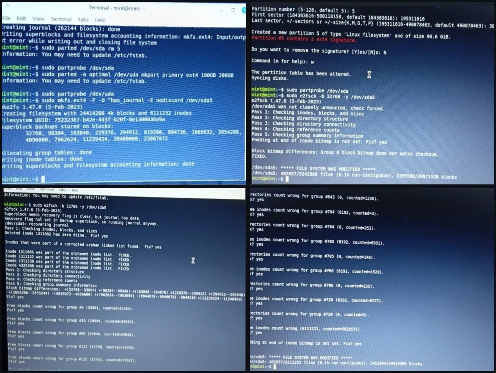
  </a>
  <figcaption>The chain that worked, mid-work: the single clean journal-less creation, the fdisk rewrite that kept the ext4 signature by answering N, and the backup-superblock fsck rebuilding group metadata count by count. Every panel here ends closer to alive than the last — the opposite of the mkfs collage above.</figcaption>
</figure>


<figure>
  <a href="/images/ir-resolution.webp" target="_blank">
    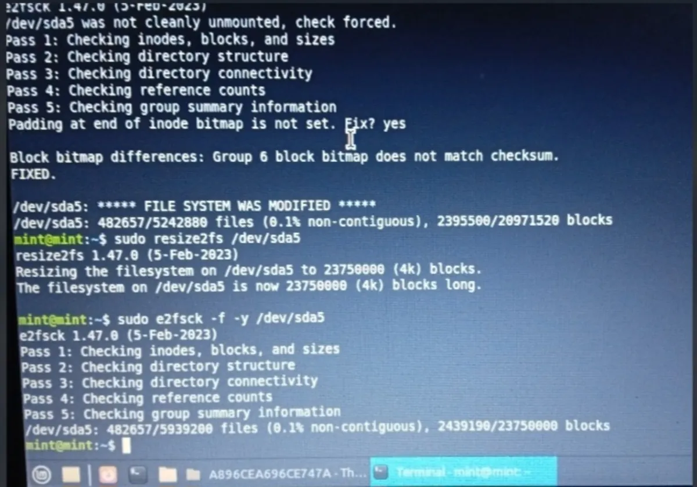
  </a>
  <figcaption>Resolution, in three movements: the repair pass closes with the filesystem modified at its old size; resize2fs grows it to exactly 23,750,000 blocks; and the final forced e2fsck runs all five passes without asking a single question — the first check in this entire report with nothing left to answer yes to.</figcaption>
</figure>


### The Outcome & What I Did Not Establish

- **Current Status:** The system boots and functions normally. The final filesystem spans sectors 195,311,616–385,311,616 and has been stable since.
- **Unknown Root Cause:** The root cause of the raw I/O failures is unproven. Candidates visible in the data — writes beyond the ~200 GB decimal offset, journal presence at mkfs time, underlying media fault — are confounded. **No `smartctl` output and no syslog/dmesg excerpt were captured during the incident.**
- **Counter-evidence:** The final 90.6 GiB filesystem lives entirely beyond the originally suspected offset and runs stable, weakening a simple bad-sector story.

### Advice for Readers

1. **Stop Immediately:** Do not re-run automated installers repeatedly over failed operations.
2. **Backup Everything:** Secure critical data to external storage or cloud before any block-level work.
3. **Work From Live Media Only:** Never modify a partition table from an OS booted off that table.
4. **Know Your Tools' Semantics:** `parted resizepart` takes an end position, not a size.
5. **Change One Variable at a Time:** When mkfs or resize2fs fails, alter a single parameter per attempt and record every output.
6. **Expect Hardware Replacement:** Persistent raw I/O errors may indicate failing media. Recovery is sometimes possible; replacement is often the safer long-term answer.
7. **Dual-Boot Isn't Always Clean:** Automated tools work most of the time. Hardware variables exist. This report exists so you know both things at once: recovery is possible, and humility about root causes is not weakness.

---

## Resources

- [Linux Mint Official Download](https://linuxmint.com/download.php)
- [Linux Mint SHA256 Checksums](https://linuxmint.com/verify.php)
- [qBittorrent Official Site](https://www.qbittorrent.org/)
- [Ventoy Official Site](https://www.ventoy.net/)
- [Ventoy GitHub Releases](https://github.com/ventoy/Ventoy/releases)

---

— King Anthony | kinganthony.tech | hello@kinganthony.tech  
If this guide saved you from a disaster, share it. If you found something I didn't cover, reach out. I'm still learning.  
Next in this infrastructure series: Automating M365 tenant onboarding with PowerShell — no GUI required.

**Installed and running?** Continue to the first-hour setup: [Linux Mint: The First Hour After Install]()

**Want the full story behind every step?** Read the companion narrative series: [Dual Booting Linux on a Machine That Barely Runs Windows]()